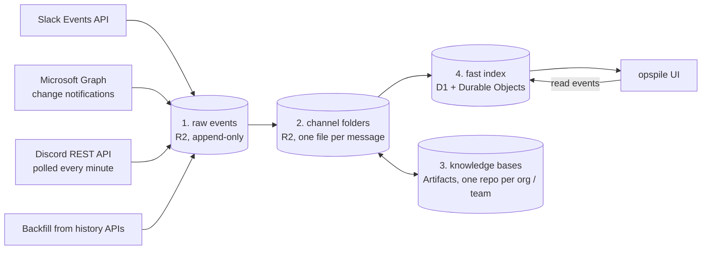

# helix-opspile architecture

opspile is a unified inbox for an ops team. It ingests every channel the team works in on
**Slack**, **Microsoft Teams** and **Discord**, keeps the threads in **Cloudflare R2**, and tracks read/unread
state per person and per team, so that you can see which threads somebody else has already
seen and you have not.

It follows the spirit of [klickhaus](https://github.com/adobe/klickhaus): a small static UI in
plain JavaScript, fed by separate ingestion services, with the data store doing the heavy
lifting.

Everything runs on Cloudflare (Workers, R2, D1, Durable Objects, Workers AI, Vectorize,
Artifacts, AI Gateway) in a single account; the thread agents' model is Claude on Amazon
Bedrock, reached through AI Gateway.

## The four piles



Each pile is derived from the one before it. Pile 2 never talks to the platforms directly,
so it, and everything after it, can be rebuilt by replaying pile 1.

### 1. Raw events

One R2 bucket, append-only, holding events exactly as the platform API delivered them. When
Slack or Microsoft add fields, we keep them; normalization happens downstream. The one
exception is credentials: Slack's deprecated verification `token` and Graph's `clientState`
are removed before an event is stored.

```
<source>/<tenant>/<channel>/<yyyy>/<mm>/<dd>/<eventTs>-<eventId>.json
```

- The key is derived from the platform's event id, so redelivered events (Slack retries with
  the same `event_id`, Graph may notify twice) overwrite themselves. Ingestion is idempotent.
- **Slack** delivers edits as `message_changed` (with the full new message), deletions as
  `message_deleted`, and reactions as separate events. All of them are stored. A file uploaded
  to a Slack Connect channel arrives as a stub (`file_access: check_file_info`: an id and a file
  type, no name or link); the normalizer looks it up once with `files.info` and keeps the
  answer here, next to the channel's events, as `slack/<tenant>/<channel>/files/<file id>.json`
  (`{ type: 'file_info', file }`, without `shares`, which quotes other channels), so a replay
  asks Slack nothing. It is not an event and is skipped. A file Slack does not show the app is
  not kept, and the message says a file of that type is there.
- **Teams** change notifications usually carry only the resource path. We store the
  notification and the message we then fetch as two objects. Graph notifications have no
  event id, so a notification is keyed by its own hash (`notification-<sha256>.json`), and a
  fetched message by its version (`<lastModified ms>-<messageId>.json`). The notification's
  `resource` names the message; the message's metadata names the notification.
- **Discord** is polled (see [Ingestion](#ingestion)): one Durable Object (`DiscordPoller`)
  stores each state of a message it reads (new, edited, other reactions) and each deletion it
  finds as an envelope `{ t, via, guild, d, thread?, root?, reactions?, at? }`. `d` is what
  Discord sent; around it is what only the poller knew at the time: the thread a message was
  posted in (Discord names just the thread's channel id), the conversation an inline reply
  belongs to, who reacted (messages carry counts only) and since when the poller has seen each
  reaction, and when it found a message gone. Keys are `<message id>-<hash of the envelope>`
  and `<message id>-delete`, so the same state read twice shares a key.
- Backfill pages from the history APIs land here too, marked `via: backfill` (Discord's:
  `via: history`).

### 2. Channel folders

```
channels/<org>/<team>/<source>-<channelId>/<rootId>/<messageId>.md
```

Every channel belongs to one **org** (a customer, a partner or a vendor) and one **team** (the
ops team that owns it). The mapping is a small rules engine over rows in D1: each rule matches the
channel id, the channel name, the Teams team name or a Slack Connect team id with a regular
expression, and sets the team, the org or the kind (`channel`, `alert`, `ignore`); the lowest
priority wins. Naming conventions (`aem-<customer>` exists on both platforms) are rules, and
so are the overrides for vendor channels, alert channels and irregular names. Channels that
no rule matches are filed under `_unassigned`. A **manual assignment** of one channel is a
rule too: its `channel_id`, priority 10.

**Shared channels.** A channel can be in several teams' inboxes, but it is filed under one team,
its first: the rules pick it, and its folders, thread rows (`threads.team`), knowledge base and
agents are that team's. The other teams follow it through `channel_teams` (source, channel id,
team): the channel's threads are in their inboxes, and their members read, reply, react, resolve
and draft there; read state in a thread is that of the team it is looked at from. Adding a team
to a channel moves the channel only for its first team, when the admin team (or nobody) holds
it; added to a channel another team holds, the new team shares it and nothing moves. Handing a
channel back to the admin team is always a move. The shares are configuration, like the rules,
so a replay of pile 1 keeps them.

An org is a slug. What it is called, its icon (a domain, whose favicon is shown, or an image
URL) and whether it is a customer, a partner or a vendor are a row in `orgs`; an org without
one is a customer shown by its slug and the favicon of its usual mail domain. The inbox and
the agents show the name and the type.

**Administration.** The admin team manages all of this at `/inbox/admin`: ops teams and
their members (found by name or email among the people and platform accounts opspile knows;
names come from the platforms and are not edited there), the rules that file channels under a team (a name prefix like `aem-`, a Teams
team, a Slack Connect team), manual assignments of channels to a team or an org, the channels
shared with more teams, and each org's name, icon and type. A team's page suggests channels for it among the ones the admin team
holds (the rule of last resort files every channel no other rule claims there): the ones where
the team's members post, react or are members (listed from Slack, or from the Teams team, into
`channel_members`), ranked tf-idf style so that someone active in most of the admin team's
channels (an admin, say) counts for little and a member active in a few counts the most, and the
ones Clef gives the team. The cron asks Clef about a batch of the admin
team's channels every run, one question set per channel (`channel_labels`): which ops team should
follow it (each described by its rules, some of its channels and its members, or none of them),
and whether it is a conversation, an alert feed or not worth following. Clef is told the channel's
name, its Teams team, its topic, its customer, how busy it is, the Adobe people who post in it
and are in it with their ops teams, the technologies seen, and its recent threads' titles; it
looks again when the channel has new activity, the ops teams change, or the label is a week old.
Every rule change applies at once (the page names the channels it
moved; the API still answers `dryRun` with what a change would move), and the page sends its
changes one after the other, so many can be made in a row. Applied, each moved channel is **re-filed** by a `refile` job on the
NORMALIZE queue: its thread folders move to `channels/<new org>/<new team>/…` (an object
already at the new place, from a message that arrived meanwhile, is newer and kept), its
thread rows take the new org, team and kind, and the new org and team get their knowledge
bases. A job starts from where each thread is filed in D1, not where it was when the job was
queued, so several changes to a channel in a row end up where the last one says. A large channel moves a few hundred files per job.

**Team managers.** A member of a team can be its **manager**: they get the admin pages and
the knowledge-base editor for that team only, where they add and remove members, promote
them to manager or demote them, and edit the team's knowledge base (its `systemprompt.md`
too). Teams, rules, assignments, orgs and the customers' knowledge bases stay with the admin
team. A team can be **self-managed**: every member is a manager, and so is everyone who joins.
Turning that off keeps the roles as they are; from then on new members join as members, and
managers can be demoted. The role is `team_members.role`, the flag `teams.self_managed`;
only the admin team sets the flag.

**Channel requests.** A team manager does not assign channels, but asks for them: their team's
page has the same channel search the admin team adds channels with (every channel, by name,
Teams team, customer or id), and picking one sends a request, "add this channel to this team",
with an optional note (`channel_requests`, migration 0028; one open request per channel and
team). The admin team sees the open ones under **Requests** in the admin pages, their number on
that tab and on the inbox's Admin switch. Opening one runs the manual assignment as a dry run
and says what confirming would do: re-file the channel under the team (and which threads move),
or share it with the team when another team holds it. **Confirm** then makes that assignment,
exactly as adding the channel on the team's page does, and records who confirmed it and what it
did; **Decline** takes an optional reason. The manager sees each request on their team's page:
pending, confirmed (moved or shared), declined with the reason, or withdrawn (they may take an
open one back). An admin who adds a requested channel to the team directly answers the request
with it. Nothing is sent by mail or chat.

Channel names and authors are not in the events, so the normalizer looks them up
(`conversations.info` and `users.info` on Slack, Graph on Teams) and caches them in D1 for a
day. These are its only platform calls. Files only move forward to a newer version, and a
tombstone is final, so a replay of pile 1 in any order rebuilds the same pile 2. A rule
changed in D1 by hand needs pile 2 emptied and replayed; one changed in the admin UI re-files
the channels it moves (below).

**One markdown file per message**, in a folder per platform thread (the root message's id; the
root message is `<rootId>/<rootId>.md`). Message bodies are markdown themselves (Slack mrkdwn
and Teams HTML are converted), so keeping each message in its own file avoids nesting one
document inside another, and makes every file a natural retrieval chunk. There is no
per-thread rollup file; reading a thread means listing its folder.

```markdown
---
source: slack
thread: slack:<enterpriseId>:<channelId>:<thread_ts>
logicalThread: slack:<enterpriseId>:<channelId>:<other_thread_ts>   # only if re-threaded
id: <ts>
at: 2026-10-14T07:37:26Z
author: { kind: person, name: …, org: …, staff: true }
editedAt: …
deletedAt: …
raw: [<raw object key>, …]
permalink: https://…
---

The message body, as markdown.
```

```
thread key   slack:<enterpriseId>:<channelId>:<thread_ts>
             teams:<tenantId>:<teamId>:<channelId>:<rootMessageId>
             discord:<guildId>:<channelId>:<rootMessageId>
```

- New messages are new objects, so concurrent replies never contend for the same file.
- An edit rewrites exactly one file. Earlier versions remain in pile 1.
- A deletion keeps the file as a tombstone (`deletedAt` set, body removed), so links and read
  watermarks stay valid.

**Enrichment on write.** When a message is copied into this pile:

- **[Clef](https://blog.cloudflare.com/clairic-extraction-model/)** (a decision model)
  classifies the thread: who has to act next (`us`, `customer`, `vendor`, `nobody`), what kind
  of thread it is (incident, security, question, request, alert), and urgency. Thread-level
  results live in the index (pile 4).
- **Deterministic extraction** handles structured tokens: CVE ids, URLs, ticket links,
  `org/site` identifiers.
- **Clairic** (an extraction model) handles loose facts, and only values above a confidence
  threshold are kept.

**Re-threading.** People often post a follow-up as a new root message instead of replying,
or split one request over several messages, and alert channels post the same alert again
and again. A root by the same person within three minutes of their previous root in the
channel, with nobody else's root between them, continues it (a *burst*). When a root message
arrives, its *skeleton* (the text without timestamps, long numbers, hex and UUID ids, query
strings and user agents; short numbers like status codes stay) is embedded and the most similar
earlier roots in the same channel, within 14 days, are found by vector search.

- **Alert channels:** an exact repeat of the skeleton or a near-identical root (cosine ≥ 0.97)
  is a match outright; otherwise Clef chooses between up to four candidates above 0.82 and
  "a new topic", told how long before each was posted, and a match needs a probability of at
  least 0.7. Candidates of the same group share their probability.
- **Conversation channels:** in a chat, answers, thanks, nudges and escalations posted as new
  messages ("done, you have access now", "this is a blocker, please help") share few words with what
  they follow up, people answer hours later, and the same words ("thanks!") are not a repeat.
  So Clef reads the channel's **latest three conversations** active in the last three days and
  the groups of up to four similar roots (cosine ≥ 0.6) as a transcript: each conversation's
  first message and its latest two before the new root, marked with the conversation's letter
  and how long before they were posted, then the new message, and says which conversation it
  continues or that it is a new topic. A match needs a probability of at least 0.8. Comparing
  the new root with each candidate on its own spread Clef's answer over several candidates and
  left most of a chat in pieces. Platform notices ("… has joined the channel") are left alone.

A match sets `logicalThread` on that one message file and on its thread row, always pointing at
the group's first thread. The file stays where it is and the platform thread is never modified, so undoing
the match is a one-field change. Replays arrive in any order, so an alert that is matched also
pulls in near-identical later alerts that had found nothing earlier, and a root pulls in the
next root by the same person within three minutes. A conversation's root is decided from the
conversations before it, so re-threading a channel again goes oldest root first
(`scripts/replay.mjs --rethread --channel <id>`). The inbox shows a group as
one entry: the first thread's title, the latest activity, the most pressing attention of any
member, and all members' messages in order. A root is re-threaded 30 seconds after it arrives,
so it can be in the inbox on its own until then: a match tells the open inboxes which threads
it folded, one that has a folded thread open shows its group instead, and opening a member's
key (a link, a tab) opens its group too.

Vector search uses Workers AI embeddings in Vectorize, written at ingestion time so that a
message can be matched seconds after it arrives.

A second index, `CONTENT` ([src/vectors.js](../src/vectors.js)), holds what was said, for
search over topics and who talks about them: one vector per message a person posted in a
channel thread (`type: message`, with the author's `person`, `staff` and `author` key) and
one per such thread (`type: thread`), the mean of the embeddings of its title and messages
in pieces of about 512 tokens (a long thread keeps its first piece and its latest). Both
carry `channel`, `thread`, `org`, `team` and `at`; the text stays in pile 2. Two minutes
after a person posts, or a message is deleted, the thread is vectorized: each message keeps
a hash of the text its vector was made from (`messages.embedded`), so only new and edited
messages are embedded again, and a deleted one loses its vector. The cron enqueues the
threads whose vectors are older than their latest message (`threads.vectorized_through`),
which also fills the index the first time. Alert threads (a bot's posts) get no vectors here.

### 3. Knowledge bases

One [Artifacts](https://blog.cloudflare.com/artifacts-git-for-agents-beta/) repository per org
and one per team: a pile of markdown files with git history.

```
kb-org-<slug>    what we know about this customer or vendor, across all teams
kb-team-<slug>   product and process knowledge for this team, across all customers
```

The repositories follow the [Open Knowledge Format](https://github.com/GoogleCloudPlatform/knowledge-catalog/blob/main/okf/SPEC.md)
(OKF v0.2), the formalised [LLM wiki](https://gist.github.com/karpathy/442a6bf555914893e9891c11519de94f)
pattern: one markdown file per concept (a site, a known issue, a playbook, a decision), YAML
frontmatter with a required `type`, links between concepts, an `index.md` per directory and a
`log.md` at the root. Provenance is in each concept's frontmatter: `sources` lists the threads
(permalinks) a concept was learned from, with who said it and when, and footnotes tie claims
to them; `generated` says which agent wrote it and when, and `verified` will record staff
review. Every change is a commit, so a bad memory is a `git revert`.

[Thread agents](#thread-agents) are the writers. Code, not the agent, writes `index.md` and `log.md`
and stamps `generated`, and a write that is not a well-formed concept is refused. For now
every write is trusted and lands on `main`; staff review comes later, against the git
history and the trust tiers OKF derives from `verified`.

**Agent instructions.** Each knowledge base may have a `systemprompt.md` at its root (a
concept of type `System Prompt`). Every thread agent appends the bodies of the two that apply
to it, the team's first and then the customer's, to the end of its system prompt, read again
before each model request; HTML comments in them are left out. Only the admin team writes
them, in the knowledge-base editor: agents' writes to `systemprompt.md` are refused, so a
prompt injection cannot change what later agents are told.

**Editor.** Members of the admin team, and team managers for their teams' knowledge bases,
have an editor at `/inbox/kb`: every knowledge base, its files, its history, and an editor for `systemprompt.md`
and the concepts. It saves as you type: a pause of a second (or leaving the file, or ⌘S)
commits the file, authored by the person and stamped `generated: { by: human:<email> }`,
through the same write path as the agents' (OKF checks, indexes and log written by code).
A save names the blob it was written from, so a colleague's or an agent's newer version is
never overwritten unseen: the editor offers to load theirs or save over it. `index.md` and
`log.md` are read-only there. It asks only in the page (no native dialogs, which a debugger
attached over CDP dismisses), and only when edits could not be saved or before a delete; the
one exception is leaving the page (Back, reload, closing the tab) with edits that could not be
saved, where only the browser's own prompt can ask.

**Thread agents per channel.** The editor shows, for each knowledge base, the channels it
learns from (a team's: the team's channels; a customer's: theirs, in every team) and whether
each one's [thread agent](#thread-agents) is on; the list of knowledge bases marks those with
an agent in any of their channels. The admin team, and the managers of the team that owns a
channel (the team of its latest thread), turn its agent on or off there, after a question in
the page. The switch is a row in `agent_channels` with who set it and when; a channel nobody
has switched yet follows `AGENT_CHANNELS`, the deployment's default. Alert channels have no
agents. Turned off, a channel's agents stop at their next message and skip their wrap-up;
their drafts and what they filed stay.

**MCP servers.** Next to the thread agents, the editor lists a knowledge base's **MCP
servers**: those of its team (`kb-team-*`) or its customer (`kb-org-*`), which the agents of
that team's or customer's threads may call from code mode (see [Thread agents](#thread-agents)).
Whoever may edit the knowledge base adds, checks, edits, switches and deletes them. A server is a
name, an `https://` URL, what it is for (the agents are told), request headers for its
credentials (sent once, sealed with `TOKEN_KEY`, then shown by name only) and optionally the
only tools agents may call. Adding or changing one connects to it and lists its tools. Above
them are the [global servers](#global-mcp-servers), with a switch for the team (in a team's
knowledge base) and one per channel the knowledge base learns from.

For admins and team managers, the pages' headers have the same switch between **Inbox**,
**Agents** (this editor: the agents' knowledge bases, channels, MCP servers and instructions)
and **Admin**, and context goes along between the inbox and the editor. From the inbox, the editor opens the knowledge base
of the open thread's customer (or of the one customer filtered on) if it has one, else the
team's; it carries the inbox's URL along (`back=`, only ever a path to `/inbox` on the same
origin), so **Inbox** returns to it as it was left: team, filters, sort, unread, the open
thread and "view as". Opened directly, **Inbox** goes to the inbox of the team whose knowledge
base is open. The editor's URL names the knowledge base and the file (or the history), and
each one opened is a history entry, so the browser's Back and Forward step through them and
back to the inbox. The editor itself is always the admin's own, also when they came from a
"view as" inbox.

The repositories are created through the Worker's Artifacts binding (one namespace per
environment, `helix-opspile` and `helix-opspile-stage`) as soon as their org or team is
known: when the normalizer discovers a channel, it makes sure the repositories for the
channel's org and team exist, and the cron creates one for every team in D1, so a team that
was added by hand gets one before it has any channel. `knowledge_bases` in D1 records the
repositories that exist and their git remotes. Internal slugs (`_unassigned`) get none.

### 4. Fast index

- **D1** holds the queryable index: containers, threads (last activity, last speaker,
  classification), people and their platform identities, ops teams, and read watermarks. It
  answers the inbox queries, for example "everything waiting on us for my team" or
  "everything from this customer in the last 7 days".
- **One Durable Object per ops team** holds live read state. UI clients connect over
  WebSocket, read events fan out to everyone on the team immediately, and the object writes
  them back to D1 in batches.
  New messages, reactions and drafts are announced in the room of every team whose inbox
  has the thread (a shared channel's are in several). A message posted in the last hour that
  mentions people it did not mention before (a new message, or an edit that adds a mention)
  names them in its announcement, with who wrote it, for their notifications; a backfill, a
  replay or a late catch-up names nobody.
- The index is derived: a `messages` row per pile-2 file, and a `threads` row recomputed from
  its messages on every write (last activity by a person, last speaker and whether they are
  staff, title, message count), so it is the same in any replay order. Alert threads use the
  last message of any kind, because they consist of bot posts.
- The UI is one static page, served by the Worker at `/inbox` behind Cloudflare Access: facet
  cards (status, type, next actor, urgency, kind, customer, platform) on the left, threads in
  fixed-height rows in the middle, and the thread as a chat on the right (customers on the
  left, Adobe on the right, with reactions and images; only your own messages are blue,
  colleagues' are grey like the customer's). Avatars are the Slack profile picture
  or the Gravatar for the email; the customer's icon is the favicon of their mail domain.
  Reactions are kept in D1 (`reactions`) from Slack's reaction events and from the reactions
  Teams reports on each message.
- A click on a facet value picks it; Shift-click, or the ≠ beside it, excludes it (negative
  filters, as in klickhaus): picked values of a card are OR'd, excluded ones AND'd, and the
  cards AND'd with each other. The URL keeps both, `f.<facet>=a|b` and `not.<facet>=c`; a
  picked value is tinted and outlined in the accent colour, an excluded one is struck
  through, and a plain click stops excluding it.
- The thread list has the personal view and a view per team the viewer is in, switched above
  the list (for a member of two teams: *Personal · Admin · Helix*). **Personal**
  (`view=personal`, and the default: any address without `team=`) has the conversations of all your teams in the channels you posted or
  were mentioned in (all of their threads, not only the ones you are in; no alerts), puts the
  latest activity first and keeps only the customer card, on which one customer is picked at a
  time; filters on the cards it does not show do not apply there, and are kept for the team
  views. Its live updates come from the rooms of all your teams. A **team's** view
  (`team=<slug>`) puts what needs you most first and has every facet card. A facet value with threads
  you have not read has its label in bold, and a red badge counts the messages that mention
  you and that you have not read yet (Slack's and Teams' mention count); a thread's
  "N replies" is bold and blue while it has replies you have not read.
- **Notifications** are shown by the browser while an inbox is open (a tab, or the installed
  app, also in the background), through the service worker, so that a click opens the thread
  in the inbox already open, or in a new one. There are two kinds, settings of the person in
  D1 (`person_settings`, `GET`/`PUT /api/settings`), so every device has them: a message that
  mentions you (on unless turned off in the user menu; the room's announcement says whom it
  mentions), and a **bell** on a view. The bell above the thread list turns notifications on
  for the view on screen with its filters (picked and excluded); a thread of that view that
  gets a message you have not read then notifies you. The inbox listens to the rooms of the
  teams its notifications need (all of yours, for mentions and Personal), checks a bell on
  the inbox on screen when it reloads, and fetches the first page of a belled view that is
  not on screen when its room announces activity. The menu lists the bells, each opening its
  view or turning it off. Inboxes in several tabs show one notification per thread, and none
  for the thread you are reading, nor while viewing as someone else. The first visit asks once
  (a toast) whether the browser may show them; browsers only ask on a click.
- The toolbar is the same on the inbox and the admin pages: the pages and label review on the
  left, and on the right whoever is signed in, with the view on screen under their name. Their
  name opens a menu with "View as" (admin team; while it is on, a chip next to the name says
  whose inbox this is and leaves it in one click), the notifications, the keyboard shortcuts, and **Log out**,
  which is Access's `/cdn-cgi/access/logout`. Live updates are not shown while they work; the
  toolbar says "Reconnecting…" when a WebSocket has been down for a few seconds.

## Read state

Read state is a **watermark** per person per thread: "has read up to message timestamp X".

- **Unread for me:** the thread's last message is newer than my watermark.
- **Seen by somebody else, not by me:** another member of my team has a watermark at or past
  the last message, and I do not.
- **Unseen by the whole team:** nobody on the team has a watermark at or past the last message.

Neither platform exposes other users' read state for channels, and each exposes the
signed-in user's own state only coarsely, so opspile owns read state. Most of it is
**inferred** rather than clicked:

| Signal | Effect |
|---|---|
| Person posts a message in the thread | Their watermark moves to that message |
| Person reacts to a message | Their watermark moves to that message (Slack `reaction_added`; Teams reports reactions on the message) |
| Person opens the thread in opspile | Their watermark moves to the last message |
| A message is edited, or a reaction is added by someone else | No change; edits never make a thread unread |
| Bot or system message | Stored and shown, but does not count as new activity |

### Status piles

The inbox sorts every thread into one pile, most pressing first: **critical** (critical
urgency, nobody at Adobe has seen it), **hot** (high urgency, unseen by Adobe), **you** (you
posted or were mentioned, and the customer spoke last or you were mentioned), **waiting**
(waiting on us longer than 15 min / 1 h / 3 h for critical / high / normal), **silent**
(waiting on the customer or vendor longer than 30 min / 1 h / 1 day: follow up or close),
**team** (your team is in it and all is well) and **quiet**. Who a thread waits on is Clef's
`next_actor`, except that a thread where Adobe posted last never waits on us (the label can
be stale or wrong), and an unlabeled thread waits on us when the customer posted last; the
API sends it as `waiting_on`. Admins can look at the inbox as another person, read-only.

### Attention

Read state answers "who has seen this"; attention ranks what that means for the person
looking, most pressing first:

1. **Nobody at Adobe has seen it**: no staff member at all (in any team or none) has posted,
   reacted or opened the thread since its last message. Staff become people in D1 the first
   time they post, so their reads count even outside the ops teams.
2. **You were mentioned** after you last read the thread (a platform mention, or your full
   name in the text).
3. **A teammate was mentioned** after they last read it.
4. **Nobody on your team has seen it.**
5. **You have not seen it.**

Alert threads skip the first level: they are bot posts and nobody outside is waiting.

## Backfill

A reply whose root has never been seen (it was posted before ingestion started, or before
the bot joined) triggers one request for the thread's history: `conversations.replies` on
Slack, the message and its `/replies` on Graph. Every message lands in pile 1 marked
`via: backfill` and is normalized like a live event, so pile 2 cannot tell them apart. The
`backfills` table makes the request idempotent.

## Labels and facts

Two minutes after a person posts, the thread is labeled (later posts reuse the same label job,
and an unchanged thread is never labeled twice):

- **Clef** answers four questions: who acts next (`us`, `customer`, `vendor`, `nobody`), what
  kind of thread it is (`incident`, `security`, `question`, `request`, `alert`, `other`),
  urgency (0–3) and whether it is resolved. The state it reads is the thread as text, with
  every author marked as Adobe staff or customer.
- **Rules** extract CVE ids, ticket keys, Edge Delivery `org/site` pairs, GitHub repos and URLs.
- A language model (`llama-3.3-70b-instruct`) writes a **title** of at most eight words. For an
  alert group it names the specific failure (the error or failing request), once per group.
  The title leaves out what the inbox shows next to it: the customer, the channel, the
  platform, the kind of thread and Edge Delivery itself; a customer or product name the model
  still writes is removed afterwards.
- Clef also answers yes/no questions about the **tech stack** the thread shows (Edge Delivery,
  Document Authoring, Universal Editor, the CDN, the content source, …). The channel keeps the
  highest probability any thread showed, so every thread of a customer shows their stack.
- **Clairic** extracts the loose facts: the problem in the customer's words, the affected URL,
  the error, a deadline and a go-live date. Only values at or above a confidence threshold are
  kept (0.8, and 0.6 for the free-text problem).

**Label review.** Members of the admin team can review labels in the inbox: a queue of
current labels nobody has reviewed, least confident first, and per question the right
answer. A review is calibration data (Clef's agreement rate and most common corrections per
question) and overrides the model's answer for that label version; when the thread changes
and is labeled again, the model answers again and the old review only counts as history.

## Replying

Replies are written in the inbox and sent **as the person**, never as a bot: each person
connects their own Slack account (user scopes `chat:write` and `reactions:write`) and Microsoft
account (delegated `ChannelMessage.Send`, which also allows reactions) once. The account must be theirs (the same person in D1, or the same
email); tokens are encrypted with `TOKEN_KEY`, Microsoft tokens are refreshed when they expire.
A reply goes to the latest platform thread of an inbox entry and comes back through the
normal ingestion path, like any other message. Replies are written in Markdown; on Slack they
are sent in mrkdwn (`**bold**` as `*bold*`, links as `<url|label>`, bullets as `•`).

The one exception is posting **as the opspile app** (`POST /api/post/app`, `src/postapp.js`,
used by the MCP tool `post_as_bot` and the WebMCP tool of the same name): the same post as a
thread agent's `post_message` (see "Agent tools"), and allowed exactly where that is, in
channels whose **Post messages** switch is on (the channel's, else its team's) on a platform
whose bot is set up, for staff of the thread's teams. The switch says whether the app speaks
in a channel at all, whoever writes the text. The post names no person and carries no
mentions; it comes back through ingestion by the app, and a thread agent there is told about
it like any message.

Discord threads are read-only in the inbox: Discord lets only bots post and react through its
API, and opspile acts as the person or not at all. They have a link to reply in Discord, no
reply box, reactions or ✅; Discord's own ✅ by staff still resolves them.

**Mentions.** `@` in a reply suggests the people opspile knows on the thread's platform, and
on Teams also the bots of the thread's Teams team (`bot_teams` in D1): the bots installed there,
which the cron lists from Graph (`installedApps`) for every Teams team with a channel in D1, and
any bot that posted, or was mentioned, in one of its channels. Bots people used come first. A
bot nobody has mentioned in a team yet can be mentioned from the inbox all the same; an `@name`
typed without picking it goes out as plain text, which the bot never receives. A picked bot is sent as an `application` mention,
which the bot receives exactly like a mention typed in Teams, from the person who wrote the
reply. That is how a team member is added from the inbox: `@<admin bot> add someone@example.com`
asks the bot that manages the Teams team, which answers in the thread (and in turn comes back
through ingestion). A bot is mentioned by the name people use for it (`handle`, the mention text),
which can differ from the name it posts under; for an installed bot that is the app's name,
which is what Teams writes when someone mentions it.

Reactions are made the same way, from a small picker or by clicking a reaction a message
already has (which adds yours, or takes it off). The Worker records a reaction in D1 as soon as
the platform accepts it, exactly as the platform's event will, so it shows at once; the event
then changes nothing. A removal only takes away a reaction made before it, and a later add
moves the reaction's time forward, so a remove-and-add comes out right in either order.

### Resolved

✅ or ✔️ on a thread's root message (`white_check_mark` / `heavy_check_mark` on Slack, `✅` /
`✔️` on Teams) by a staff member means **resolved**. `e`, or the Resolve button that appears
when the pointer rests on Send for a second, adds ✅ as the person; a ✅ put on a reply in the
inbox goes on the root as well (and comes off both). It lands on the root of the
entry's latest platform thread; undo takes the person's own ✅ off again (someone else's ✅ is
theirs to remove). It overrides Clef's `resolved_p`, and a thread resolved this way is not in
the "you", "waiting" or "silent" status piles.

A **customer message after the ✅ reopens** the thread: it is open until Clef has labeled the
thread with that message in it, and from then on Clef decides again (so "thanks, works now"
does not keep it open), until staff resolve it again, which moves the ✅ (off and on again) so
that it is newer than the customer's message. Staff and bot messages after the ✅ change
nothing. A ✅ without a time (from a backfilled Slack message) counts from the root message's
time.

The models see reactions too: each message is followed by who reacted with what (customer or
Adobe staff), and a reaction relabels the thread, so a customer's ✅ or 👍 on the answer can
make Clef call it resolved.

### Drafts

A reply can wait as a **draft**: **Save draft** appears above Send, next to Resolve, when the
pointer rests on Send for a second (or Send is pressed for a second on touch), and ⌘S / Ctrl+S
in the reply box does the same. An inbox entry carries **at most one draft**, and it is
shared: everyone in the teams that follow the channel (the one it is filed under, and those it is
shared with) sees it, and can change, send or discard it.
Admins, who can open any thread, see its draft but change only their own teams' drafts.

- Drafts live in D1 (`drafts`), keyed by the inbox entry (a re-threaded group's first thread).
  They are user state, like watermarks: rebuilding the index from pile 2 keeps them. A draft
  on a thread that is later folded into a group shows on the group, and moves to the group's
  key when it is saved again.
- A draft's `updated_at` is its version. A save names the version its text was written from,
  and a draft that changed meanwhile is not overwritten: the colleague's draft is shown, with
  an offer to overwrite it. A discard does the same.
- Sending a reply written from the draft uses it up (unless it changed since). Saves and
  discards are fanned out over the rooms of every team that follows the channel, so every
  open inbox follows at once; a reply box that still holds the draft unchanged follows the
  draft, one with your own changes keeps them (and offers to load the draft instead). What
  you type and do not save stays with its thread in the tab.
- In the inbox, an entry with a draft shows **✎ Draft**, and the **Draft** card filters by
  drafts saved last by you, by a colleague, or none. A draft does not change the status pile.

### Steering reactions

Hovering a message shows the quick reactions ✅ 👀 🙏 👍 😀 🚀 🛟. Three of them steer the
inbox, on any message of the thread:

- **👀 seen**: the person who put it is on it. For them it counts like having posted (higher);
  for the rest of the team, a colleague's 👀 since the customer last wrote puts the thread in
  "team on it" and halves its score in the team view, unless it mentions them.
- **🙏 thanks**: after the last message, nothing is pending (`waiting_on` is nobody).
- **🛟 help**: a colleague asks the team to look: the thread is in "you" for everyone else
  and its score in the team view doubles, until it is resolved.

## Thread agents

One agent per inbox entry (a thread, or a re-threaded group under its first thread's key),
in the channels where agents are on: the admin team and team managers switch them per channel
in the knowledge-base editor, and `AGENT_CHANNELS` is the default for the rest. Each is a Durable Object
(`ThreadAgent`) running [Pi](https://developers.cloudflare.com/agents/harnesses/pi/) through
the Agents SDK's `PiHarness`: the transcript, tool calls and retries live in the object's
SQLite, so a run survives evictions and deploys, and a model request that fails is retried.

**When it runs.** Every new message of the entry pokes the agent through the NORMALIZE queue
(after 15 seconds, so a burst arrives together; a new root's after it is re-threaded, so that
a root folded into a group pokes the group's agent, not one of its own); it reads the
messages after its watermark from pile 2 and gets them as one input, the whole thread on first contact. A new message
during a run joins that run. A day after the latest message, a schedule wakes it once more to
wrap up: file what was learned, or put a follow-up in the draft.

**In the inbox.** The open thread shows the agent's **latest turn** under its last message,
on the Adobe side, as "Opspile Agent" with opspile's icon: while it works, a spinner and what
it is doing (reading the thread, checking a web page, updating the draft…); once done, its
closing note for the team, which the prompt asks for at the end of every turn (1 to 3
sentences: what it found and what it changed). It is outlined, not filled, since nobody posted
it. The page asks `GET /api/agent` when the thread opens or changes, and every few seconds
while the agent works or a new message waits for it; the turn is read from the agent's
transcript (`src/agent/turn.js`), nothing else is stored.

**Traces.** The admin team sees everything an agent did with the MCP tool `get_thread_trace`:
the thread's messages and the agent's steps in one timeline (`src/agent/trace.js`, read from the
same transcript through the agent's `trace()`): each input, its thinking and text, every tool
call with its arguments and result, the MCP server calls its code mode scripts made (pi keeps
no record of a script's calls, so the agent keeps its latest 200 in its storage, `mcp-calls`:
when, which tool, the arguments clipped, the outcome, never the result), prompt and tool
changes, and the tokens and cost per step. An agent that does not answer leaves the thread's
messages, with `agent.error`.
It covers the transcript since the agent's last reset; long text is clipped.

**Prompt injection.** Before an agent sees a message that Adobe staff did not write
(customers, partners, bots), Clef answers one yes/no question: does it try to instruct or
reconfigure an AI that reads it? A message at or above p = 0.5, or one the check could not
answer, is withheld: the agent only learns that it exists. Verdicts are kept per message in
the agent's storage, so each message is checked once. Text the agent does see is fenced and
labelled as written by people outside its control.

**What it can do.**

| Tool | |
|---|---|
| `read_thread` | the whole entry, flagged messages withheld; with `thread` (a key, or a link to one of its messages as people paste them), another conversation of the same channel, its first and latest 100 messages |
| `read_file` | a file attached to a message of the entry (`src/agent/files.js`), named by its link as the message shows it or by a Slack file id, never any other: fetched with the app's credentials (the Slack bot's `files.info` and token, the Discord bot's refreshed links), up to 10 MB. Images (PNG, JPEG, GIF, WebP up to 3.75 MB) go to the model as images; plain text as it is; PDF, Word, Excel, OpenDocument, Numbers, HTML, XML and CSV through Workers AI's Markdown conversion (`AI.toMarkdown`). Text comes in parts of 30,000 characters (`offset`), and every part goes through Clef's injection check first, as a message would; a flagged file is withheld. Files of withheld messages cannot be read, nor Teams files (SharePoint, behind the sender's permissions). |
| `list_channel_threads` | the other conversations of the agent's channel, latest activity first (a re-threaded group as one, no join messages), paged by `before`; with `query`, those whose title has it, then those whose root is similar to it (Vectorize, the roots' embeddings from re-threading). Only its own channel: an agent never reads another channel's threads |
| `get_draft`, `update_draft` | the entry's shared draft, saved as the person `opspile agent` with the same version check as a person's save. Unless `post_message` is on, this is its only write outside the knowledge bases: it cannot post, react or resolve. A person reads the draft and sends it. |
| `post_message` | only where it is turned on (see "Agent tools"): posts a reply in the thread as the opspile app |
| `bash` | only where the `computer` is turned on (see "Agent tools"): a shell with files of its own |
| `git_ls`, `git_read`, `git_grep`, `git_log` | the team's and the customer's knowledge base, and the GitHub repositories listed for the team, the customer or everyone in `agent_repos` (to start: this repository) |
| `kb_write` | create, replace or delete concepts in either knowledge base, in one commit |
| `codemode` | a JavaScript script that calls the tools above, and the team's and the customer's MCP servers, as `await tools.<name>(args)`; only what the script outputs reaches the model |

GitHub repositories are read from Artifacts mirrors: the cron imports each listed repository
into a fresh Artifacts repo, promotes it once it is readable and deletes the mirror it
replaces, at most every six hours. Reads need no GitHub token and hit no rate limit; private
repositories cannot be imported yet.

**Code mode and MCP servers.** The `codemode` tool is pi-durable's code mode: the script runs
in a QuickJS sandbox on the agent's own thread (`createInlineCodemodeSandbox`; one object per
thread, so a script that computes holds up only its own agent, for at most its interrupt
budget), every call it makes is a nested tool call, and a script interrupted by an eviction
resumes where it was without making its finished calls again. Each ops team and each customer
can have MCP servers (`mcp_servers`, maintained in the knowledge-base editor next to the
per-channel switch; credentials are request headers sealed with `TOKEN_KEY`). An agent gets the enabled servers of its thread's team and
customer: each tool becomes `mcp__<server>__<tool>`, callable **only from scripts**, never
offered to the model as a tool of its own, and each server is a code mode namespace that
`describeNamespace()` and `searchTools()` find. So a server with a hundred tools costs the
prompt a few lines, and a script can call several and filter what they return. A server's
`allow` list limits the tools agents get; a tool that declares itself read-only may run again
after an eviction, any other is reported to the model as interrupted instead. The list of
servers and tools (no credentials) is kept in the agent's storage, so a restarted agent has the
same tools at once; before the agent is told anything it is checked against D1, and the servers
are asked again when it changed or after an hour. MCP results come from systems outside
opspile; the prompt says they are data, not instructions, like customer messages.

### Global MCP servers

Some servers are not a team's or a customer's but opspile's own, built in
(`src/agent/globals.js`) and set up once: **`browser`** and **`github`**. They are off until
the admin team or a team's managers turn one on, for an ops team or for a single channel
(`mcp_global_switches`; a channel's switch wins over its team's, and a channel without one
follows its team). An agent gets those on for its thread's team or channel, next to the team's
and the customer's, as `mcp__browser`, `mcp__github`; its id there is `global:<key>`. Their
tools are those the last check found (`mcp_global_tools`), so an agent does not ask a
server or mint a token just to list them; the editor's **Check** and the cron, once a day,
ask again. The prompt says that these are opspile's own, and that customer data does not go
into websites or URLs that are not the customer's or Adobe's.

**`browser`: Cloudflare Browser Run.** Cloudflare's own hosted
[Browser Run MCP server](https://github.com/cloudflare/mcp-server-cloudflare/tree/main/apps/browser-rendering)
(`https://browser.mcp.cloudflare.com/mcp`), with an account API token that may only use Browser
Run (`BROWSER_RUN_TOKEN`, *Browser Run Write*; account-scoped, so the server finds the account
itself). Its tools load a page in Browser Run's Chrome and return it as markdown or HTML, a
screenshot, a PDF, its links, elements by CSS selector or JSON extracted from it, or crawl a
site. Each call loads the page anew, signed in nowhere: there is no session to click through.
The tools that list and kill the account's browser sessions are left out of what agents get.

**`github`: GitHub's MCP server, read-only, as the opspile GitHub App.** The server is GitHub's
hosted one, at `https://api.githubcopilot.com/mcp/readonly` with `X-MCP-Readonly` and
`X-MCP-Lockdown` (public issue content from people without push access stays hidden: text
from strangers that nobody screened). It authenticates with **installation tokens** of the
opspile GitHub App (`src/github.js`), so it reads exactly the repositories the app is
installed on, all of an account's or a selection, and nothing else; the app asks for read
permissions only. The app is public, so that customers' organizations can install it too;
since anyone can, an installation is used only after the admin team allowed it in the editor
(`github_installations`), and a revoked one gets no more tokens. The admin team creates the app from the editor with GitHub's manifest flow:
the page posts the manifest to GitHub, GitHub asks to confirm and sends them back with a code
(and a state opspile signed for them), and opspile trades the code for the app and its private
key, which stays in D1 (`github_apps`), sealed with `TOKEN_KEY`; then GitHub's installation
page. Nobody copies a key. A token lives an hour: the Worker signs a JWT with the key (RS256,
Web Crypto; GitHub's PKCS#1 key is wrapped as PKCS#8), trades it for a token per installation,
keeps it per isolate until shortly before it expires, and an agent's client is replaced
before its token runs out. An app installed on several accounts is a server per account,
`github_<account>`.

Writes clone the knowledge base into memory (isomorphic-git), apply the change, rewrite the
indexes and the log, commit and push with a short-lived write token. Many agents write the
same team knowledge base, so a rejected push starts over from a fresh clone; a change that
names the blob it was written from (`base`) fails instead of overwriting a newer version.

**Seeding.** Staff can teach an agent: `POST /api/agent/seed` (or the MCP tool `seed_agent`)
with a thread hands the note to that thread's agent, and with a team and a customer slug to a
knowledge-base agent (`kb:<team>:<org>`) that has the same tools minus the thread and the
draft. Staff notes are trusted and not checked by Clef.

**The model.** Claude Opus 5.5 on Amazon Bedrock (the inference profile
`us.anthropic.claude-opus-5-5` in `us-east-2`), through Cloudflare AI Gateway: Bedrock's
`bedrock-runtime` endpoint speaks the Anthropic Messages API at `/anthropic`, AI Gateway
passes it through, and the Bedrock API key goes in `Authorization: Bearer`. (`bedrock-mantle`
speaks it too, but serves only older Claude models in that region.) The gateway meters every
request but keeps **no logs**: prompts carry customer messages, so request logging is off
(turn it off on any new gateway too).

**Replay.** Agents are not part of the replay path. Their output is user state (drafts) or
pile 3 (git history); replaying pile 1 pokes them, but they find nothing past their watermark.

### Agent tools

Two tools are off until the admin team or a team's managers turn them on, as the global MCP
servers are: for an ops team or a single channel (`agent_tool_switches`; a channel's switch wins
over its team's), in the knowledge-base editor (**Tools and MCP servers**, `src/agent/agenttools.js`).
Before an agent is told anything it reads the switches of its thread's team and channel; the
tools it has are kept in its storage and installed as their own extension (`opspile-tools`,
right after opspile's own), which a change replaces in place. Each comes with a section of the
system prompt on how to use it.

**`post_message`.** The agent posts a reply in the latest platform thread of its entry right
away (`src/agent/posting.js`), as the opspile app, never as a person: on Slack with the bot
token (`chat.postMessage` in the thread, the Markdown in a `markdown` block, which Slack renders
itself, and `text` in mrkdwn for notifications and for the message file), on Discord with the bot, in the Discord thread when
the conversation is one and as an inline reply to its first message otherwise, with mentions
switched off. On Teams with the opspile bot (`src/teamsbot.js`): Microsoft Graph lets no app
post to a channel, but a Bot Framework bot can, through the Bot Connector, in a team it is
installed in. The bot is the opspile Entra app itself, single tenant, registered as an Azure
Bot with the Teams channel, and packaged as a notification-only Teams app in the org catalog
(`TEAMS_APP_ID`). A post replies in the channel thread (`<channel id>;messageid=<root id>`)
with a Bot Framework token of the app; when the bot is not in the team yet, opspile installs
the app there through Graph (`TeamsAppInstallation.ReadWriteSelfForTeam.All`, which lets the
app install only itself) and posts again. Its messaging endpoint (`/teams/bot`) answers every
activity and keeps nothing: opspile reads Teams through Graph. A platform whose bot is not set
up does not get the tool. The prompt asks the agent
to post only what the team would send as it is, and to keep anything uncertain or sensitive in
the draft. A post may name the draft version it sends, which uses the draft up. The reply comes
back through the platform's events like any message; the agent keeps the ids of its latest
posts and is not told about them, so it never answers itself.

**`computer`.** pi's own `bash` tool, run on [Cloudflare Computer](https://github.com/cloudflare/computer)
(`@cloudflare/computer`, `src/agent/computer.js`). The ThreadAgent object holds a Workspace: a
filesystem in its own SQLite, so each thread has a working directory (`/workspace`) whose files
last from one turn to the next, and nobody else's. Commands run in a `WorkerShellBackend`:
[just-bash](https://github.com/vercel-labs/just-bash) in a Dynamic Worker (the `LOADER`
binding), which reaches the files back over Workers RPC through `WorkspaceServiceProxy` (the
Worker exports it) and the object's `__getWorkspaceStub()`. The shell has the text tools (cat,
grep, sed, awk, sort, find, jq…) and `curl`, with the Dynamic Worker's own network access
(egress `direct`, no filter), and no npm, node or python. What curl fetches is untrusted, like
customer messages; nothing stops an agent from sending what it read, so the prompt says not to
send anything to sites that are not the customer's or Adobe's. The
bridge is an `ExecutionEnv` for pi-durable whose `exec` is `workspace.runtime.exec`; pi's file
tools are not installed, so the rest of the environment answers `not_supported`.

## People

Authors are normalized to `{ kind: person | bot | system, org, staff }`.

- On **Slack**, bot posts carry `bot_id` and no `user`, and Slack Connect marks people from
  another workspace with `user_team`.
- On **Discord**, bots carry `author.bot`, webhooks `webhook_id`. Discord shares no email
  with bots, so a member is staff when they have one of the `DISCORD_STAFF_ROLES`
  (`identities.staff`), or when they connected the account in the inbox (OAuth `identify`),
  which links it to their person: their posts move their watermark and count as theirs.
- On **Teams**, the support tenant invites everyone as a guest, staff included, so
  `userType` and `tenantId` do not distinguish staff from customers. The organization is
  derived from the person's **mail domain** instead. Bot posts carry `from.application`; a
  bot (`applicationIdentityType: bot`) keeps its id as its identity, webhooks and connectors
  stay anonymous.

**Profile cards.** Hovering over (focusing, or tapping) a name or avatar in the inbox shows
what opspile knows about the person: name, picture, platform account, job title and company
(Slack profile title, Graph `jobTitle` and `companyName`, cached with the identity), mail
domain, ops teams, the channel's org, and above all who they are to us:

- **Adobe**: staff (a person marked staff, or a mail domain in `STAFF_DOMAINS`);
- **Partner**: their mail domain, or a parent domain, is in the `partner_domains` table
  (agencies and system integrators, maintained by hand, like the rules);
- **Customer**: anyone else; the card notes when their domain is not the usual customer
  domain of the channel, which is how an unlisted partner shows up;
- **Bot**.

A list of partner domains is explicit and never wrong, where guessing from "not staff and not
the customer's domain" would call a customer's second domain a partner. The cards travel with
the inbox and thread payloads (`profiles`, keyed by `messages.author_key`), so a hover costs no
request, and emails stay on the server.

## Platform facts that shape the design

These were measured against the live APIs during exploration.

- **Both platforms are two-level:** a root message and a flat list of replies, no deeper
  nesting. A root without replies is a thread of length one.
- **Slack** message ids are `ts` strings, unique per channel. A thread is keyed by the root's
  `ts`; replies carry `thread_ts` and `parent_user_id`. The root's `latest_reply` changes
  whenever a reply arrives, which makes change detection cheap.
- **Teams** message ids are epoch-millisecond strings, unique per channel. Replies carry
  `replyToId`. The root's `lastModifiedDateTime` does **not** change when replies arrive, so
  new activity cannot be detected by polling roots.
- **Bots edit their own messages later**, for example to add a ticket link, which is why edits
  never make a thread unread.
- **Discord is two-level in another way.** A channel's messages are flat, and a *thread* is
  a channel of its own (`channel_id` is the thread's id, its `parent_id` the channel). A thread
  started from a message has that message's id, and a forum post's first message has the
  post's id, so the thread id is the root message id: a thread's messages are filed under its
  parent channel and the thread id, next to the message it started from. People also answer
  with an inline reply (type 19, `message_reference`) instead of a thread; that reply joins
  the conversation of the message it answers, and a thread started from such a reply joins it
  too. Message ids are snowflakes (ms since 2015 shifted by 22 bits), unique across Discord.
  Joins, pins, boosts and "started a thread" notices are not stored in pile 2.
- **Alert channels** consist entirely of bot posts without replies. They are filed as
  `kind: alert` and counted, rather than shown as individual unread threads.

## Ingestion

Two new apps:

- A **Slack app**, installed into the enterprise grid, subscribed to message, edit, deletion,
  and reaction events. Slack only delivers message events for channels the app is a member
  of, so the app has to be added to every ingested channel, including Slack Connect channels.
  With `SLACK_JOIN_TEAMS` it adds itself to every public channel of those workspaces
  (`src/autojoin.js`, bot scope `channels:join`): a channel as it is created or unarchived,
  and on the cron, at most 40 a run, every other public channel it is not in. Channels Slack
  refuses (`app_cannot_join_channel`, say) are tried again after a week (`slack_joins`).
  Private channels still need an invite; channels the rules mark `ignore` are not joined.
- A **Microsoft Entra app registration** in the support tenant with application permissions
  to read teams, channels and channel messages. One tenant-wide change-notification
  subscription on `/teams/getAllMessages` delivers root messages and replies. It carries no
  resource data (so no encryption certificate) and lives at most 60 minutes, so a cron
  renews it every 20 minutes. Microsoft stopped metering Teams APIs on 2025-08-25, and
  creating the subscription needed no protected-API approval (measured 2026-10-20).
  Polling is not an alternative: `/messages/delta` and `/messages` return root messages
  only, never replies.

- A **Discord application** with a bot in each server opspile reads (`DISCORD_GUILDS`),
  permissions *View Channels* and *Read Message History* and the privileged *Message Content*
  intent, which REST reads need as well. Discord delivers messages only over its gateway
  WebSocket, which would keep a Durable Object in memory, and billed, around the clock; a
  support server gets a few messages a day, so opspile **polls** instead. The poller object's
  alarm asks every minute for each server's channels and active threads, which name their
  latest message, and reads the messages after the last one stored where there are newer
  ones: two requests when nothing happened. An archived thread that gets a message is active
  again, so archived threads are read only on the first poll, `DISCORD_HISTORY_DAYS` back.
  Every fifth poll it reads the conversations active in the last day again and compares them
  with what it saw: an edit or other reactions are stored as a new state of the message (a
  reaction timed when it was first seen), a message no longer there as a deletion. The object
  stores each thread's parent, each reply's root, the last message id per channel and thread,
  and its view of the last day's messages; the cron pokes it, so a stopped alarm restarts.

## Open questions

- Slack Connect: does adding the app to a shared channel require approval from the other
  workspace?
- Re-threading: what confidence threshold keeps false merges rare, measured on real
  follow-up posts?
