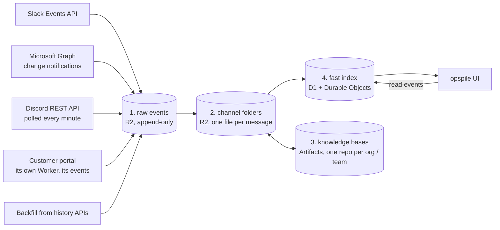
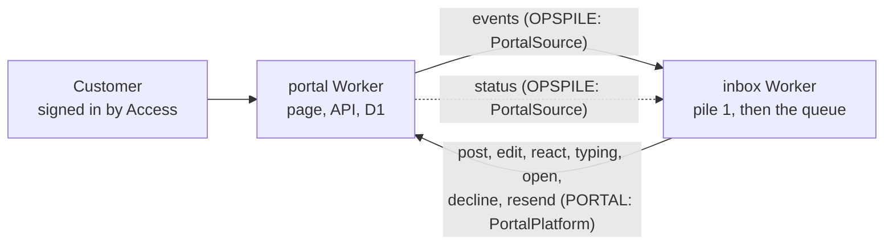

# helix-opspile architecture

opspile is a unified inbox for an ops team. It ingests every channel the team works in on
**Slack**, **Microsoft Teams** and **Discord**, and those of its own **customer portal** (for
customers who can use none of the three with Adobe), keeps the threads in **Cloudflare R2**, and
tracks read/unread state per person and per team, so that you can see which threads somebody
else has already seen and you have not.

It follows the spirit of [klickhaus](https://github.com/adobe/klickhaus): a small static UI in
plain JavaScript, fed by separate ingestion services, with the data store doing the heavy
lifting.

Everything runs on Cloudflare (Workers, R2, D1, Durable Objects, Workers AI, Vectorize,
Artifacts, AI Gateway) in a single account; the thread agents' model is Claude on Amazon
Bedrock, reached through AI Gateway.

## The four piles



Each pile is derived from the one before it. Pile 2 never talks to the platforms directly,
so it, and everything after it, can be rebuilt by replaying pile 1.

### 1. Raw events

One R2 bucket, append-only, holding events exactly as the platform API delivered them. When
Slack or Microsoft add fields, we keep them; normalization happens downstream. The one
exception is credentials: Slack's deprecated verification `token` and Graph's `clientState`
are removed before an event is stored.

```
<source>/<tenant>/<channel>/<yyyy>/<mm>/<dd>/<eventTs>-<eventId>.json
```

- The key is derived from the platform's event id, so redelivered events (Slack retries with
  the same `event_id`, Graph may notify twice) overwrite themselves. Ingestion is idempotent.
- **Slack** delivers edits as `message_changed` (with the full new message), deletions as
  `message_deleted`, and reactions as separate events. All of them are stored. A file uploaded
  to a Slack Connect channel arrives as a stub (`file_access: check_file_info`: an id and a file
  type, no name or link); the normalizer looks it up once with `files.info` and keeps the
  answer here, next to the channel's events, as `slack/<tenant>/<channel>/files/<file id>.json`
  (`{ type: 'file_info', file }`, without `shares`, which quotes other channels), so a replay
  asks Slack nothing. It is not an event and is skipped. A file Slack does not show the app is
  not kept, and the message says a file of that type is there.
- **Teams** change notifications usually carry only the resource path. We store the
  notification and the message we then fetch as two objects. Graph notifications have no
  event id, so a notification is keyed by its own hash (`notification-<sha256>.json`), and a
  fetched message by its version (`<lastModified ms>-<messageId>.json`). The notification's
  `resource` names the message; the message's metadata names the notification.
  A deleted channel message cannot be fetched (Graph answers 404), so its `deleted`
  notification is all pile 1 has of the deletion: the normalizer files it as the message's
  tombstone (`normalizeTeams`), timed when the notification was received (the object's
  `receivedAt`), and skips every other notification, whose message it files from the fetched copy.
  The files of a Teams message are kept here too, as bytes: the images pasted into it (hosted
  contents, fetched with the app's Graph token) and the files attached to it (SharePoint or
  OneDrive links, fetched through Graph's `/shares` with `Files.Read.All`), under
  `teams/<tenant>/<team>/<channel>/files/<sha256 of the URL>` with their content type and name
  (`src/teamsfiles.js`). The normalizer copies them when it first sees the message; the message
  keeps the platform's link, and an image attached as a file is shown where Teams shows it. The
  inbox's media proxy serves the copies, only to those who may see the message's thread
  (SharePoint files only from there, since the app could read any of them), and agents' `read_file` reads them. They are not events and are skipped;
  one Graph does not hand over is not kept, and the file stays a link.
- **Discord** is polled (see [Ingestion](#ingestion)): one Durable Object (`DiscordPoller`)
  stores each state of a message it reads (new, edited, other reactions) and each deletion it
  finds as an envelope `{ t, via, guild, d, thread?, root?, reactions?, at? }`. `d` is what
  Discord sent; around it is what only the poller knew at the time: the thread a message was
  posted in (Discord names just the thread's channel id), the conversation an inline reply
  belongs to, who reacted (messages carry counts only) and since when the poller has seen each
  reaction, and when it found a message gone. Keys are `<message id>-<hash of the envelope>`
  and `<message id>-delete`, so the same state read twice shares a key.
- **The customer portal** (see [Customer portal](#customer-portal)) is a Worker of this
  repository, so its events say what the normalizer needs: `{ portal, seq, at, type, domain,
  channel, author, message | reaction | lobby }` (`src/portal/events.js`), a message as it is now
  (`rev` counts its edits and its deletion), with its files, whom it mentions, its channel's
  name and its author's name, mail address and picture. They are stored as they arrive, under `portal/<domain>/<channel, or
  _lobby>/<yyyy>/<mm>/<dd>/<event ms>-<portal>-<seq>.json`: `seq` is the event's number in the
  portal's outbox, so one delivered twice is one object, and `domain`, the customer's mail
  domain, is the tenant.
- Backfill pages from the history APIs land here too, marked `via: backfill` (Discord's:
  `via: history`; the portal's, which tells of a thread again when asked: `via: resend`).
  The history import's land here as `via: import` (Slack's under `<ts>-import.json`), which the
  normalizer reads from the object's metadata, so a replay files them the same way (see
  "History import").

### 2. Channel folders

```
channels/<org>/<team>/<source>-<channelId>/<rootId>/<messageId>.md
```

Every channel belongs to one **org** (a customer, a partner or a vendor) and one **team** (the
ops team that owns it). The mapping is a small rules engine over rows in D1: each rule matches the
channel id, the channel name, the Teams team name or a Slack Connect team id with a regular
expression, and sets the team, the org or the kind (`channel`, `alert`, `ignore`); the lowest
priority wins. Naming conventions (`aem-<customer>` exists on both platforms) are rules, and
so are the overrides for vendor channels, alert channels and irregular names. Channels that
no rule matches are filed under `_unassigned`. A **manual assignment** of one channel is a
rule too: its `channel_id`, priority 10. A **follow rule** (target `follow`) files nothing: it
shares every channel it matches with its team (see "Shared channels"). Two teams' rules that
match the same channel are a **rule conflict** (`src/ruleconflicts.js`), which the admin team
settles in its inbox, where it is a thread ("Requests as threads"): either team files the channels both match, the other rule's pattern
leaves the winner's out (`^(?!winner)loser`), and the other team may follow them (a follow rule
of `^(?=winner)loser`); or the conflict is kept as meant. Manual assignments are never in a
conflict: they settle one for a channel, so a channel one of them decides is in none.

**Shared channels.** A channel can be in several teams' inboxes, but it is filed under one team,
its first: the rules pick it, and its folders, thread rows (`threads.team`), knowledge base and
agents are that team's. The other teams follow it through `channel_teams` (source, channel id,
team): the channel's threads are in their inboxes, and their members read, reply, react, resolve
and draft there; read state in a thread is that of the team it is looked at from. Adding a team
to a channel moves the channel only for its first team, when the admin team (or nobody) holds
it; added to a channel another team holds, the new team shares it and nothing moves. Handing a
channel back to the admin team is always a move. Which team a shared channel is filed under can
be swapped (`POST /api/admin/swap`, **Make primary** on the sharing team's page, for the admin team
and whoever manages both teams): the channel moves to the team it was shared with, by hand, and its
former team shares it. The shares are configuration, like the rules, so a replay of pile 1 keeps
them. A follow rule's shares are rows here too (`added_by` `rule:<id>`, `src/followrules.js`):
written after every rule change and on the cron, taken away once the rule no longer matches, and
not removed by hand.

**Following technologies.** A team follows technologies of the tech stack (`team_follows`, migration
0072; its managers and the admin team pick them on its page, `PUT /api/admin/follows`), and so does a
person (`person_follows`; from a thread's tech stack dropdown, or the Following section of their menu,
`PUT /api/follows`). A thread that shows one is in the team's inbox, or the person's personal view,
whichever team its channel is filed under, and they work it there as a shared channel's: read,
reply, react, resolve, draft, search, live updates, notifications, the MCP server. What a thread
shows is its own label's (`labels.tech`: what Clef is sure of, and what the rules detected), not its
channel's or its customer's, so a team that follows Experience Workspace gets the threads about it,
not every thread of a customer that uses it; and an inbox entry shows what any of its members does.
Conversations only: an alert channel's threads are followed by none. Anyone who may sign in
follows, on an ops team or not: someone who signed in from `SIGNIN_DOMAINS` on no team follows as a
team's member does, and their follows are how threads come into their personal view. What a follow
opens is only ever worked out for someone signed in; the portal's "how many listen"
(`entryFollowers`) leaves out those who may no longer sign in. A follow lets one reply where the
platform decides who posts, as themselves on Slack and Teams (the platform refuses one who is not in
the channel); not in the customer portal, nor as the app, which take the inbox's word: there a
person's follow alone is not enough (`mayPost`, `mayReply` in `src/shares.js`; `can_post` on
`GET /api/thread`). Nothing is filed anew: the
channel stays under its team, with its shares, and a following team cannot start a thread in it.
`src/follows.js` has the SQL; `thread_tech` has what each thread shows by index, so that `team = ?
OR <shared channel> OR <followed>` stays a search by index (`teamsOf`, `mayWork`, `roomsOf`, the
inbox's `inInbox`). A thread's agent writes the knowledge bases of the teams that follow it, as those
of its channel's shares (`accessibleRepos`, `via: 'follow'`).
A person also follows a **customer**, a **person** or an **area** (`person_follows_by`, migration
0087; `PUT /api/follows { kind, target }`): the customer's conversations, the threads the person
posted in, and those Clef puts in the area (`thread_areas`, by index, written with the label, as
`thread_tech` is) are in their personal view the same way, and in `followersOf` for live updates
and notifications. A team follows a customer too (on the customer's page in Customers, its managers
and the admin team; `PUT /api/admin/org-follows`): a follow rule of field `org` (migration 0098),
which matches the org the other rules file a channel under, and the org's that were merged into it,
so every channel of the customer is shared with the team, now and later, as any follow rule's
channels are. On the customer's page everyone on a team follows it themselves, a manager gives a
channel of their team back to the admin team (`POST /api/admin/release`) or takes it out of their
team's inbox where it is shared by hand, and asks for one of another team's (a request with `move`).

**What to follow, suggested** (`GET /api/follows/suggest`, `src/followsuggest.js`): products
(technologies), topics (areas) and customers, for everyone signed in. Without a query, what the
channels of their personal view were about in the last 180 days (`thread_tech`, `thread_areas` and
the customers of those channels' conversations), then the products and topics of the most
conversations of every team in the last 30 days, with the 30 days before to say what is rising,
less what they follow already; customers only from their own channels. With `q`, every product,
topic and customer whose name has its words. Names and counts only, never a thread; the trending
counts are the same for everyone, and an isolate keeps them an hour. The inbox shows them in place of
an empty personal view (where someone on no team starts), and in a dialog from the Following
section of the menu (`ui/followsuggest.js`).

An org is a slug. What it is called, its icon (a domain, whose favicon is shown, or an image
URL) and whether it is a customer, a partner or a vendor are a row in `orgs`; an org without
one is a customer shown by its slug and the favicon of its usual mail domain. The inbox and
the agents show the name and the type.

The org list in the admin pages shows each org with the icon the inbox resolves for it (its
own, else the favicon of its usual mail domain: the most common one among the people outside
Adobe who post in its threads, free mail and tenant domains left out), and an empty square
where there is none, so the orgs without an icon stand out (and can be listed alone). Favicons,
in the admin pages and the inbox, come through `/api/favicon` (`faviconProxy`), at one address per
domain on the inbox's origin: Google's favicon service answers with a redirect to one of several
hosts, a different one each time, which a browser does not keep. The Worker follows it, keeps the
image in the data center's cache for a week and the browser keeps it as long; it answers 404
where Google has only its globe (for an hour), and 502 where Google did not answer (for a
minute). An org's page suggests icons (`src/favicons.js`): the favicons of the websites its
mail domains, slug and name suggest (`<slug>.com`, `www.<slug>.com`, `<name>.com`, …) and the
icons those sites name (`<link rel="icon">`, `apple-touch-icon`), each image with what Clef
thinks of it: whether the site is the org's own (not a namesake's, an agency's or a parked
domain's; Clef is told each site's title where it can be read) and whether the image is a logo
rather than a stock icon. Picking one makes it the org's icon. Sites are asked with a browser's
user agent (many answer a bot's with an error page); an `.ico` of bitmaps, which Clef cannot
read, is decoded into a PNG for it (`src/ico.js`), and an SVG icon is offered without Clef's
verdict.

**Unassigned channels.** A channel no rule files under an org (its name is not
`<product>-<org>`, nobody assigned it) is in the org `_unassigned`, which Customers lists as
Unassigned, with how many channels it has (`unassigned` of `GET /api/admin/orgs`; the ignored ones
are not counted). Its page (`GET /api/admin/org?slug=_unassigned`) lists them, each with the orgs
it may belong to (`src/orgassign.js`): a Slack Connect team or Teams team it shares with the
channels of an org and few others (the inbox's own Enterprise Grid is in every Connect channel), the
usual mail domain of an org that the people outside Adobe in it or posting there write from, and an
org's slug or name as a word of its name, or a few words together (`home-depot`), the products the
org rules name in their `^(?:aem|…)-` and words such as `adobe` or `alerts` aside. Where none fits,
it suggests a new org: its people's mail domain, else the first word of its name. Picking one, any
other org, or a new one named in the same list (made with its type first, `POST /api/admin/orgs`)
assigns the channel there by hand (`POST /api/admin/assign`, target `org`).

**Duplicate customers.** An org is a slug the rules give a channel (`aem-<slug>`,
`<product>-<slug>`, a manual assignment), so one company can end up under two: a channel named
`workfront-acmeco` and one named `aem-acme`. The admin pages' Customers list the pairs of orgs
that may be one (`GET /api/admin/org-duplicates`, `src/orgmerge.js`), likeliest first. A pair is
a candidate when its signals add up: names (the same in letters and digits, one the start of the
other, spelled alike, a word in common), the same icon (or one's icon the other's mail domain), the
same usual mail domain of their people, channels with the same Slack Connect team, Teams team or
portal domain, and people outside Adobe in channels of both (`channel_members`, counting only those in
the channels of a few orgs: staff, bots and agencies are everywhere). A domain or a Slack Connect team
more orgs share is a partner's, and weighs less. Clef is then asked about each candidate, shown both
orgs (names, type, icon, channels and their topics, mail domains) and the signals, and told that an
agency's people or Slack Connect team in both is no sign: "should A and B be one organization: do
both names refer to the same company?" Its answers are kept in `org_pairs` with a fingerprint of what
it was shown, and asked again once that changes, two dozen a load; the page loads the list again while
Clef gets further. The orgs' facts are kept in the isolate for five minutes.

The admin team merges a pair from its page (`POST /api/admin/org-merge`, tried first with `dryRun`).
The merge is a row of `org_merges` (migration 0091) that `loadRules` hands every caller of the rules
as a rule of target `merge`, applied after the others (`mergedOrg` in `src/rules.js`): what the rules
file under the merged slug, now or later, by a template or by hand, is filed under the one kept, and
its channels move as for a rule change (only the merged org's: a channel filed otherwise for another
reason stays where it is). The org kept keeps its name, icon and type, and the merged one's fill in
where it has none; the merged org's `orgs` row goes (the merge keeps it), its agents' MCP servers,
secrets and repositories, the people who follow it, its stack drawing and its portal lobbies go to
the org kept (one of the same name there stays the kept org's), and the entries of its knowledge base
that the kept org's has not are copied over as the person merging (a path both have stays in the
merged org's, for a dream or a person to reconcile). The merged org leaves the lists (orgs, knowledge
bases); its knowledge base stays in Artifacts. Undoing a merge (on the kept org's page) moves its
channels back and gives it its row again; what moved with it stays. Anyone on a team who sees one of
the two (the customers its teams own) sees the pair too and asks the admin team for the merge (`POST
/api/admin/org-merge-requests`), which waits in the admin team's inbox, a thread there ("Requests as
threads"), until the admin team merges or declines it; the admin team can also say two orgs are not the same, which takes the pair off everyone else's
list until somebody asks for its merge.

**Adobe's bots.** Staff are told apart by mail domain, and a bot has none, so a bot of Adobe's
(an agent that provisions access, say) would show on the customer's side of a thread. Every bot
opspile knows that posted, or that somebody said whose it is (`identities` of kind `bot`: written
when one posts or is mentioned, a Slack bot or Teams app the first time it posts, `botIdentity` in
`src/lookup.js`; `src/ourbots.js`), is a thread of the admin team's inbox ("Requests as threads"),
which says how much it posted and where, and quotes its latest three messages, each with a link to
its thread; there the admin team says which are Adobe's and which are external (`identities.ours`:
1, 0, or NULL while nobody said; with who said it and when). A bot that posted and that nobody said
either of waits there, open, and counts on Inbox in the header until an admin answers it
(`unreviewedCount`); the others are resolved threads, where what was said can be changed. There is
no page of bots. An Adobe bot is staff (`toAuthor`): the inbox shows it on Adobe's side, as a colleague, its
messages in D1 follow at once (`messages.staff`), and so do the ones written before in the thread
view (`accountAuthor` in `src/api.js`, since their frontmatter says what was so then). Looking the
account up again keeps the say. Its messages stay a bot's: they are not counted (a bot does not
answer the customer, `last_staff`), and the agents fence them as every bot's
(`untrusted` in `src/agent/deliver.js`, which trusts staff people only).

**Adobe's admin accounts.** The Teams tenant that hosts the teams has admin accounts of its own
(`owner_` and initials, "People", below), staff by themselves, but nothing in Graph says who uses
one: their name is the initials. Each is a thread of the admin team's inbox too, with the bots
(`GET /api/admin/accounts`, `src/accountlinks.js`), and the admin team gives each the mail address
of the Adobe person whose it is (`PUT /api/admin/accounts`): the account is linked to that person
(`identities.person`, with `linked_by` and `linked_at`, migration 0097), and so shows with their
name and picture, on their profile card, and counts as one of their accounts ("One account a
person"). Its messages in D1 follow at once (`relabelAccount`: `messages.person`, `staff`,
`author`, and the threads' `last_staff` and `last_author`), and so do the ones written before in
the thread view (`accountAuthor`). Only an account that is staff by itself and that no mail
address links is linked, and only to a staff person, so no customer's account becomes Adobe's.
Looking the account up again keeps the link; giving no address takes it back.

**Alert bots.** A bot may also only post alerts (`identities.alerts`, migration 0090, set in its
thread of the admin team's inbox, whatever its side): a thread it starts is an alert (`threads.kind =
'alert'`), also in a channel the rules make a conversation, so a channel can hold people's
conversations and a monitoring bot's alerts both (`src/alertbots.js`). Only the root decides: a
person's reply to an alert leaves it an alert, and the bot's reply in a person's thread leaves that
a conversation. The message index writes the kind (`threadKind` in the normalizer: the root's
author, the message itself or the root D1 has; a reply that arrives before its root is filed as a
conversation until the root comes), and everything after it goes by the thread's kind, not the
channel's: no agent, no Clef label (an alert's title instead), no vectors or full-text items. A
re-filing (`src/refile.js`) writes it again from the rules and the alert bots, and `plan` counts a
thread filed so as filed where the rules say; so a change of the flag re-files the channels the bot
started threads in, which makes their threads alerts, or conversations again, and takes away or
makes again what goes by the kind. Re-threading keeps the two apart in such a channel: an alert
joins alerts only, a conversation conversations only.

A bot's page also gives it the name and picture the inbox shows (`identities.display_name` and
`display_avatar`, an https image URL; NULL shows the platform's), for bots the platform says
little of: Teams gives an app's messages no picture, and names a bot by its registration, not
by its app. Without an admin's, a Teams bot's picture is its app's icon: the cron's list of each
Teams team's installed apps (`syncInstalledBots` in `src/bots.js`) points `identities.avatar`
at `/api/bots/icon` for the app definition installed (a new version is a new URL), which
fetches the definition's `colorIcon` from Graph beta (`AppCatalog.Read.All`) when an image asks,
and caches it a day; without the permission the inbox shows the initials. The name goes on its messages in D1 at once (`messages.author`, and a thread's
`last_author` that was the bot's), on those written before in the thread view (`accountAuthor`),
and in the frontmatter of the ones it writes from then on (`toAuthor`, `resolveAuthor`); the
picture is read from the account (the thread view, profile cards, the bots a reply can
mention). A Slack bot's own picture is the one its messages come with (`bot_profile.icons`),
kept on its account when it has none (`botIdentity`).

**Administration.** The admin team manages all of this at `/inbox/admin`: ops teams and
their members (found by name or email among the people and platform accounts opspile knows;
names come from the platforms and are not edited there), the rules that file channels under a team (a name prefix like `aem-`, a Teams
team, a Slack Connect team), manual assignments of channels to a team or an org, the channels
shared with more teams, and each org's name, icon and type. A team's page suggests channels for it among the ones the admin team
holds (the rule of last resort files every channel no other rule claims there): the ones where
the team's members post, react or are members (listed from Slack, or from the Teams team, into
`channel_members`), ranked tf-idf style so that someone active in most of the admin team's
channels (an admin, say) counts for little and a member active in a few counts the most, and the
ones Clef gives the team. The cron asks Clef about a batch of the admin
team's channels every run, one question set per channel (`channel_labels`): which ops team should
follow it (each described by its rules, some of the channels it holds or follows through a share,
and its members, or none of them),
and whether it is a conversation, an alert feed or not worth following. Clef is told the channel's
name, its Teams team, its topic, its customer, how busy it is, the Adobe people who post in it
and are in it with their ops teams, the technologies seen, and its recent threads' titles; it
looks again when the channel has new activity, the ops teams change, or the label is a week old.

**The team wizard** (`src/teamwizard.js`) goes the other way: from the admin team's channels to
teams that do not exist yet. Channels are named by convention (`<product>-<customer>`), so a
prefix that three or more of the admin team's channels share (up to the first or second `-` or
`_` of a Slack or Discord channel's name, or of a Teams team's name, which is what is named so
on Teams) is often a product without a rule. The list of teams has each such group under
**Suggested teams**, as they come up; its page lists its channels, the rules that would file them
(channel name starts with the prefix, and the Teams team's name for its Teams channels), what a
dry run of them moves, and the Adobe people present in them (members, posting or reacting; staff
with a mail address), those in the most first. Checked are the ones in at least half of the
group's channels and there more than twice as often as in the admin team's channels at large,
so that an admin in all of them does not count. When most of those are on one ops team already,
the page offers to give that team the rules instead. **Create** makes the team (with what new
teams start with), adds the checked people as members, and saves the rules, which re-file the
channels as any rule change does (`POST /api/admin/team-wizard`, `dryRun` for the preview). A
group that is no team is dismissed (`team_prefix_dismissals`, migration 0088), with its channel
count, and suggested again once more channels start with it.

Every rule change applies at once (the page names the channels it
moved; the API still answers `dryRun` with what a change would move), and the page sends its
changes one after the other, so many can be made in a row. Applied, each moved channel is **re-filed** by a `refile` job on the
NORMALIZE queue: its thread folders move to `channels/<new org>/<new team>/…` (an object
already at the new place, from a message that arrived meanwhile, is newer and kept), its
thread rows take the new org, team and kind, and the new org and team get their knowledge
bases. A job starts from where each thread is filed in D1, and also moves what is still where it was
when the job was queued (a message filed meanwhile points the row at the new place), so several
changes to a channel in a row end up where the last one says. A large channel moves a few hundred files per job.

**Team managers.** A member of a team can be its **manager**: they get the team's own section
of its page in Teams, and its agent's, for that team only, where they add and remove members, promote
them to manager or demote them, and edit the team's knowledge base (its `systemprompt.md`
too). Teams, rules, assignments, orgs and the customers' knowledge bases stay with the admin
team. A team can be **self-managed**: every member is a manager, and so is everyone who joins.
Turning that off keeps the roles as they are; from then on new members join as members, and
managers can be demoted. The role is `team_members.role`, the flag `teams.self_managed`;
only the admin team sets the flag.

**Suggested members.** A team's page (but the admin team's) suggests the Adobe people who are likely
on the team and are not (`GET /api/admin/member-suggestions`, `src/membersuggest.js`), for its
managers and the admin team to add with one click (the same `POST /api/admin/members` as the field
above it). The team's channels are the ones it holds and the ones shared with it. Three signals,
each scaled to its best person and weighed: the team's threads they posted or reacted in over the
last six months (a reaction half a thread), the team's channels they are in (`channel_members`:
Slack's members of the channel, the Teams team's), both tf-idf style (the log of the count, times
the square root of the share of everything they worked, or are listed in, that is the team's, so an
admin active everywhere counts for little), and the topics of the newest topic map that are mostly
the team's (at least two of its threads and a quarter of the topic's), with who worked their threads
anywhere: the people `list_experts` and `list_topics` name for them. Staff with a mail address only,
as a member is. Each comes with why, in numbers and topic names. **Dismiss** leaves someone out for
the team (`member_suggestion_dismissals`, migration 0095), and so does taking someone off it, until
**Suggest again**.

**Channel requests.** A team manager does not assign channels, but asks for them: their team's
page has the same channel search the admin team adds channels with (every channel, by name,
Teams team, customer or id), and picking one sends a request, "add this channel to this team",
with an optional note (`channel_requests`, migration 0028; one open request per channel and
team). The admin team sees each in its inbox, a thread ("Requests as threads"), the number of the
open ones on Inbox in every page's header. **Confirm** there runs the manual assignment as a dry
run first and says what it would do: re-file the channel under the team (and which threads move),
or share it with the team when another team holds it. **Confirm** then makes that assignment,
exactly as adding the channel on the team's page does, and records who confirmed it and what it
did; **Decline** takes an optional reason. The manager sees each request on their team's page:
pending, confirmed (moved or shared), declined with the reason, or withdrawn (they may take an
open one back). An admin who adds a requested channel to the team directly answers the request
with it, and so does a rule that moves the channel there. Confirming closes the request first, so
one declined or withdrawn meanwhile moves nothing, and a failed assignment opens it again. Nothing
is sent by mail or chat.

A thread's agent files requests too, from its sidebar (`src/agent/channelrequest.js`): asked there
why the thread is in this team's inbox, it answers from `channel_assignment` (the rule that filed
the channel, with its note, and the rules that would without it), finds the team it belongs to
with `list_teams`, and `request_channel_reassignment` asks for it, for the person who wrote the
sidebar message, with their reason. Such a request asks for a **move** (`move`, migration 0071):
confirmed, the channel is filed under the team even when another team holds it, instead of being
shared with it (with `share`, the agent asks for the usual request instead). It names the thread
whose sidebar it came from (`thread`), which the request's thread links to. The agent files one only
while it answers a sidebar message, never on the thread's messages, which customers write.

**Membership requests.** The agent asks for people as well: asked in its sidebar to add someone to
an ops team (the person who wrote, or a colleague they name), it finds the team with `list_teams`,
and `request_team_membership` files a request (`member_requests`, migration 0096,
`src/memberrequests.js`, `src/agent/memberrequest.js`) for the person who wrote the sidebar
message, with their reason and the person: their mail address as written, or the one person the
inbox knows by exactly that name, the author when neither is given. Only staff addresses
(`STAFF_DOMAINS`) are asked for, nobody already on the team, and one request per team and address
is open at a time. An admin decides it in the admin team's inbox, or one of that team's managers on the
team's page (**People asked for**): **Confirm** adds the person as adding them on the team's page
does (a member, a manager in a self-managed team; the sign-in allow list follows), **Decline** takes
an optional reason. Confirming closes the request first, and a failed addition opens it again; adding
the person on the team's page answers their open requests. As with channel requests, the agent
files one only while it answers a sidebar message, never on the thread's messages. It is not
`request_membership`, which asks a platform's admin bot to add people to the channel itself.

**Portal requests.** Customers ask as well, for a channel of their own in the customer portal:
the admin team opens one for them from its thread in the admin team's inbox, and a team's managers
on their team's page when the team follows a technology the customer picked. See [Customer
portal](#customer-portal).

**Requests as threads.** What waits for the admin team is a thread of its inbox
(`src/requestthreads.js`, `GET /api/requests`), not a page of the admin pages: a channel request,
a membership request, a customer in the portal, a merge of customers, a bot or an admin account
nobody said whose it is, a conflict between the teams' technologies or their rules. Its key is
`request:<kind>:<id>` (`src/requestkeys.js`: the row's id, a bot's or an account's identity key,
a conflict's key), and the inbox lists it in the admin team's view only, with the team's own
threads, under a "customer" of its kind (Channel requests, Bots, Rule conflicts, …), of kind
`request`, waiting on us while it is open and resolved once it is decided; the decided ones stay
(the latest hundred of each kind). Their own type on the Type card, **Admin requests** (`f.type=request`,
beside Conversations and Alerts), filters to them. The number on Inbox in every page's header counts
the open ones of every kind (`GET /api/admin/requests?count=1`), and a click on it opens them: the
admin team's inbox, on Admin requests that are unresolved (`REQUESTS` in `ui/header.js`). Its thread is in no channel and nothing of it is posted: the
request as whoever asked said it (or, for a bot, an account or a conflict, as the inbox sees it),
what the admin team writes about it, and what was decided. What they write is the request's
**decision log** (`POST /api/requests/note`, `request_log`, migration 0100), the reply box's place;
under the messages, the card of what can be decided now, each action with what it does, its fields
and, where it can be tried, what it would change (Confirm's dry run, a merge's, a rule conflict's
side winning). Deciding (`POST /api/requests/resolve`) runs the route of `/api/admin/*` the admin
pages ran, as the person deciding, so the checks, the claim of a request and its outcome are
src/admin.js's; only what the request offers then can be run. A request's own row says what was
decided and by whom (a channel, a membership, a portal or a merge request), also when it was
decided elsewhere (withdrawn by a manager, confirmed on a team's page, answered by an assignment);
what is decided of a bot, an account or a conflict, which have no such row, goes into the log. The
kinds without a time of their own are kept in `request_threads` from when they are first seen
waiting, and a conflict that is gone (settled, or its rules changed) stays there with its title,
a resolved thread with its log (docs/STATE-MACHINES.md, "Request thread"). Read state is the
watermarks of the keys, read in the admin team's room as a thread is; a change of a request is
announced there (`{ type: 'request' }`), and the inboxes load the requests again. Old addresses of
the Requests page (`/inbox/admin?tab=requests&request=…`) open the request's thread. Nothing of
this goes to the agents, the labels or the search.

Channel names and authors are not in the events, so the normalizer looks them up
(`conversations.info` and `users.info` on Slack, Graph on Teams) and caches them in D1 for a
day. These are its only platform calls. Files only move forward to a newer version, and a
tombstone is final, so a replay of pile 1 in any order rebuilds the same pile 2. A rule
changed in D1 by hand needs pile 2 emptied and replayed; one changed in the admin UI re-files
the channels it moves (below).

**A renamed channel is re-filed** the same way, by the same `refile` jobs: the rules read a
channel's name, its Teams team's name and its Slack Connect teams, so a channel renamed to a
name a rule maps to an org (or another team, or a kind) takes its threads along. The normalizer
notices it when a Slack rename event arrives, when a Teams notice says the channel or its team
was renamed (it looks the channel up again then), and when a lookup (a day after the last, from a
message or the cron) finds them changed; Discord renames are found by the lookups. It queues the
moves only when the rules classify the channel differently than before, before it files the
message that came with the change. A manual assignment is a rule, so a rename does not undo it
(a channel assigned to a team keeps it, and takes the org its new name gives); the teams the
channel is shared with stay. A rename event older than what D1 knows of the channel (a replay)
is left out.

**One markdown file per message**, in a folder per platform thread (the root message's id; the
root message is `<rootId>/<rootId>.md`). Message bodies are markdown themselves, converted
through a syntax tree: each platform's body is read into mdast (Teams HTML in `src/html.js`;
Slack's blocks, `rich_text` first, and its mrkdwn where there are none in `src/slackmd.js`;
Discord's flavor of markdown in `src/discordmd.js`; the portal's is markdown as its author
typed it, which stays as it is but for images, which become links, `src/portalsource.js`) and
written by `src/mdast.js`, so markers
and escapes are where markdown wants them and the inbox shows what the platform shows (a
Teams system notice, whose body is an empty
`<systemEventMessage/>`, is written from its `eventDetail`: "Meeting ended after 50 s. Only Ada
joined.", with the names looked up where Graph leaves them out), so keeping each message in its own file avoids nesting one
document inside another, and makes every file a natural retrieval chunk. There is no
per-thread rollup file; reading a thread means listing its folder.

**Folder snapshots** are a read cache beside the folders, not part of pile 2's record:
`snapshots/<folder>.json` holds every file of one folder, parsed, with its R2 version
(`src/filecache.js`). A Worker may wait on only six R2 calls at a time, so an isolate that had
not read a thread before read a thread of 300 messages in some fifty rounds (three seconds);
with the snapshot it lists the folder, reads the snapshot, and reads only the files whose
version the snapshot does not have, then writes the snapshot again behind the answer. A file
is never taken from a snapshot for a version it does not have, so a stale or missing snapshot
costs reads, never correctness; re-filing a folder deletes its snapshot, and emptying pile 2
may drop them all.

```markdown
---
source: slack
thread: slack:<enterpriseId>:<channelId>:<thread_ts>
logicalThread: slack:<enterpriseId>:<channelId>:<other_thread_ts>   # only if re-threaded
id: <ts>
at: 2026-10-14T07:37:26Z
author: { kind: person, name: …, org: …, staff: true }
editedAt: …
deletedAt: …
dropped: [color, highlight]   # only if the markdown cannot show what the platform did
raw: [<raw object key>, …]
permalink: https://…
---

The message body, as markdown.
```

```
thread key   slack:<enterpriseId>:<channelId>:<thread_ts>
             teams:<tenantId>:<teamId>:<channelId>:<rootMessageId>
             discord:<guildId>:<channelId>:<rootMessageId>
             portal:<mail domain>:<channelId>:<rootMessageId>
```

- A message that quotes another (Slack: one forwarded with it, `is_share`, or the preview Slack
  adds under a link to a message, `is_msg_unfurl`) has it below its text and above its files, as
  a markdown quote whose first line is its author, linked to it with the title
  `"Quoted message, <ISO time>"` (`quoteMarkdown` in [src/markdown.js](../src/markdown.js)). The
  inbox shows it as a card. Its words are not its author's: they count for no mentions, nor for
  the vectors of what people talk about, and editing the message leaves the quote alone.
- New messages are new objects, so concurrent replies never contend for the same file.
- What markdown cannot say stays in pile 1 only, and `dropped` names it: a Teams message whose
  text is in more than one colour (`color`) or partly highlighted (`highlight`), as a table
  that marks some rows by colour does (`htmlDropped` in [src/html.js](../src/html.js)). A colour
  all of the text has (pasted from a document) means nothing and is not named. An agent reading
  the message is told, and reads it as it was sent with `raw_message`.
- An edit rewrites exactly one file. Earlier versions remain in pile 1.
- A deletion keeps the file as a tombstone (`deletedAt` set, body removed), so links and read
  watermarks stay valid.
- A Slack `permalink` names the channel's workspace (`https://<workspace>.slack.com/…`, from
  `team.info`, kept in `channels.domain`): a bare `slack.com` link opens in whichever workspace
  the browser used last, and people are often in several. A channel of the whole Enterprise org,
  or one shared between its workspaces, links to the workspace most channels live in. Links
  filed before a channel's workspace was known are rewritten in D1 when it becomes known.

**Enrichment on write.** When a message is copied into this pile:

- **[Clef](https://blog.cloudflare.com/clairic-extraction-model/)** (a decision model)
  classifies the thread: who has to act next (`us`, `customer`, `vendor`, `nobody`), what kind
  of thread it is (incident, security, question, request, alert), and urgency. Thread-level
  results live in the index (pile 4).
- **Deterministic extraction** handles structured tokens: CVE ids, URLs, ticket links,
  `org/site` identifiers.
- **Clairic** (an extraction model) handles loose facts, and only values above a confidence
  threshold are kept.

**Re-threading.** People often post a follow-up as a new root message instead of replying,
or split one request over several messages, and alert channels post the same alert again
and again. A root by the same person within three minutes of their previous root in the
channel, with nobody else's root between them, continues it (a *burst*), unless that root is
deleted by then (people delete a message and post it again, and the new one is the thread), or
someone has answered it in its thread already (then the new one is a message of its own, as the
next of several questions each in its thread). A root that only greets ("Hello Ada", "Hi team
:wave:": a salutation, the people it is addressed to and emoji, `greets`) says nothing of its own,
and its author's next root within 15 minutes continues it the same way: people greet, then take
minutes to write what it is about, and Clef reads a greeting as a conversation of its own. A root
that says nothing but @-mentions ("@<the bot>", "@Ada Lovelace", at most emoji and punctuation
besides, or not even a mention: "?", ":eyes:"; `mentionsOnly`) continues its author's previous
root within those 15 minutes the same way, with the same conditions (nobody else's root between
them, that root not deleted and not answered in its thread yet): its author is calling the bot or a
colleague to the question they just asked, and it has no words for Clef or vector search to place
it by. A mention is `@` and up to four capitalized words, what the platforms write for one, so
"@Ada can you check" says something and is Clef's to decide. Somebody else's bare mention is not
theirs to continue: one of a conversation's people, @-mentioned by name, is an addressed reply
(below), and the same mention by its own asker, after somebody else's root, or later than 15
minutes, is Clef's. In the case that showed it, a customer asked whether a tool had an issue,
then pinged the bot three and a half minutes later, 30 seconds past BURST_MS, and the ping's own
entry got an agent that asked the customer what he needed. When a
root message
arrives, its *skeleton* (the text without timestamps, long numbers, hex and UUID ids, query
strings and user agents; short numbers like status codes stay) is embedded and the most similar
earlier roots in the same channel, within 14 days, are found by vector search.

- **Alert channels:** an exact repeat of the skeleton or a near-identical root (cosine ≥ 0.97)
  is a match outright; otherwise Clef chooses between up to four candidates above 0.82 and
  "a new topic", told how long before each was posted, and a match needs a probability of at
  least 0.7. Candidates of the same group share their probability.
- **Conversation channels:** in a chat, answers, thanks, nudges and escalations posted as new
  messages ("done, you have access now", "this is a blocker, please help") share few words with
  what they follow up, people answer hours later, and the same words ("thanks!") are not a repeat.
  So Clef reads the channel's **latest three conversations** active in the last three days and the
  groups of up to four similar roots (cosine ≥ 0.6) as a transcript: each conversation's first
  message and its latest two before the new root, marked with the conversation's letter and how
  long before they were posted, then the new message, and says which conversation it continues or
  that it is a new topic. A match needs a probability of at least 0.8, and 0.99 for a conversation
  with replies in its platform threads (`MIN_CLEF_THREADED`), and for any conversation in a
  channel that replies in threads (of its roots in the last 30 days, at least five, half or more
  got a person's reply in their own: a question that is still waiting for its first reply there is
  held in threads all the same): people continue a chat with more top-level messages where the
  chat is top-level messages, and where they reply in threads, a new top-level message is nearly
  always a topic of its own, however close it reads. Folded into conversations held in threads at
  0.8, new roots got replies of their own as often as the channel's new topics; folded into ones
  without, half as often. In channels that reply in threads, those folded at Clef's usual
  certainty got replies of their own twice as often as the other folds. Comparing the new root
  with each candidate on its own spread Clef's answer over several candidates and left most of a
  chat in pieces. Platform notices ("… has joined the channel") are left alone.
- **Replies posted top-level:** somebody who answers what they just read in the channel's box,
  rather than in the thread's, posts a reply as a root: it @-mentions the person it answers, and
  it comes at once. A root that @-mentions, by name, somebody who spoke in one of the
  conversations Clef reads, less than five minutes after that conversation's latest message, is
  its *addressed reply*: Clef's usual certainty in a conversation (0.8) is enough to fold it,
  whatever the channel's habit and the conversation's thread replies, and even when it has
  replies of its own already. The fold is `logical_via = 'reply'`, and, like a burst member, it
  stays in its group when people answer it in its platform thread (below): that thread is where
  the conversation went on, so whoever answers the reply answers the group. The lower bar is only
  for the conversation the root addresses: where Clef picks another one, it needs
  `MIN_CLEF_THREADED` as before. Of production's roots over two weeks, 13 were addressed replies,
  and Clef gave 0.8 or more to three of them: a chat's answer and its follow-up, and a staff
  answer to a customer. The ten it kept apart say so themselves ("in other news", "another
  ticket", a question of their own), which is what the five minutes are for: an @-mention of
  whoever was active last, hours later, is as often a topic of its own.
- **Quotes:** a root that quotes a message (below) stays on its own, whatever Clef or a burst
  would say. Forwarding a message into the channel, or linking to one, starts a topic on purpose:
  whoever meant to continue that conversation would have replied in it, and the text that goes
  with a quote ("first step in that direction") reads like a follow-up of whatever was said last.
  The root after it can still continue it. In the transcripts Clef reads, a quote is
  `> <author> wrote:` and its text.
- **Thread marks:** a root that announces a thread (🧵, `:thread:`) stays on its own too, and
  out of a burst: nearly all of them are answered in their thread.
- **Replies of its own (de-threading):** a conversation's root that people answer in its own
  platform thread holds a conversation of its own, however much it reads like a follow-up (a
  different customer raising a related problem by @-mentioning whoever was active last). One
  that has a person's reply when it is decided is not folded. One that gets its first after it
  was folded is split back out (`dethread`, on that reply): its row loses `logical_thread`
  and gets `logical_via = 'split'`, which re-threading (forced, or a burst before it) leaves
  alone for good, its root file loses `logicalThread`, the roots that followed it in a burst go
  with it, and the open inboxes reload the group (`split` in the room's `thread` event); until
  all of that is done, `split_from` names the group it left, so a retry finishes it. So the
  group's entry stops interleaving the two platform threads, and its replies go to its own
  platform thread again (src/post.js `target`, the entry's latest). A burst member, an addressed
  reply (`logical_via = 'reply'`, above) and alerts stay in their group.
- **Replies the inbox routed:** a group's replies go to the platform thread it was last active
  in, which may be a folded root's. Once one does (a person's from the inbox, the app's, or a
  thread agent's), the group's conversation goes on there, where the channel sees it: that root
  gets `routed_at` (`routeReply`, written before the post) and stays in its group for good. Its
  replies do not split it out, neither the inbox's own nor those of the people who answer them
  there, and a forced re-threading leaves it alone. Splitting it would leave the answer the
  channel read in an entry without the question it answered.

A match sets `logicalThread` on that one message file and on its thread row, always pointing at
the group's first thread. The file stays where it is and the platform thread is never modified, so undoing
the match is a one-field change. Replays arrive in any order, so an alert that is matched also
pulls in near-identical later alerts that had found nothing earlier, and a root pulls in the
next root by the same person within three minutes (15 after a greeting, or for a root that only
mentions). A conversation's root is decided from the
conversations before it, so re-threading a channel again goes oldest root first
(`scripts/replay.mjs --rethread --channel <id>`). The inbox shows a group as
one entry: the first thread's title, the latest activity and the latest member's label, the most
pressing attention of any member, and all members' messages in order. A first thread whose messages
were all deleted after a member folded into it has no activity, title or link: the next member's
stand in. A root is re-threaded 30 seconds after it arrives,
so it can be in the inbox on its own until then: a match tells the open inboxes which threads
it folded, which take those threads' own entries off the list once the group's is there (as does
a reload of the first page that has them in a group, should the announcement be missed), one
that has a folded thread open shows its group instead, and opening a member's key (a link, a
tab) opens its group too.

Vector search uses Workers AI embeddings in Vectorize, written at ingestion time so that a
message can be matched seconds after it arrives.

A second index, `CONTENT` ([src/vectors.js](../src/vectors.js)), holds what was said, for
search over topics and who talks about them: one vector per message a person posted in a
channel thread (`type: message`, with the author's `person`, `staff` and `author` key) and
one per such thread (`type: thread`), the mean of the embeddings of its title and messages
in pieces of about 512 tokens (a long thread keeps its first piece and its latest). Both
carry `channel`, `thread`, `org`, `team` and `at`; the text stays in pile 2. Two minutes
after a person posts, or a message is deleted, the thread is vectorized: each message keeps
a hash of the text its vector was made from (`messages.embedded`), so only new and edited
messages are embedded again, and a deleted one loses its vector. The cron enqueues the
threads whose vectors are older than their latest message (`threads.vectorized_through`),
which also fills the index the first time. Alert threads (a bot's posts) get no vectors here.
A re-filed thread's vectors are made again (its hashes cleared, a vectorize job queued), so
that they carry its new team and org; re-filed as an alert or ignored, it loses them. The
knowledge bases' concepts have theirs here too (`type: kb`, see "Search" under
[Knowledge bases](#3-knowledge-bases)), so every query of a thread's vectors names its `type`.

A third index, `SEARCH` ([src/fulltext.js](../src/fulltext.js)), is for full-text search: an
[AI Search](https://developers.cloudflare.com/ai-search/) instance with built-in storage, one
item per message of a channel thread (people's and bots', not system notices), its markdown
body as it is. It carries `team`, `channel` (a hash of the channel key: AI Search filters read
the first 64 bytes of a value, and a Teams channel key is longer), `message` (`<thread>|<id>`)
and `at`. The vectors find what a message is about; BM25 here finds the words it has, an error
string, a hostname or an id, which an embedding blurs. Its items are kept in step by the same
job as the vectors: each message keeps a hash of its team and text (`messages.indexed`) and
its item's id (`messages.search_item`), so an edit uploads one item again (a re-upload under
the same name replaces it), a deletion takes it away, and a re-filed thread's items are
uploaded again under the new team (re-filed as an alert or ignored, it loses them). A failure
leaves a message's row as it was, so the next run tries again, and does not keep the vectors
from being made; an item whose deletion failed keeps its id until it is gone. Search only
counts and shows an item whose message D1 has and is not deleted, so a deleted message's words
are never found, whatever is left in the index. A job uploads at most 100; `threads.indexed_through` tells
the cron's sweep which threads are behind. AI Search's own vectors (the instance is hybrid)
are not used yet: the `CONTENT` vectors already do that part.

### 3. Knowledge bases

One [Artifacts](https://blog.cloudflare.com/artifacts-git-for-agents-beta/) repository per org
and one per team: a pile of markdown files with git history.

```
kb-org-<slug>    what we know about this customer or vendor, across all teams
kb-team-<slug>   product and process knowledge for this team, across all customers
```

The repositories follow the [Open Knowledge Format](https://github.com/GoogleCloudPlatform/knowledge-catalog/blob/main/okf/SPEC.md)
(OKF v0.2), the formalised [LLM wiki](https://gist.github.com/karpathy/442a6bf555914893e9891c11519de94f)
pattern: one markdown file per concept (a site, a known issue, a playbook, a decision), YAML
frontmatter with a required `type`, links between concepts, an `index.md` per directory and a
`log.md` at the root. Provenance is in each concept's frontmatter: `sources` lists the threads
(permalinks) a concept was learned from, with who said it and when, and footnotes tie claims
to them; `generated` says which agent wrote it and when, and `verified` will record staff
review. Every change is a commit, so a bad memory is a `git revert`.

[Thread agents](#thread-agents) are the writers. A thread's agent writes its team's and its
customer's knowledge base, those of the teams its channel is shared with (`channel_teams`), and
those of the teams that follow a technology its thread shows (`team_follows`, see "Following
technologies"); every other team's it reads but cannot write (src/agent/repos.js, `accessibleRepos`). Code, not the agent, writes `index.md` and `log.md`
and stamps `generated`, and a write that is not a well-formed concept is refused. For now
every write is trusted and lands on `main`; staff review comes later, against the git
history and the trust tiers OKF derives from `verified`.

**Layout.** OKF fixes no taxonomy; ours does, so that every knowledge base is laid out the
same way and a concept is found by its type (`LAYOUT`, src/agent/okf.js). The types and their
directories are the ones the agents had settled on most:

| type | directory | |
| --- | --- | --- |
| Customer | `customer/` | kb-org only |
| Contact | `contacts/` | one person, at `contacts/<first-last>.md` |
| Site | `sites/` | kb-org only |
| Tech Stack | `tech-stack/` | |
| Project | `projects/` | kb-org only |
| Known Issue | `issues/` | |
| Incident | `incidents/` | |
| Decision | `decisions/` | |
| Playbook | `playbooks/` | |
| Product Area | `product-areas/` | |
| Reference | `reference/` | anything else worth looking up |
| Vendor, Product, Feature, Category | `products/` | kb-team only: the team's catalog of products (see "Labels and facts") |
| Stack Drawing | `stack.md` at the root | kb-org only, one per customer, written with `draw_stack` (below) |

A type of its own goes in a directory named after it. The agents' prompt lists the table, and
`kb_write` refuses an agent's concept of one of these types anywhere but its directory, a type
spelled otherwise, a customer's type in a team's knowledge base, a catalog type in a customer's,
and a Contact that is not one person named after its title (a list of people,
`contacts/people.md`); people's edits in the editor are not held to it (but for the catalog's
own checks, which hold everyone). Concepts written before it stay where they are until an agent changes
them, which moves them (the prompt says so). People are a Contact each, an
[OKF concept](https://github.com/GoogleCloudPlatform/knowledge-catalog/blob/main/okf/SPEC.md#4-concept-documents)
like any other: its `title` their name as the platform shows it, its `description` who they are
to us in one sentence (which the inbox's profile cards show), `aliases` the other names they go
by, and `resource: mailto:<address>` (OKF's "canonical URI for the underlying asset") when a
message shows it. A customer's knowledge base has everyone who works on its threads, the
customer's, partners' and Adobe's people, with their role on that account; a team's has its own
members and the colleagues and partners it works with across customers, and never a customer's
people. A member's Contact in their team's knowledge base is their **profile** on the team, the
same for every customer: its description what they do on the team and own, its body what they
know (products, areas), the customers they work with most and how to reach them, with sources.
Every agent's prompt lists its team's members, the busiest first, with the path of each one's
profile and whether it is there yet (`team-members`, src/agent/teammembers.js), and asks it to
keep them as threads show what the members do: their role on one account still goes to kb-org.

**Diagrams.** Beside the concepts, a knowledge base holds diagrams: `.dot` files, Graphviz DOT
with the FMC attributes of the stack drawing's renderer (src/fmc.js: `fmc` on nodes and clusters,
`request` on channels), drawn as FMC block diagrams. A diagram goes beside the concept it belongs
to, which links it (`reference/delivery.dot` beside `reference/delivery.md`); it has no
frontmatter: its title is the graph's `label` and its description the `//` comment it starts
with, as `index.md` lists it (`(Diagram)`), and its commit says who wrote it. Agents write them
directly with `kb_write`, whole, as they write concepts (the prompt teaches them the notation),
and people in the editor, which draws one beside its text as it is typed (by the renderer
Worker, below, or where there is none by the page's renderer, `/inbox/fmc.js`, imported the
first time one is opened). Graphviz cannot run in a Worker (it is
WebAssembly compiled from bytes, which Workers refuse), so every write of a `.dot` is checked by
src/dot.js instead: the DOT grammar, the edge operator of the graph's kind, the FMC kinds, at most
400 nodes and 64 KB. A write it refuses says which line; what passes, Graphviz then lays out on the
server, and a write of what dot calls an error is refused with dot's words (src/diagrams.js).

**The renderer Worker.** Graphviz runs on the server in a Worker of its own,
`helix-opspile-graphviz` (src/graphviz/worker.js, graphviz/cloudflare.config.ts), as the agents'
computers run their programs: a wasm build of dot (`@ai-ecoverse/wasm-graphviz`, built by
homescoop: dot_static with the core renderers and the dot and neato layouts linked in, no expat,
zlib or cairo) is the `graphviz` image of the computers' bucket (scripts/computer-images.mjs,
not offered to teams), and a SLICC kernel with its root in memory runs it, one kernel per isolate,
booted with the first layout, its processes Dynamic Workers (`LOADER`). A layout is a run of
`dot -K<engine> -T<format>` with the DOT on its stdin, ten seconds at most (src/graphviz/
render.js), after which the kernel is ended for the next one to boot. It has no public address:
the inbox Worker's service binding (`GRAPHVIZ`, its `Graphviz` entrypoint) is its only way in,
with `layout` (dot's output) and `render` (the FMC drawing of src/fmc.js, `drawLayout`, the same
the page draws, from `-Tjson0`: the layout without dot's drawing instructions, which src/fmc.js
does not read, a third of `-Tjson`'s size; dot's output crosses the kernel's pipe, and its size,
not the layout, is what a large diagram's time goes to). A write is checked with `-Tplain`. It is deployed before the inbox Worker, which binds it; until its image is in
the bucket, or when it fails, writes are checked by src/dot.js alone and the editor draws in the
page (`/inbox/fmc.js`). The editor asks it first (`POST /api/diagram`, for the members of a
team), so the editor needs no Graphviz of its own where it is deployed; a diagram the renderer
cannot lay out in its ten seconds is answered 503, and the page draws it itself. dot is in the agents'
Base image too, for laying out a diagram in the shell before writing it.

**Agent instructions.** Each knowledge base may have a `systemprompt.md` at its root (a
concept of type `System Prompt`). Every thread agent appends the bodies of those that apply
to it, its team's first, then those of the teams its channel is shared with, then the customer's,
to the end of its system prompt, read again
before each model request; HTML comments in them are left out. Only people write them,
whoever may edit the knowledge base, in its **Knowledge base** section: agents' writes to `systemprompt.md` are refused, so a
prompt injection cannot change what later agents are told.

**Stack drawing.** A customer's knowledge base may have a `stack.md` at its root (a concept of
type `Stack Drawing`, src/stack.js; a `Tech Stack` concept is one platform's setup, in
`tech-stack/`, which a part's Note may link to): how their site is put together, as Markdown that reads as it
is. A summary, then `## Parts`, a table of `| Layer | Part | Tech | Note |` (the layer by its
name or id, Tech the id of a tech stack entry where one fits, read through the catalog's moves, or
`own` for what the customer built; every write sets it as the catalog has it, src/stacktech.js: an
id that moved becomes the one it moved to, a part without one whose name a technology covers,
src/products.js `coveredBy`, gets that one, and an id no team has is refused for an agent and kept
for a person; only the Tech cells change, and the agent or the editor is told what was set), then `## Flows`, a table of
`| From | To | What |` between parts by name, then any notes. Two optional columns say more:
a part's Kind (an agent, the default, a storage, a channel, a person or an external system)
and Group (a frame in its layer), and a flow's Kind (by default what is named goes from From to
To; `read`, `write`, `modify` or `request`); they are written only when a row has one, so a file
without them reads and writes as before. The tables are read and written
through a markdown tree (src/mdast.js). The thread agents keep it with `draw_stack`, which
writes the whole drawing from parts and flows (they read it first and give its hash as `base`;
its other frontmatter, such as `sources`, and its notes stay), and people edit it in the editor
like any concept. A write of `stack.md` that cannot be drawn (no parts table, an unknown layer,
a flow between parts that are not there, more than 40 parts or 60 flows) is refused whoever
writes it (`checkConcept`), so the inbox can always draw it. `GET /api/kb/stack?org=` answers
it parsed, by layer, with who wrote it and when (its `generated` stamp), for whoever may read
the knowledge base; the inbox draws it (ui/stack.js) as an FMC block diagram, a part under the
pointer or the focus lighting its flows and naming them. Without one, the inbox draws nothing:
the drawing is the only customer-level record of what a customer runs, which its thread agents
keep, and Clef's answers are each thread's. Every write of `stack.md` also keeps its parts (but
people) in D1 (`org_stacks`, migration 0084, src/orgstacks.js) for the inbox's list by customer;
the cron reads the drawings of knowledge bases that have no row yet.
The agents are told to keep it current: every turn's system prompt has a `stack-drawing`
section with the drawing's parts by layer and its hash (the `base` for `draw_stack`), or that
there is none, the technologies Clef saw in the customer's channel threads of the last 90 days
(`thread_tech`, at 0.8 or above, with how many threads showed each) that no part is, and the
parts none of them showed (retired, or only not talked about); the prompt asks them to draw it once they know what serves the customer's
pages, and again in the same turn a thread shows a part, flow or change it lacks, only from what
someone said or showed. The day-later wrap-up asks again.

How it is drawn: src/fmcstack.js makes the drawing DOT, Graphviz (`@viz-js/viz`, in the browser)
places it, and src/fmc.js draws it after the
[FMC visualization guidelines](https://www.fmc-modeling.org/visualization_guidelines). The layers
are rows in their order, top to bottom (the n-tier layout), each a grey frame with its name in a
column at its left, as wide as the others; people above them, and then the layers are in a frame
of their own, the system of interest, with external parts beside it (the standard arrangement).
Agents are rectangles, storages rounded, people human agents; a flow between two agents passes
a channel, labeled with what passes, and a request's channel has the R, pointing from the part
that asks; a flow to or from a storage is its read, write or modify access. Edges run across and
down only, with rounded corners, each on a track of its own in the corridor between two rows;
the tracks are ordered to cross as few edges as they can and spread evenly, and a corridor that
is too narrow (or narrower than the others) gets the room it lacks there, not every corridor
more. Edges that leave or enter a node's side the same way share a port, an edge tree with one
arrowhead; an edge to a channel keeps a port of its own. Node lines are twice as thick as edges.
Where the guidelines pull apart, the drawing decides so: a node's size says how important it is
(the parts with the most flows are larger, two sizes only), never how long its label is (it is
wrapped, then cut) nor how to dodge an edge; the layers' order wins over fewer crossings, which
only the order within a row may reduce; flows within a row run left to right, the rows top to
bottom; the corridors are as wide as each other unless one needs more, so edges are as far from
their nodes everywhere, at the cost of some being longer than they need. The renderer takes any
FMC block diagram as DOT (`fmc` on the nodes and clusters); `npm run ui:dev` shows the
guidelines' figures drawn by it at `/__dev/fmc`.

**Editor.** A team's page in **Teams** and a customer's in **Customers** (`/inbox/admin`,
ui/admin.js) have their agent's sections (ui/agent.js) after their own: **Thread agents**,
**Tools and MCP servers**, a team's **Extraction rules**, and **Knowledge base**, its files and
history beside an editor for `systemprompt.md` and the concepts. Beside every section, whoever may look
at the knowledge base talks to its agent (see "The knowledge base's sidebar", under Thread agents). Members of the admin team, and
team managers for the knowledge bases of their teams and of the customers their teams own,
change them there. The files of a knowledge base but `systemprompt.md` and its Clef areas (`areas/`) are everyone's on its team (`pathOwner`, src/agent/kbwrite.js, which takes a path only as it is: `./systemprompt.md` is refused)
(`mayWrite`, `write` on each knowledge base of `GET /api/kb`): a team's members write their team's,
and the members of the teams that own a customer the customer's. The members of every ops team see every team's agent there read-only (its
files, history, thread agents, tools and MCP servers: the API answers them `GET`s only, and
says per knowledge base whether they may change it, `may`), as every thread agent reads them,
and the customers' their teams own the same way. A team owns the customers with a channel filed under it or shared with it
(`threads.team`, `channel_teams`; ignored channels aside), so ownership follows the channels
when they are re-filed or shared; src/kbaccess.js says who looks and who changes. What the
members change is only their
own settings, whether the agent's thinking shows in their inbox (see *In the inbox*, below). It saves as you type: a pause of a second (or leaving the file, or ⌘S)
commits the file, authored by the person and stamped `generated: { by: human:<email> }`,
through the same write path as the agents' (OKF checks, indexes and log written by code).
A save names the blob it was written from, so a colleague's or an agent's newer version is
never overwritten unseen: the editor offers to load theirs or save over it. `index.md` and
`log.md` are read-only there. It asks only in the page (no native dialogs, which a debugger
attached over CDP dismisses), and only when edits could not be saved or before a delete; the
one exception is leaving the page (Back, reload, closing the tab) with edits that could not be
saved, where only the browser's own prompt can ask.

Teams lists the teams you manage (all of them for the admin team), and for everyone else every
team with a knowledge base, under **Other teams**; Customers the customers (for the admin team)
or the customers of your teams with a knowledge base, by name, each with its agent's channels
and its entries. A team's or a customer's own section is for whoever manages it, so the others
see its agent's sections only. An entry is a file other than
`index.md`, `log.md` and `systemprompt.md`; `knowledge_bases.entries` keeps the count, which
every write updates (and opening a knowledge base, when its listing is complete),
and the cron counts the knowledge bases not counted yet, a batch per run, over their whole tree.

**Thread agents per channel.** **Thread agents** shows, for each knowledge base, the channels it
learns from (a team's: the team's channels; a customer's: theirs, in every team) and whether
each one's [thread agent](#thread-agents) is on; its tab, and the lists, count those with an
agent. The admin team, and the managers of the team that owns a
channel (the team of its latest thread), turn its agent on or off there, right away (no
question: it is one channel, and switches back as easily). The switch is a row in
`agent_channels` with who set it and when. A team's knowledge base also has the team's
default, **On by default** (`agent_teams`, after a question in the page, since it switches many
channels at once): on, every channel of the team that nobody switched has an agent, the
channels it gets later too. A new team starts with it on (the admin team's name for it in
`changed_by`), and with the [agent tools](#agent-tools) `computer`, `extraction_rules`,
`web_search`, `resolve` and `label` and
the [global servers](#global-mcp-servers) `browser` and `github` on for the team (those marked
`newTeams`; `fluffyjaws`, which acts as a person, is not); the teams from before that have them as they had them, and deleting a team
deletes them. A channel nobody switched has an agent when its team's default or
`AGENT_CHANNELS`, the deployment's default, turns it on. Alert channels have no
agents. Turned off, a channel's agents stop at their next message and skip their wrap-up;
their drafts and what they filed stay.

**MCP servers.** **Tools and MCP servers** lists a knowledge base's **MCP
servers**: those of its team (`kb-team-*`) or its customer (`kb-org-*`), which the agents of
that team's or customer's threads may call from code mode (see [Thread agents](#thread-agents)).
Whoever may edit the knowledge base adds, checks, edits, switches and deletes them. A server is a
name, an `https://` URL, what it is for (the agents are told), request headers for its
credentials (sent once, sealed with `TOKEN_KEY`, then shown by name only) and optionally the
only tools agents may call. Adding or changing one connects to it and lists its tools. Above
them are the [global servers](#global-mcp-servers), with a switch for the team (in a team's
knowledge base) and one per channel the knowledge base learns from. In a team's knowledge base
the per-channel switches fold, the channels switched on their own first and then by name, with a
filter when there are many; in a customer's they are all there is, so they are shown unfolded.

Every page has the same header (`ui/header.js`, `ui/header.css`): a switch between **Inbox**,
**Teams** and **Customers** (the sections of `/inbox/admin`, each team and customer with its
agent) for every member of a team, the admin team's requests being threads of its inbox
("Requests as threads", the number of the open ones on **Inbox**),
**Topics** (`/inbox/topics`, [below](#topic-maps)) and **COGS** (`/inbox/cogs`, [below](#cogs)).
Each opens as it was left in that browser tab: the header keeps every page's address
(sessionStorage) whenever it changes, so **Inbox** comes back with its team, filters, sort,
unread, the open thread and "view as", and each admin section with what was picked in it, at
its section and file. From the inbox, what is on screen picks what the others open on:
Customers the customer on screen (the open thread's, or the one customer filtered on), Teams
the team picked (in the team views). With nothing on screen for them, they open as they were
left. The inbox, not opened yet, opens from a team's page on that team. The address names the
team or the customer, its section and the file open there (`view=`, `path=`), and each file
or section opened is a history entry, so the browser's Back and Forward step through them;
going between the admin sections is one too. `/inbox/kb`, where the knowledge bases had a page
of their own, sends its links there (`repo=`, or the inbox's `org=` and `team=`). The admin
pages are always the admin's own, also when they came from a "view as" inbox. On a phone the switch is
the page you are on, with a menu of the others.
Your menu, on every page, has **Appearance**: the color scheme, the system's (the default),
light or dark, kept per browser. The inbox's menu is three columns under who you are (you and
your view; notifications and the Thread Agent; Appearance, the keyboard and logging out): side by
side on a screen 1000px wide or more, one under the other below that, so a phone has the single
column it always had.

**Search.** The inbox's search finds concepts too (`GET /api/search`'s `kb`,
src/kbsearch.js): those of the knowledge bases of the view's teams (a team's view: the team; the
personal view: the viewer's own teams, not those of the channels it shows) and of the customers
those teams own, as far as the viewer may read them (src/kbaccess.js), so nobody on a team
finds any, and a merged customer's is the one it was merged into. Artifacts has no search, so D1
keeps what is searched (`kb_concepts`, migration 0094, src/kbindex.js): a row per markdown entry
(not `index.md`, `log.md` or `systemprompt.md`), its blob hash, its frontmatter's `type`, `title`
(else its first heading, else its file name), `description`, `tags` and `aliases`, and the first
8 KB of its body. Every write updates the rows of the files it changed from the work tree it
pushed; the cron reads the knowledge bases not read yet in full (`knowledge_bases.search_commit`
NULL: never, or a write's update failed; a new knowledge base has nothing to read), 30 a run,
the teams' first, reading only the blobs whose hash is not the row's. Each concept also has a
vector in `CONTENT` (`type: kb`, the knowledge base's `team` or `org` slug, `repo`, `path`), the
mean of the embeddings of its names, type, tags, description and body in up to four pieces,
made by the cron, 100 a run, for the rows whose blob changed since (`embedded` NULL); the
threads' queries ask only for `type` `message` and `thread`. A query is embedded once for the
threads and the concepts. A concept matches by its words (every word of the query in its title,
aliases, type, tags, description or body: 0.4, plus up to 0.8 for the words in its title or
aliases and 0.3 for those in its tags, type or description) and by meaning (its vector, by the
threads' thresholds: a similarity of 0.6 and within 0.12 of the best), the scores added; only
what `kb_concepts` has counts, so a vector left behind by a deleted file finds nothing. The ten
best come with their knowledge base, type, title, description and, where the words are in the
body (or it has no description), the part of the body around them as markdown: whole lines from
the first with a word (a long one from shortly before it, a code block from its fence), about
280 characters, a heading as bold text and images by their text, which the inbox renders as it
renders messages (its links as text: the entry is the link). The MCP server's
`search_threads` returns them as `knowledge`, and `get_knowledge` reads one.

The repositories are created through the Worker's Artifacts binding (one namespace per
environment, `helix-opspile` and `helix-opspile-stage`) as soon as their org or team is
known: when the normalizer discovers a channel, it makes sure the repositories for the
channel's org and team exist, and the cron creates one for every team in D1, so a team that
was added by hand gets one before it has any channel. `knowledge_bases` in D1 records the
repositories that exist and their git remotes. Internal slugs (`_unassigned`) get none.

### 4. Fast index

- **D1** holds the queryable index: containers, threads (last activity, last speaker,
  classification), people and their platform identities, ops teams, and read watermarks. It
  answers the inbox queries, for example "everything waiting on us for my team" or
  "everything from this customer in the last 7 days".
  It keeps one piece of text: each message's first 200 characters as one line of plain text
  (`messages.preview`, written by the normalizer), and the latest one of every thread
  (`threads.last_text`, derived with the other `last_*` columns), so the inbox's rows show
  the latest reply without reading the thread. Threads indexed before it was kept (migration
  0035) get it from the cron, a few hundred per run, the most recent first
  (`src/previews.js`, from the latest message's file in pile 2).
- **One Durable Object per ops team** holds live read state. UI clients connect over
  WebSocket, read events fan out to everyone on the team immediately, and the object writes
  them back to D1 in batches, a couple of seconds later (`FLUSH_MS`). Once a batch is written,
  the room says which reads it had (`reads`); the inboxes reload on that, since one that reloaded
  on the read itself would still have the thread unread.
  New messages, reactions and drafts are announced in the room of every team whose inbox
  has the thread (a shared channel's are in several). A message posted in the last hour that
  mentions people it did not mention before (a new message, or an edit that adds a mention)
  names them in its announcement, with who wrote it, for their notifications; a backfill, a
  replay or a late catch-up names nobody.
  An inbox on screen reloads its first page (and the open thread, if it changed) half a second
  after an announcement. A tab in the background does not: it notes which threads changed and
  catches up when it is shown again, unless a bell watches the inbox it shows (bells are checked
  on its reloads). The thread agent's status is not polled from the background either. A socket
  that was down has missed what its room announced, so when it comes back the inbox and the open
  thread reload, in the background tab's case once it is shown.
- The index is derived: a `messages` row per pile-2 file, and a `threads` row recomputed from
  its messages on every write (last activity by a person, last speaker and whether they are
  staff, title, message count), so it is the same in any replay order. Alert threads use the
  last message of any kind, because they consist of bot posts.
- The UI is one static page, served by the Worker at `/inbox` behind Cloudflare Access: facet
  cards (status, type, next actor, urgency, kind, customer, platform) on the left, threads in
  fixed-height rows in the middle, and the thread as a chat on the right (customers on the
  left, Adobe on the right, with reactions and images; only your own messages are blue,
  colleagues' are grey like the customer's). Avatars are the Slack profile picture
  or the Gravatar for the email; the customer's icon is the favicon of their mail domain.
  Reactions are kept in D1 (`reactions`) from Slack's reaction events and from the reactions
  Teams reports on each message.
- **Search** is the box over the thread list (`/` jumps to it): one search over the view on
  screen, a team's inbox or the personal view (`view=personal`), on every platform at once, Slack, Teams and Discord alike (`GET /api/search`,
  [src/search.js](../src/search.js)). It looks three ways and adds them up. By meaning: the
  query is embedded (bge, with its instruction for short queries) and the `CONTENT` index
  answers with the team's message and thread vectors and those of the channels shared with it;
  a match needs a similarity of 0.6 and to be within 0.12 of the best one. By the words of a
  message: `SEARCH` with BM25, every word in one message (Porter stemming: "purged" finds
  "purge"), the recent boosted; the best scores 0.7, the others by their BM25 score relative to
  it. By the words of the thread: every
  word of the query in the title, the channel or the customer (the more of them in the title,
  the better), or in a fact (a URL, ticket, CVE, site, the problem). Members of a re-threaded
  group count for its entry, and D1 decides what the viewer sees, as for the inbox. The results
  take the list's place, best match first, each with the message that matched (its words
  marked); opening one scrolls the thread to that message. The filter cards count and filter
  the results, j and k step through them, and Esc or **Clear** brings the inbox back.
  Above the threads, under **Knowledge base**, are the entries of the knowledge bases about the
  query (`kb`, [src/kbsearch.js](../src/kbsearch.js), see "Search" under
  [Knowledge bases](#3-knowledge-bases)), the first three and then **N more**, each a link to it in
  the editor of its team's or customer's page, with the markdown around the words (else its
  description) rendered by the messages' renderer, four lines at most; the filters are the threads' and leave them be.
- A click on a facet value picks it; Shift-click, or the ≠ beside it, excludes it (negative
  filters, as in klickhaus): picked values of a card are OR'd, excluded ones AND'd, and the
  cards AND'd with each other. The URL keeps both, `f.<facet>=a|b` and `not.<facet>=c`; a
  picked value is tinted and outlined in the accent colour, an excluded one is struck
  through, and a plain click stops excluding it.
- The thread list has the personal view and a view per team the viewer is in, switched above
  the list (for a member of two teams: *Personal · Admin · Helix*). **Personal**
  (`view=personal`, and the default: any address without `team=`) has the conversations in the channels you posted or
  were mentioned in, whichever team they are filed under (all of their threads, not only the ones you are in; no alerts),
  and the ones that show a technology you follow (see "Following technologies"), puts the
  latest activity first (a person's last post, or for a thread only bots posted in its last
  message) and keeps only the customer and platform cards (one customer is picked
  at a time); filters on the cards it does not show do not apply there, and are kept for the team
  views. Unless the expert view is on (the user menu, the `expert` setting), it is the simple
  one: a column of customers by logo and name instead of the cards, and the list by customer
  until one is picked. A customer's ≠ in that column, or a Shift-click on it, excludes it as on
  the cards (`not.customer=` in the URL, and in a bell on the view): its threads leave the list,
  and it stays at the end of the column, struck through and out of the red badge of **All
  customers**, with or without threads, until a click brings it back. **All customers** drops
  the pick and what is excluded. The column goes by unread mentions of you, then unread, then
  the rest; within each, your **regulars** come first (with a star), then the others, then the
  **inactive** ones (faded until something is unread), by name within those, with a line between
  two of them. Your regulars are the few customers you send most of your messages to: the fewest
  that have four in five of your messages of the last 90 days, at most a fifth of the customers
  you posted to, none with less than one in twenty of them (in production most people send four
  in five of theirs to one to three customers). Inactive are those you have neither posted to
  nor been mentioned in for two weeks (`standing` of the personal view's first page,
  src/standing.js). A click on a regular's star takes it out of your regulars: what you posted
  there so far no longer counts toward them. The others have a mute, on hover: a muted customer
  leaves your personal view until you post or are mentioned in one of its channels again (that
  channel comes back, with its threads), or a thread of it you follow has activity again; what came
  before the mute no longer counts (`POST /api/standing`, `customer_marks`). Both can be undone
  from the note they leave; neither changes what you may see or work.
  Beside each customer's heading in the list by customer are the key parts of its **stack**:
  the first part of each layer of its [stack drawing](#3-knowledge-bases), top to bottom, Other's
  left out (`stacks` of `/api/inbox`, from `org_stacks`, src/orgstacks.js); a customer without a
  drawing has none. A click on them shows the drawing (`GET /api/kb/stack`, ui/stack.js) under
  the heading; the thread's tech stack dropdown has a link to the same.
  Besides its cards it has one switch, **Mentions** (the @ at the top right of the
  customers; `mentions=1` in the URL), keeps the threads that mention you, read or not (`mentioned`, all
  the thread's mentions, has you); with unread only, the ones with mentions of you you have not read. The
  customers without such a thread leave the column while it is on. Team views do not have it:
  their Involves card has Me (you posted or were mentioned). Its live updates come from the rooms of your teams and of the teams those channels are
  filed under; in the rooms of other teams, only about those channels (scoped sockets,
  `src/room.js`). Someone on no team (no-team mode, `SIGNIN_DOMAINS`) has only this view.
  A **team's** view
  (`team=<slug>`) puts what needs you most first and has every facet card. First comes the
  status (unseen and critical, unseen and hot, you, waiting too long, they went silent, team on it,
  the rest); within a status, the score of `ui/rank.js`, boosted trees over what the inbox knows
  of a thread (how long ago, who is waited on, urgency, resolved, kind, …) learned from Clef's
  pairwise judgements of production threads, from what people open in the list and from which
  customers get answered first (`npm run rank`, see the README), plus how close the thread is to
  you (mentioned you, you posted, 🛟 or 👀 by a colleague). Opening a thread by clicking it in
  the list records the pick, with the threads on screen and their features, in `rank_events`
  (`POST /api/rank/pick`, migration 0040), for that training. A facet value with threads
  you have not read has its label in bold, and a red badge counts the messages for you that you
  have not read yet, as Slack's badge does: those that mention you, and in a thread you posted or
  were mentioned in (any member of a re-threaded group), the messages of other people since
  you first were in it, each message once (`unreadForYou`, `unreadInYours` in `src/threads.js`).
  The same count is on the customers of the personal view and on its rows, which it marks red;
  a thread's
  "N replies" is bold and blue while it has replies you have not read.
- **Channels a message names** (`#name`, or `#C…` where Slack sent the id without the name, as
  it does for bots) are resolved when the thread is read (`src/channelrefs.js`, the `channels`
  of `/api/thread`), so channels opspile learned about later are named too: the thread shows
  `#name`, linked to the inbox that has the channel (the view on screen if it does, else your
  team's, else Personal) with the channel's customer picked, or to the channel on Slack or
  Discord when it is in none of yours. Inbox titles and last texts get the names of the ids.
  **Links to a channel** (not to a message in it) are resolved the same way, on every
  platform (`src/channelurl.js`, the `channel_links` of `/api/thread`): a Teams channel's link
  in a Slack message, or a Slack channel's in a Teams post, opens the channel's threads in the
  inbox, and a bare link shows `#name`. A link to a channel that is in none of your inboxes
  stays a link to its platform. A link names the channel's workspace, and only a channel there
  is the one it means; Slack's app links (`app.slack.com/client/T…/C…`) name a workspace, which
  under Enterprise Grid is one of the org's that channels are filed under (`channels.group_id`,
  their `tenant` being the org).
- **The list stays put** while it is the same list (the same view, filters, unread only and
  Mentions):
  reading a thread neither moves nor hides its row. Every thread it has shown stays in it,
  read or not (unread only is "unread when the list was opened"); the rows in view, and those
  scrolled past, keep their order, and the rows below them are sorted as the view sorts.
  Threads that come in since (new ones, or with unread only, read ones with a new message)
  are added at the end of a team's list, except critical and hot ones, which come in right
  below the rows you have seen; in the personal view, threads with activity since that you
  have not seen in it come to the top. Another filter or view, unread only, or a click on the
  view already shown sorts it afresh; the thread open then stays, if it passes the filters.
  With unread only, the filter cards' counts are of what is unread now, so they go down as you
  read, while their rows keep their order as the list's do.
- **Notifications** are shown by the browser while an inbox is open (a tab, or the installed
  app, also in the background), through the service worker, so that a click opens the thread
  in the inbox already open, or in a new one. The inbox stays on the view on screen (Personal,
  or a team's inbox with its filters) when that view can show the thread, and only otherwise
  switches to the closest that can, Personal first; a new window opens the view the inbox that
  showed the notification was on, by the same rule. There are three kinds, settings of the person in
  D1 (`person_settings`, `GET`/`PUT /api/settings`), so every device has them: a message that
  mentions you (on unless turned off in the user menu; the room's announcement says whom it
  mentions), a new message from someone else in a thread of yours (you posted in it, were
  mentioned in it or put 👀 on it, in any thread of its group; on unless turned off, and the
  announcement says whose thread it is; bots' messages and edits do not count, and a message
  that mentions you notifies as a mention), and a **bell** on a view. The bell above the
  thread list turns notifications on for the view on screen with its filters (picked and
  excluded); a thread of that view that gets a message you have not read then notifies you.
  The inbox listens to the rooms of the teams its notifications need (all of yours, for
  mentions, your threads and Personal), checks a bell on the inbox on screen when it reloads,
  and fetches the first page of a belled view that is
  not on screen when its room announces activity. The menu lists the bells, each opening its
  view or turning it off. Inboxes in several tabs show one notification per thread, and none
  for the thread you are reading, nor while viewing as someone else. The first visit asks once
  (a toast) whether the browser may show them; browsers only ask on a click.
  A page sees the browser's permission, not whether the system shows the banner (on a Mac,
  System Settings or a Focus keeps Chrome's banners off while Chrome says "granted"). So the
  menu's **Send a test notification** sends one with the chime and asks whether a banner
  showed; if not, a dialog (`ui/notifyhelp.js`) walks through the system's settings, with
  drawings of System Settings on a Mac, for the browser and the installed app's own entry. While
  the browser blocks them, the menu says how to allow them again. Once the browser allows them,
  the inbox sends "Notifications are on" once in a tab and once as the installed app, with a
  toast asking whether it popped up. `/inbox?notify=help` opens the troubleshooter.
- The toolbar is the same on the inbox and the admin pages: the pages and label review on the
  left, and on the right whoever is signed in, with the view on screen under their name. Their
  name opens a menu with "View as" (admin team; while it is on, a chip next to the name says
  whose inbox this is and leaves it in one click), the notifications, the keyboard shortcuts, and **Log out**,
  which is Access's `/cdn-cgi/access/logout`. Live updates are not shown while they work; the
  toolbar says "Reconnecting…" when a WebSocket has been down for a few seconds.
- The inbox's keyboard follows Slack's where the inbox has the same thing (`SHORTCUTS` in
  `ui/inbox.js`, shown by ⌘/, `?` or "All keyboard shortcuts" in the menu; Ctrl and Alt for ⌘
  and ⌥ off a Mac): ⌘K searches, ⌥↑/⌥↓ (with ⇧, the unread ones) go through the list, also
  from the reply box, ⌘⇧A is unread only, ⌘⇧M mentions of you (not in Chrome, whose key it is, as in Slack), ⌘⇧K a new thread (⌘N is the
  browser's), ⌘. shows or hides the sidebar, ⇧Esc reads every thread in the list, F6 moves between
  the filters, the list, the thread's messages, its reply box and the sidebar (⌘F6 too, as F6 is
  the browser's), ⌃1…9 (Ctrl+Shift+1…9 off a Mac) picks a view, ↑ or ⌘↑ in an empty reply box
  edits your last message (without one, puts the last message in focus) and ⌘⇧\ reacts to the
  last one. On a message in focus ↑/↓ move, `e` edits it, `r` reacts, `m` (or the menu key, ⇧F10)
  opens its menu and Esc goes back to the reply box. Esc in the reply box leaves it (what was typed
  stays), and Space and ⇧Space page through the open thread wherever the focus is not on
  something Space presses or types in, not the list the browser would scroll after a click on a
  thread. Every Escape the page takes is kept from the browser, which would leave full screen on
  a Mac. In the text boxes ⌘B, ⌘I, ⌘⇧X, ⌘⇧C, ⌘⌥⇧C, ⌘⇧U and
  ⌘⇧7/8/9 write (or take off) markdown, and a link pasted over words becomes theirs. The inbox's
  own keys stay: `/`, `j`/`k`, `e` (resolve), `a` (the Thread Agent).

### 5. Stats (klickhaus)

Not a pile of its own but a copy of pile 4 for statistics: one row per message in ClickHouse,
for [klickhaus](https://github.com/adobe/klickhaus)' opspile view (`opspile.html`), which has
the facets, the chart and the long time ranges of klickhaus' other views
([src/clickhouse.js](../src/clickhouse.js)). Every thread in D1 is exported, of every team and
kind (channels the rules ignore never get there).

- **No text.** A row is the message's metadata (when, which platform, channel, team and the
  teams it is shared with, org; its author's kind, relation, name, mail domain and ops teams;
  whether it was edited, its reactions, mentions and files) and its thread's classification:
  the title, whether it is resolved, who it waits on, Clef's label (who acts next, kind,
  urgency and its level, `resolved_p`) and the facts (tickets, sites, CVEs, URLs, the problem). Its `url` opens the
  thread in the inbox's personal view.
- **As the inbox shows it.** The label, title, resolution and facts are the inbox entry's: a
  re-threaded group's latest member's label (with its agent's answers and reviews), its first
  thread's title, the facts of every member, and resolved by a staff ✅ on a member's root or
  its agent (until a customer writes again)
  or else by Clef (`resolved_p` ≥ 0.5). Who it waits on is the inbox's `waiting_on`: Clef's
  next actor, except that a thread where Adobe posted last never waits on us, an unlabeled one
  waits on us when the customer posted last, and a 🙏 after the last message leaves nothing
  pending. The urgency level is the inbox's bucket (none is low).
  So exporting a thread exports its group; a group of more than 100 threads exports only the
  threads that changed and its first.
- **One table, rows replaced.** `opspile_messages_raw` is a ReplacingMergeTree keyed by
  `(timestamp, thread, message_id)`; `_version` is the export's time, so the latest export of a
  message wins, and `_deleted` makes it a tombstone: a deleted message, and every message of a
  thread re-filed as ignored. klickhaus reads it through a view with `FINAL`. Rows are kept 18
  months.
- **Written by the Worker.** An export reads D1 only, and POSTs `INSERT … FORMAT JSONEachRow`
  with `async_insert=1&wait_for_async_insert=1` to `CLICKHOUSE_URL` as a user that may only
  insert there (credentials in headers). What D1 did not keep before (the author's kind, edited,
  the number of files: `messages.author_kind`, `edited`, `attachments`, migration 0041) is read
  from pile 2 once and kept; the normalizer writes it for every new message.
- **When.** A message written queues an export of its thread three minutes later, after the
  label job; the label job queues one when it writes a label, and so do re-threading, a reaction
  and a re-file. A job queued before the thread's latest export is dropped, so a burst exports
  once. Each thread remembers what was exported (`threads.exported_through`, the row's
  `updated_at`, and `exported_at`); the cron enqueues up to 1,500 threads a run, newest first,
  whose rows are behind: a message written since, a label, a review or re-threading since the
  export, or a re-file (which clears the watermark). That is the backfill too, and the retry: a
  failed insert leaves the watermark as it was. Without the `CLICKHOUSE_*` bindings nothing is
  exported.
- **Not re-exported by itself:** a renamed org or a changed type, a partner domain, team
  membership and shared teams. A thread's rows take them on with its next export.

In the inbox, the header has **Stats** for members of the teams in `KLICKHAUS_TEAMS`: it opens
`KLICKHAUS_URL/opspile.html` in a new tab, filtered to the customer and team on screen.

## Read state

Read state is a **watermark** per person per thread: "has read up to message timestamp X".

- **Unread for me:** the thread's last message is newer than my watermark.
- **Seen by somebody else, not by me:** another member of my team has a watermark at or past
  the last message, and I do not.
- **Unseen by the whole team:** nobody on the team has a watermark at or past the last message.

Neither platform exposes other users' read state for channels, and each exposes the
signed-in user's own state only coarsely, so opspile owns read state. Most of it is
**inferred** rather than clicked:

| Signal | Effect |
|---|---|
| Person posts a message in the thread | Their watermark moves to that message |
| Person reacts to a message | Their watermark moves to that message (Slack `reaction_added`; Teams reports reactions on the message) |
| Person opens the thread in opspile | Their watermark moves to the last message |
| A message is edited, or a reaction is added by someone else | No change; edits never make a thread unread |
| Bot or system message | Stored and shown, but does not count as new activity; a system notice is no reply either, and titles a thread only when nobody said anything in it |

### Status piles

The inbox sorts every thread into one pile, most pressing first: **critical** (critical
urgency, nobody at Adobe has seen it), **hot** (high urgency, unseen by Adobe), **you** (you
posted or were mentioned, and the customer spoke last or you were mentioned), **waiting**
(waiting on us longer than 15 min / 1 h / 3 h for critical / high / normal), **silent**
(waiting on the customer or a vendor longer than 30 min / 1 h / 1 day: follow up, chase the
vendor, or close; for normal and low urgency, Saturdays and Sundays in the viewer's time zone do
not count), **team** (your team is in it and all is well) and **quiet**. Who a thread waits on is
Clef's `next_actor`, except that a thread where Adobe posted last never waits on us (the label can
be stale or wrong), and an unlabeled thread waits on us when the customer posted last; the
API sends it as `waiting_on` (`us`, `customer`, `vendor`, `nobody`), and the inbox's Waiting on
card has Us, Customer, Vendor and Nobody. In a vendor's thread (see "Vendors") the other side is
the vendor: one that waits on someone outside Adobe waits on the vendor, whatever its label
calls them. Admins can look at the inbox as another person, read-only.

### Attention

Read state answers "who has seen this"; attention ranks what that means for the person
looking, most pressing first:

1. **Nobody at Adobe has seen it**: no staff member at all (in any team or none) has posted,
   reacted or opened the thread since its last message. Staff become people in D1 the first
   time they post, so their reads count even outside the ops teams.
2. **You were mentioned** after you last read the thread (a platform mention, or your full
   name in the text).
3. **A teammate was mentioned** after they last read it.
4. **Nobody on your team has seen it.**
5. **You have not seen it.**

Alert threads skip the first level: they are bot posts and nobody outside is waiting.

## Backfill

A reply whose root has never been seen (it was posted before ingestion started, or before
the bot joined) triggers one request for the thread's history: `conversations.replies` on
Slack, the message and its `/replies` on Graph. Every message lands in pile 1 marked
`via: backfill` and is normalized like a live event, so pile 2 cannot tell them apart. The
`backfills` table makes the request idempotent. An error that stays (the bot is not in the
channel) ends a request. Any other leaves it open: the queue retries it, and the cron sends out
what is still open after an hour, an hour apart, until the thread has been quiet for a week.

## History import

What a channel had before the inbox did is read on request (`scripts/import.mjs --since <day>`
or `--days N`, `src/history.js`): for every known Slack and Teams channel, the threads started
since, page by page, one `import` job on the NORMALIZE queue a page, which sends the next. Slack's
`conversations.history` lists the roots posted since (a thread's replies with
`conversations.replies`); Graph lists a channel's threads by their latest activity, with
`$expand=replies`, and the first one quiet since before then ends the listing. A page stops
after about 300 messages, and the next job goes on in the same page. Pages are a few hundred
subrequests each, so they are spread out: the script starts each channel at its own second, and
a channel's next page waits 30 to 60 seconds, so that a queue batch rarely holds two. Alert channels are left out
unless asked for (`--alerts`), and ignored ones always.

- **Only what the inbox does not have.** A thread with a message heard of any other way (live, a
  backfill, a catch-up) is left as it is; one imported before is imported again, the same keys,
  so nothing changes but what changed since.
- **Filed like any message, waking nobody.** Pile 1 marks them `via: import`, and the normalizer
  files and indexes them as usual, mentions and reactions too, but sends no agent poke,
  re-threading, label, vector or full-text job, no file copy, no backfill (the import has the
  whole thread, its root perhaps a moment behind), no export job (the cron's export sweep takes
  them, newest first) and no announcement to the inboxes.
- **Imported threads.** `messages.imported` is set while every pile-1 object of a message is the
  import's (`MIN` on upsert, so in any order), and `threads.imported` while every message of the
  thread is. Such a thread was over before the inbox began: it is read by everyone (`readState`,
  the red badge, the other teams' counts), waits on nobody (`waitingOn`, in the inbox and in
  klickhaus), is quiet in the status piles, and says `imported` to MCP clients. The cron's
  vector and label sweeps leave it out, and so does a re-file (which exports it again, and
  moves its vectors only where it has some); `replay.mjs --relabel`, `--vectorize` and `--index`
  make them when wanted (with `--imported`, only theirs). Their labels announce nothing: the
  inboxes that follow what one shows hear of it with its next live message. A message of it heard of otherwise (a reply, an edit, a Teams reaction)
  makes it a live thread like any.
- **Progress** is `history_imports`, one row per channel: where the next page starts (the
  platform's cursor, and how many roots of that page are done), and how many pages, threads and
  messages so far. A page moves the row on only from where it started, so one delivered twice
  moves it once and sends no second next page; a newer import of the channel replaces the row,
  and the older one's pages stop. An error that stays (the bot is not in the channel, Graph
  refuses it) ends it; any other is the queue's to retry (a rate limit backs off), and one that
  outlives the retries leaves the row open with its error, for `--resume`.

## Labels and facts

Two minutes after a person posts, the thread is labeled (later posts reuse the same label job,
and an unchanged thread is never labeled twice):

- **Clef** answers four questions: who acts next (`us`, `customer`, `vendor`, `nobody`), what
  kind of thread it is (`incident`, `security`, `question`, `request`, `access`, `people`,
  `meeting`, `other`; alerts are `alert` without asking), urgency (0–3) and whether it is
  resolved. The state it reads is the thread as text, with every author marked as Adobe staff
  or customer. A vendor's thread is asked the other way round (`VENDOR_QUESTIONS`, see
  "Vendors"): its authors outside Adobe are the vendor's, and who acts next is `us`, `vendor` or
  `nobody`. `access` is about permissions and getting into tools; people joining, leaving,
  being introduced or away are `people`; scheduling and sharing a call's notes are `meeting`.
- In the same call, Clef answers a yes/no question per **area** (a topic, in the code and the
  inbox's Topic filter). Areas are authored: each is a file at `areas/<id>.md` of a team's
  knowledge base (type `Area`: its `title` the name, its `description` what Clef is asked, "Is
  this thread about <description>?", `enabled: false` to stop asking it), compiled into `areas`
  (migration 0086, src/areas.js) with the team's catalog, on every write and by the cron. The id is
  the file's name, so a rename (its title) keeps its labels. Clef asks every team's, each id
  once (the admin team's, else the first team's by name, that is on), the built-in ones in the
  order they were measured in and the others after. Only people write them (the admin team and
  team managers; an agent's write under `areas/` is refused): each is one more question in every
  label. Until a team has written any, the built-in list below is asked, and
  `npm run areas:bootstrap` writes it as kb-team-admin's files, which ask the same.
  The built-in areas (src/label.js `TOPICS`) are:
  authoring and content, sign-in and permissions, project plan and go-live, caching and
  delivery, domains and certificates, performance, preview and publishing, SEO, URLs and
  redirects, code and deployment, blocks and front-end code, errors and traffic, limits and
  quotas, security and compliance, roadmap and feedback. The kind says what the thread asks for,
  the topics what concern it is about, and the tech stack (below) which products: an incident
  and a question can both be about caching, on Akamai or Fastly. Topics name no products. A
  thread keeps the topics at 0.55 or above (`labels.topics`): the best single cut on 225 threads
  labeled by hand (macro F1 0.82; the ten topics before, kept at 0.8, had 0.56 and left 59% of
  the threads with no topic, these 31%, the hand labels 24%). The list came from the
  [topic map](#topic-maps). Clef's answers move a little with the other questions of a call,
  so the four questions above and the topics are asked in a call of their own, as they were
  measured, and the tech stack in calls of its own: an entry added or changed does not move the
  topics' answers. Measure again when the questions or the topics change. A label from before
  shows `golive` as `project`, and `commerce` and `integrations`, products now, not at all,
  until the thread is labeled again.
- **Extraction rules** (`src/extract.js`) find facts and detect technologies: regular
  expressions, or scripts, which are configuration of the ops teams (`extraction_rules`), not
  code. The admin team's apply to every channel, any other team's to the channels it owns, on
  top. The admin team's start as migration 0043 wrote them: CVE ids, ticket keys, Edge Delivery
  `org/site` pairs (in hostnames, including `aem.network` and `aem.reviews`, da.live paths and
  admin API paths), the admin API operation, AEM Cloud Service `pNNN-eNNN` environments, GitHub
  repos, aem.live documentation pages and tools, configuration files (`cdn.yaml`,
  `redirects.xlsx`, …), HTTP status codes of failures, response headers that name a request or
  an error, support cases, and URLs (not chat links and attachments); and detections: an Edge
  Delivery or Document Authoring link, an AEM Cloud Service, Assets or App Builder host, an
  Akamai error reference, a Cloudflare ray id, a Fastly or CloudFront header, another git host.
  A rule is a pattern with a value template (`$2/$1`), a case and an `exclude` pattern, that
  writes a fact of its `field` or detects technology `field`. A regular expression cannot be
  stopped once it runs (and a Worker's clock stands still while it does), so a pattern that
  repeats a group that itself repeats without bound, as `(a+)+`, is refused when it is saved
  and when it runs: that shape backtracks without end on text that almost matches. A script is an ES module whose
  default export gets the thread and returns `[{ field, value }, { tech }]`; it runs in a
  Dynamic Worker of its own (`LOADER`), without network access, within two seconds. Rules are
  edited on the team's page in Teams (**Extraction rules**), with the MCP
  server's tools (`list_extraction_rules`, `save_extraction_rule`, …), and by thread agents
  where the team turned on their `extraction_rules` tool (see "Agent tools").
- A language model (`llama-3.3-70b-instruct`) writes a **title** of at most eight words. For an
  alert group it names the specific failure (the error or failing request), once per group.
  The title leaves out what the inbox shows next to it: the customer, the channel, the
  platform, the kind of thread and Edge Delivery itself. When the model still names the
  customer or the product, it is asked once more, told which names to leave out, and its
  second answer is kept whole (the names are never cut out of a title, which leaves broken
  phrases such as "Headless options in without App Builder"). When the model finds nothing
  to name ("None", "No title available"), the thread has no title, and the inbox shows its
  first words. Now and then an inference goes wrong and the answer is no language: the
  replacement character, the marks of special tokens, one word three times, or text that did
  not end within the 40 tokens a title may take (`garbled`, `cutOff` in `src/label.js`). The
  thread is not the cause (asked again, the model answers as ever), so such an answer is asked
  for once more, and is no title when that is no better: the thread keeps the title it had.
  The log counts them (`route: 'title'`, `dropped`). Topic names are checked the same way.
- Clef also answers yes/no questions about the **tech stack** the thread shows (Edge Delivery,
  Document Authoring, Universal Editor, the CDN, the content source, …): the technologies of
  the teams' configuration (`tech_stack`), each asked as "Does this thread show that the
  customer uses <description>?". Every team's are asked in every channel, as one union
  (src/extract.js `techFor`): where the channel's team has an entry of an id, its own is asked
  there (turned off, it is not asked there); elsewhere the admin team's when it is on, else the
  first team's by name that is on, with the aliases of every team's that is on (off only where
  every team has it off). Clef gets at most 24 questions per call; the
  rest are asked in calls of their own, at the same time, in the order of their ids. A question's
  key in a call is a hash of the id (src/techid.js `questionKeys`: a catalog path is no key),
  mapped back when Clef answers, and stored nowhere. The label keeps what the thread showed
  (`labels.tech`, migration 0059; a rule's detection counts as 1), and so does `thread_tech`, by
  index. Nothing is kept per channel or customer from Clef's answers: the customer's stack is its
  stack drawing (`channel_tech`, which kept each technology at the highest probability any
  thread of the channel showed, was dropped in migration 0085).
  Of the technologies a thread shows, Clef is then asked, in one more call after the first
  answers, whether the thread is **about** each: whether the question, the problem or the work
  concerns it, not only mentions it (`aboutQuestions`, keyed as the tech questions;
  `labels.about` and `thread_tech.about`, migration 0083). "Uses" is what follows, filters and
  the agents' evidence read; "about" is for the Topics page and the expert finder, where
  Edge Delivery, which a quarter of the threads show, would otherwise join everything. A thread
  that shows nothing makes no second call; one whose second call failed keeps `labels.about`
  NULL (not asked), apart from `{}` (about none of them), and the failure is logged.
  The inbox shows a team's own name for a technology in its inbox and threads, the admin
  team's elsewhere.
  The entries are the teams' **catalog** (src/catalog.js, migration 0081): each team's
  knowledge base lists the products the team supports under `products/`, one concept per file,
  a `Vendor` at `products/<vendor>.md` (its name, never asked), a `Product` at
  `products/<vendor>/<product>.md`, a `Feature` of it at
  `products/<vendor>/<product>/<feature>.md`, and a `Category` at `products/categories/<name>.md`
  (a kind of product any vendor makes, asked for the vendors no file lists). A technology's id is
  its path without `.md` (`adobe/aem-sites/edge-delivery`, `fastly/cdn`); its `title` is its
  name, its `description` what Clef is asked, `aliases` and `layer` as below, and `enabled: false`
  turns it off. A product with features only groups them and is not asked, unless it says
  `asked: true`. A feature is part of its product, an Adobe product is a product of its own and
  another company's is its vendor's (`tech_stack.product`, `vendor`, `kind`), and the portal
  offers Adobe's. The files are the source and `tech_stack` the compiled copy every reader
  reads: a write of a team's knowledge base that touches `products/` compiles its catalog from
  the work tree it pushed (src/agent/kbwrite.js), and the cron compiles one whose head is not the
  commit it was compiled from (`knowledge_bases.catalog_commit`; src/catalogsync.js), so a revert
  or a push from outside lands too. A write under `products/` that is not a catalog entry where
  its type goes, with a title and (but for a vendor) a description, is refused, whoever writes it.
  A row without a `path` was saved in D1 (with `save_tech`, or before the catalog) and is edited
  there; a compiled one only in its file.
  An id moves with its file: a write that deletes a catalog file and creates one of the same type
  and title gives the new one the ids the old one had in `moved_from` (nothing else pairs them: a
  file that replaces an unrelated one must not take its labels), and a file may list them itself:
  a rename that changes the title, or the D1 entries' short ids (`eds`) when they are first
  written as files. The compile keeps them (`tech_moves`), and when a move is new it rewrites
  what D1 keeps under the old id, once: the D1 row of that id, follows, `thread_tech`,
  extraction rules that detect it and the portal's lobbies. A move whose old id
  is still a file of the catalog is only mapped. Each new move is logged with the rows it
  rewrote (`route: 'catalog'`, `action: 'move'`), so one nobody meant can be traced. Files (a
  stack drawing's Tech) and labels from before are read through the map (src/catalog.js
  `techMoves`), and their technologies keep a name.
  **Conflicts** between the teams' technologies are the admin team's to settle, in their threads
  of its inbox ("Requests as threads", counted with the other requests) and with the MCP server's `list_tech_conflicts`
  and `resolve_tech_conflict` (src/techconflicts.js). They are computed from `tech_stack` each
  time: an id two teams define otherwise (`diverging`: name, description, layer, product, or on
  in one and off in another; each team's is asked in its channels, so it may be meant; a team
  that only turns the admin team's off opts out, which is none), and a
  name or alias two ids that are on share (`name`: a thread that names it matches either). An
  admin keeps one as it is (with a note; hidden while its definitions stay what they were kept
  with, `tech_conflict_keeps.fingerprint`, migration 0082), uses one team's definition everywhere
  (the others' files and rows of it are deleted), deletes one definition, takes a shared name off
  one technology's aliases, or merges one technology into another (its files go, then the other's
  file lists it in `moved_from`, so the compile rewrites what D1 keeps under it). Each writes the
  teams' catalog files as the admin, through the same write path as the editor, or the D1 row of
  one saved there.
  An entry also has **aliases** (`tech_stack.aliases`, migration 0057): the names it goes by in
  threads ("AEMaaCS", "IMS Org", "EdgeWorkers"), which match product names to it and are not
  asked of Clef. A feature people ask about by its own name is an entry, not an alias: the AEM
  Sidekick was an alias of Edge Delivery until migration 0061, so Clef never asked about it, the
  Topics page drew it as Edge Delivery, and a thread about it showed nothing of its own.
  Every entry is in a **layer** of the customer's stack (`tech_stack.layer`, migration 0068,
  src/stack.js `LAYERS`): edge (CDN, WAF, code at the edge), site (what serves the pages), content
  (authoring and assets), code, commerce and data, marketing and insights, identity, or other. A
  team's own entry of an admin team's id without one takes the admin team's. The list by
  customer names the likeliest of each layer beside the customer, and the stack drawings are
  drawn in the same layers.
  Every entry is part of a **product** (`tech_stack.product`, migration 0056): the Adobe product
  it belongs to, by its name on [Adobe's product list](https://business.adobe.com/products.html)
  (Edge Delivery, Document Authoring, the AEM Sidekick, Universal Editor, Experience Workspace,
  AEM as a Cloud Service, MSM and Edge Functions are Experience Manager Sites; Dynamic Media is Experience Manager
  Assets; CX Enterprise Coworker, Brand Concierge, Brand Visibility, Journey Optimizer, … are
  their own), or a category for other companies' (CDN, Code hosting, Consent, …). Clef is asked
  about each entry; the product groups them, in a team's **Extraction rules** and on the Topics page, where an
  entry is a feature of its product. Migration 0056 added what the product census (Clairic over
  all 822 channel threads with a person's message) found the threads naming that no entry
  covered, and the Adobe products they named that had none; it also put the names people use
  into the descriptions of others (Google Tag Manager and Tealium are their own entry now,
  Adobe's analytics another), where nobody had changed them since migration 0043. They are what
  Clef's topics about commerce, assets, Sites Optimizer, integrations and the inbox would have
  been.
- In a call of its own (so that it moves none of the answers above), Clef reads the **language**
  the thread is written in, for the most part (`labels.language`, an ISO 639-1 code of
  src/translate.js `LANGUAGES` or `other`, and `labels.language_p`; migration 0097), which the
  inbox [translates](#translation) from. A label from before has none until it is labeled again.
- The inbox filters by kind, topic and tech stack (the channel's, at 0.8 or above), and so do
  the MCP server's `list_threads` and the inbox's WebMCP `filter_threads`.
- **Clairic** extracts the loose facts: the problem in the customer's words, the affected URL,
  the error, a deadline and a go-live date. Only values at or above a confidence threshold are
  kept (0.8, and 0.6 for the free-text problem). It was also asked for the **products** a thread
  names, for the topic map to match against the tech stack, until the teams' catalogs and Clef's
  "about" replaced it: on the ground-truth set (`npm run truth`) Clef's answers found two in three
  of the technologies marked by hand and Clairic's names a sixth to a third, and adding them to
  Clef's added three points of recall and nothing to F1. The `product` facts from before stay
  until a thread is labeled again; a topic map built before lists the names no entry covered as
  gaps.

**Label review.** Members of the admin team can review labels in the inbox: a queue of
current labels nobody has reviewed, least confident first, and per question the right
answer. A review is calibration data (Clef's agreement rate and most common corrections per
question) and overrides the model's answer for that label version; when the thread changes
and is labeled again, the model answers again and the old review only counts as history.

### Topic maps

Clef's topics are asked: each is a question someone wrote, and a thread about something nobody
asked about gets none. A **topic map** (`src/topicmap.js`, the **Topics** page) finds what the
threads are about from what was said in them instead, for every internal user: the members of
the ops teams, and Adobe's people on none (staff, or a mail domain of `STAFF_DOMAINS`), who
find topics, customers and people to follow there (the admin team and team managers rebuild it
and change the areas on it). It shows the common themes, who works on which and for whom, and
where Clef's topics miss: what to ask Clef next.

- The threads: channel threads with a `CONTENT` thread vector, at least three messages, and not
  a `meeting` or `people` thread (whose vectors say "let's meet" more than what about). Their
  vectors are centred (the mean taken away, then of unit length again): bge's vectors share a
  large common part, and without it k-means makes a few big clusters and many of one thread.
- Topics are found **within each area** (map version 2): each thread is in its likeliest area
  (`labels.topics`), or in none, and each area's threads are clustered with **k-means**
  (spherical, cosine; k-means++ seeds, the best of four runs, seeded so the same threads make
  the same map) into about one topic per twelve threads, at most eight, and at most sixteen of the
  threads in no area, the candidates for new areas (`areaTopics`). A topic
  that is **one customer's, one team's or one product's concern** is no topic: when one of them
  has 60% of its threads or more, and at least twice its share of the area's, it is dissolved,
  each of its threads going to the nearest topic left, until none is or one is left (a single
  one an area could not split keeps `concentrated`, as `customer:acme`, when one has 60% of it and
twice its share of all the map's threads). The lift keeps what is
  everywhere (Edge Delivery, the team with most channels) from concentrating anything. Each
  topic has its `area` (null: the threads in none, the candidates for new areas). A few hundred
  threads take a quarter of a second.
- One call names every topic (two to five words) and says in a sentence what its customers
  need: it reads all of them at once, each as the titles of its fifteen most typical threads
  (nearest its centre), the Clef topics and the products they have, with how many threads have
  each, so the names tell the topics apart. The model is the agents' (Claude on Bedrock, through
  AI Gateway, counted for COGS) where agents are configured, else the language model of the
  titles. A name that is vague (made of words such as "issues", "management", "content
  delivery"), too long, or another topic's, and a topic it did not name, are named on their own
  from the titles. No name names a customer; one given twice gets a number.
- With them, per thread: the Adobe people who posted (staff, by `people.id`, with their
  messages), the customers', partners' and vendors' people who posted (`customers`: by
  `people.id` where they are a person of D1, else, as every customer's person in production, by
  their platform account, `a:<author_key>`, named as `identities` has it, and not followed from
  the page; the accounts of one mail address are one, the first of them: a customer's guest
  account and the one of their own workspace, on Slack Connect; bots are nobody), who each
  person is to group them by (`peopleOf`: Adobe's by the team they are on whose threads they
  posted in most, or none when they are on no team, the others by the customer of most of their threads), the customer (`orgs`), Clef's topics (`labels.topics`), the **tags** on the page,
  and the **products**: the technologies Clef says the thread is about (`thread_tech.about`), or,
  for a label that was not asked that (from before migration 0083, or whose "about" call failed),
  the ones it shows (src/topicmap.js `techProductsOf`). Each is named as its entry and drawn as the
  product the entry is part of (its features listed when it is picked). Clef answers only about
  the tech stack, so a map has no gaps: what no team's catalog lists yet shows as a stack
  drawing's part without Tech instead. Maps built before were built from the products Clairic
  named, matched to the tech stack (src/products.js `coveredBy`), and kept the ones no entry
  covered as **gaps**, which the page still lists for those maps.
- Each topic's **place** on the page (`topics[].at`, three coordinates, the farthest topic 1
  from the middle; `src/topicspace.js`): a thread's vector is its topic, but also its people, its
  products and its customer (a team's threads read alike, and so do one customer's), so a topic
  placed by the plain mean of its threads sits where its people are as much as where its
  subject is. Every thread is fitted as the sum of a part for its topic, one per person who
  posted, one per product and one for its customer (ridge regression, a part of n threads
  shrunk by n / (n + 1), ten sweeps of coordinate descent, a third of a second for 4,000
  threads), and the topics are placed by the first three principal components of their own
  parts. On the production threads (835, Nov 2026) a thread's main Adobe poster could be told
  from its vector 52% of the time and from what is left once those parts are out 17% (chance
  22%), its customer 77% and 21% (26%), its topic 52% and 46%.
- The cron builds one when the newest is a week old, and the admin team with **Rebuild**; a row
  of `topic_maps` each (the map as JSON), the newest five kept.
- The [expert finder](#replying) reads the newest (`src/topicindex.js`): which topic each thread
  is in and who worked each topic's threads, so it can tell a thread agent which topics a person's
  similar threads are in, and list who works a topic (`list_topics`).

The page draws the map in three dimensions (`ui/topicview.js`, with three.js from
`/inbox/three.js`), in a space laid out by `ui/topicspace.js`, of three kinds, each a **hierarchy
of bubbles** (`ui/topicgraph.js`): the topics in their areas (and "Not in an area"; on maps
before version 2, the tag most of a topic's threads have), the people in their teams (Adobe's)
or their customers (the others'; a customer whose people did not post is a bubble too), and the
features of the tech stack in their products (Adobe's) or vendors (the others'). A group of one
child is that child, but a customer stays a bubble.

- **The space.** The topics are fixed at their places (`topics[].at`; on a map from before them,
  each area on a sphere and its topics around it). The products come next, each pulled to the
  topics it shares threads with, then the people, pulled to the topics (hardest), the products
  and the other people they share threads with; how hard two pull is the threads they share
  against how many each has. A group is where its members are, by their threads. The places are
  of the whole map, so a bubble stays where it was when a team is picked or only some threads
  are shown. While drawn, bubbles push each other apart, the bigger moving less, and are pulled
  gently back to their places.
- **The bubbles.** Each in its kind's color of the page (the stylesheet's, read by the script),
  as big as its threads (by volume). A closed group is glass with its children inside, at their
  own size when they fit, else all scaled down alike and packed so none overlaps; an opened one
  is a thin shell around its members (an area's topics), or, when they are far apart (a team's
  people), a hub with a spoke to each. A product no tech stack entry names is glass, empty.
- **Gestures.** Drag turns, scroll zooms; it turns slowly by itself until it is touched, and
  again three minutes after (not for those who ask for less motion). A click picks a bubble:
  lines go to the bubbles it shares threads with, and the rest fade. Holding a group pops it (it
  swells while held, and its children come out of where they sat in it); holding an opened
  group's shell or a member folds it (it shrinks). A double-click shows **only** that bubble's
  threads, with all they are about; a double-click on nothing shows all of them again.
- **Names.** At most ten, the biggest groups and the most threads first, those a pick shares
  threads with before them, none over another; the one pointed at besides.

The filters are a team, the kinds shown and the threads a bubble needs; they, the groups opened
(`open`), only what (`only`) and the pick are the page's address. A node picked shows what it
shares threads with and its threads, each a link into the inbox; without a pick, the panel
lists the gaps first (**Not in the tech stack**: the products no entry names, by their threads;
those two customers or more name, then, folded, those of one customer, which are as likely a
brand or a system of theirs, and a count of the names of one thread; adding one in a team's
**Extraction rules**, or its name to an entry's description, makes Clef ask about it), then the
topics with the share of their threads Clef tagged at all, the fewest first on a click: the
topics Clef rarely tags are what its topic questions miss.

### Trends

The Topics page also shows how much the channels talk about each part of the map week by week, as
Google Trends shows a search term, and what is **trending**, **declining** or **peaked**. It is one
page: the chart over the bottom of the map (the camera keeps the bubbles' middle above it), and
the panel beside both. The bar's one search finds on the map as you type, and Enter puts what it
names on the chart (a topic, an area or a product, words, or `~a phrase`, separated by commas);
the bubble pointed at adds its line while pointed at, a pick or a bubble popped keeps its line
there.

- **One map.** The trends' topics are the topic map's. Because the map clusters every thread with
  three messages or more, of every month, an old topic is a topic too. The map keeps the space it
  found its topics in (`topic_maps.vectors`, the newest map's only): the mean, each topic's centre,
  and a sample of raw thread vectors. Its own threads have their topics from it
  (`trend_threads`). Every other thread the page counts gets the topic with the nearest centre, or
  none below `MIN_SIM` (`src/trends.js` `assignPending`). The cron assigns `ASSIGN_BATCH` threads
  per run: those without a topic in the newest map, and those whose vector changed
  (`threads.embedded`). A map from before maps kept their space is built again by the next cron.
- **What is counted.** Channel threads of the last 52 weeks that Clef labelled, not meetings or
  people's comings and goings, and no internal org's (`trendsData`). A re-threaded group counts
  as its first thread, with the messages of all its members. `GET /api/topics/trends` sends all of
  them in compact form (kept for five minutes per isolate). Each one has its channel, customer,
  team, platform, kind, topic, technologies, and messages by the week they were written. The page
  does the counting (`ui/trends.js`).
- **A week counts channels:** of the active channels that week (those with a message in a
  counted thread), the share that had a matching thread with one, on a three-week mean. A chatty channel counts once, as a person
  searching ten times counts once in Google Trends. The history import (more, shorter threads,
  never re-threaded) then counts the same as the live inbox. The map's team filter applies.
- **The map's hierarchy.** The series are the graph's nodes, under the graph's ids: a topic
  (`topic:3`) and its area (`tag:cdn`), a feature of the tech stack (`product:tech:…`) and the
  product it is part of (`product:group:…`, from `tech_stack.product`). In the panel, without a
  pick, the areas with their topics and the products with their features are **trees**. A group
  opens and folds there the way its bubble bursts and folds on the graph, and both use the same
  `open`. Each row has its sparkline, its badge (↑ trending, ↓ declining, peaked and when) and
  its share of the active channels in the last six weeks. Filtered to trending, declining or peaked, the trees become one list, the
  strongest first. A click on a row, or on a bubble, picks the node on the graph and adds its
  line to the chart's (with none yet, to the most trending topics the chart starts with), where
  it stays until × takes it off. **Clear** takes every line off, and so does × on the last one:
  the chart stays empty (an empty `tq`, kept in the address) until a pick or a search adds a
  line, instead of going back to those.
- **Terms**, separated by commas (`tq`), are anything the map has, by its name, or words and
  phrases (`GET /api/topics/trends/match`):
  - **Words** are whole words, in a title or a message preview (`LIKE`, then a word-boundary test).
  - **A phrase** (`~…`) is embedded with bge's query prefix. `CONTENT` is asked month by month for
    its 100 nearest thread vectors, because one query for all time would return only the 100
    nearest of the year.
  - Only phrase matches above a floor count. The floor is `SEMANTIC_Z` standard deviations above
    the phrase's mean similarity to the map's sample of vectors, because bge makes any two threads
    0.4 to 0.6 alike. The response is `capped` when a month returned all 100, so that month's
    count is too low.

  A click on a week lists that week's threads in the panel (`GET /api/topics/trends/threads`, by
  the rowids the data names them by).
- **Trending, declining, peaked.** Each node is judged on three things:
  - **Absolute frequency:** how often it comes up (channel-weeks).
  - **Relative frequency:** its share in the last six full weeks against the twelve before, as a
    lift and as a Poisson z, which says how certain that change is for so few or so many.
  - **Acceleration:** whether its share is rising faster or slower than in the four weeks before.

  **Trending** means up on a "before" it had, with z ≥ 2, at least six channel-weeks, and not
  falling again; the faster it rises, the higher it ranks. **Declining** means down, with
  z ≤ −2, from at least eight. **Peaked** means a peak (on a five-week mean) at least 1.8 times
  its usual share and more than four weeks back, with the share at most 60% of the peak now.
  Something that is trending again is not listed as peaked, and something that peaked is not
  listed as declining. What never came up before (an area Clef was only just given) is not
  trending. Anything mostly one customer's (more than 60% of its channel-weeks) counts half and
  is marked as such.

### Translation

A thread written in another language than the reader's shows translated (src/translate.js,
`translationOf` in ui/inbox.js). The reader's language is the browser's (`navigator.language`, its
primary subtag), and a thread's is Clef's (above): where Clef is sure of it (0.8 or more) and it is
not the reader's, the page asks `GET /api/translate` for the thread's messages in the reader's
language, and shows them in place of what was written, each marked "translated", under a bar that
says from which language, shows the thread as written again (for that thread, while the page is
open), or stops translating the language. A mixed thread is Clef's to call: one written mostly in
English with a Japanese greeting is English, and is not translated.

- **Settings.** Each person's (`person_settings`): `translate`, on unless turned off, and
  `noTranslate`, the languages they read as written. The bar's "Don't translate Japanese" adds one;
  the user menu's **Translation** section has the switch and the list, where ✕ translates a language
  again.
- **The model.** Workers AI's GLM-5.3 (`TRANSLATOR`), told the target language by name, gets up
  to twelve messages (6,000 characters) a call, as a JSON object by number, each with its author's
  name, and answers with one: each message's translation, or null for one in that language
  already (in a mixed thread, the English replies). It writes set phrases of politeness as the
  target language says them, names as their people write them (the authors' names tell it that
  `龍` is Long), and keeps markdown, mentions, URLs, code, file names, product names and `:emoji:`
  codes as they are. It thinks little first (`reasoning: low`, temperature 0.2): a call takes one
  to six seconds. Of twelve models tried on a Japanese thread, Llama 3.3 (the titles' model)
  translated set phrases word for word ("Please take care of me"), Llama 4 Scout and Mistral Small
  called Japanese English, and the reasoning models (gpt-oss, DeepSeek, Gemma 4, Qwen) took ten
  seconds to a minute; GLM-5.3 wrote the most natural English, the fastest, and stayed so on
  German threads with links, images and mentions. It costs some three times what Llama 3.3 does,
  about a tenth of a cent for a short thread, once. A message with nothing to translate
  (links, code, mentions and emoji only) and one over 6,000 characters are not asked. One request
  translates at most 40 messages, at the same time, and says how many are left (`more`), which the
  page asks for next; what the model did not answer for (`failed`: no JSON, or the call failed) is
  not kept, and the page asks again a minute later.
- **The cache.** D1 keeps every translation (`translations`, migration 0097), by message and
  language, with a hash of the body it is of: a thread is translated once per language, and an
  edited message again. It holds the text of messages, as pile 2 does, and the cron deletes rows
  after 90 days; a page that asks again has them made again. Each answer names the version of each
  message (`for`: its edit, else its time), so the page never shows the translation of an earlier
  text. The log says how many were kept, made and failed (`route: 'translate'`), never the text.
- The platform's notices and deleted messages are not translated, and nothing is translated before
  it is sent: replies go out as written.

## Replying

Replies are written in the inbox and sent **as the person**, never as a bot: each person
connects their own Slack account (user scopes `chat:write` and `reactions:write`) and Microsoft
account (delegated `ChannelMessage.Send`, which also allows reactions) once. The account must be theirs (the same person in D1, or the same
email); tokens are encrypted with `TOKEN_KEY`, Microsoft tokens are refreshed when they expire.
A reply goes to the latest platform thread of an inbox entry and comes back through the
normal ingestion path, like any other message. Replies are written in Markdown; on Slack they
are sent in mrkdwn (`**bold**` as `*bold*`, links as `<url|label>`, bullets as `•`). Mrkdwn has
no tables: a reply or edit with one goes as a `markdown` block too, which Slack renders, table
and all, with the mrkdwn as its `text` (`slackBlocks` in `src/post.js`); where Slack refuses the
block (`invalid_blocks`, `block_mismatch`), it goes once more as the text alone. A reply with
files goes in mrkdwn still: `files.completeUploadExternal` takes its comment in mrkdwn.

A reply shows in the thread at once, as it will look once sent (the person's name, avatar and
blue bubble from their latest message on the platform), with a thin bar under it, as in
iMessage. The platform takes a reply in about a second (`POST /api/post`); there is no real
progress to report, so the bar eases towards 90% and completes and fades once the post
returns. The bubble then stays until the message comes back through ingestion (some ten
seconds later: the Slack event, the normalize queue's batch, the live update), and the message
takes its place unchanged. On Teams it does not wait for Graph's change notification, which
Graph may deliver minutes late or retry for long: the message Graph answered the post with is
kept in pile 1 at once (`keepTeamsPost`, after the answer), under the key the notification's
fetch of the same version will use, and normalized like any. Every post logs one line, how it
ended (`route: 'post'`, `action: 'sent'`: who, where, its key, the status, the platform's id or
error, the time it took; never the text: `logPost` in `src/postkeys.js`). Replies to a thread go out one after the other, in the order they
were written. One that failed says why, with **Retry** and **Discard**; it stays until then.
A page that lost the answer cannot know whether the post went out, and a platform would take the
same post twice, so a reply carries a key, the same on every retry (`post_keys`, migration 0049,
`src/postkeys.js`; the cron deletes keys after a day). A retry that finds the first answer gets
it, without posting. One that finds the first try unfinished says the reply may have been sent,
and offers **Send again**, under a new key, so that sending it twice is the person's decision. A
reply the platform refused is not kept, so its Retry posts. The MCP tools send no key.
A reply the platform took and named waits for its message, however long ingestion takes: after a
minute it says "Sent, not back from Teams yet" (with Hide), and it goes once the message is in
the thread, or after a day. Replies being sent are kept in localStorage until then
(`saveSending`, per person): leaving the page (a reload, closing the tab, a crash) loses none. The
next page shows each again, one that was still on its way as "Not sure it was sent", with Retry
under the same key, which the Worker answers without posting again if the post went out. Files are
not kept: one with files that did not go out says so and can only be discarded, and leaving the
page while it is on its way asks first, with the browser's "Leave page?", as for a new thread.

**Emoji names.** A `:name:` in a reply goes out as the platform knows it (`src/shortcodes.js`):
Slack gets Slack's name, Teams and Discord the character. Another platform's name or spelling is
Slack's (`:facepalm:` is `:face_palm:`, `:thumbs-up:` is `:thumbsup:`, from the GitHub and
Discord names in `src/emoji.js` and by leaving out separators, `src/emojinames.js`), and a
workspace's own emoji (one somebody reacted with, and on Slack every one of `emoji.list`, bot
scope `emoji:read`, remembered per isolate for ten minutes) stays. For any other name, Clef
picks the closest emoji from at most 16 candidates (the most alike by name and CLDR keywords,
then common ones), at most three names per reply, within 2.5 seconds; it needs a probability of
0.5, else the name stays as typed. On Slack, Clef is asked only once `emoji.list` answered:
without it (no `emoji:read`, Slack failing; tried again after a minute) a name that is not a
standard one may be a custom emoji and stays as typed. Answers are remembered per isolate. Code
(fenced blocks of three or more backticks or tildes, code spans of any number of backticks) and
addresses (bare, autolinks in `<…>`, link destinations) are left alone. Edits (`POST /api/edit`)
go the same way. The inbox shows every platform's names as emoji the same way.

**Custom emoji in the inbox.** `GET /api/emoji/custom` gives the page what `emoji.list` says,
aliases followed: a custom emoji shows as its image, in messages, titles, previews, reactions
and the thread list's moods, and an alias of a standard emoji as that emoji. The images load
straight from Slack's CDN, which wants no sign-in; one that fails shows as `:name:`. Reactions of
other platforms never use them: Teams stores `like`, which a workspace may have an emoji of its
own for. `emoji.list` covers the workspace of the bot token only, so the other side's emoji in a
Slack Connect channel have no image. For such a name, and any other nobody has, the page asks
`GET /api/emoji/closest`: the emoji Clef picks as in a reply, three names a request and 40 a page
load, shown with a dotted underline and a tooltip that says what it stands for. Only once
`emoji.list` answered, since the name may be on it, and only for a `:name:` on its own, so
`urn:aem:sites` stays as it is. Previews in plain text, like notifications, keep the name.

**Emoji suggestions.** Typing `:` and two more characters of a name in the reply box (or in a
message being edited) suggests up to eight emoji, as typing `@` suggests people. First, at
once, those whose Slack name, or another platform's name for them, has what was typed: the
whole name, then names it starts, then names with a part it starts, then any, one name per
emoji (`matchEmoji`, `src/emojinames.js`), in a Slack thread the workspace's custom emoji too.
When that leaves room, Clef fills the list
(`GET /api/emoji`): it ranks the candidates above by how likely each is what is being
typed, with no threshold, and the list takes them in that order, skipping the emoji it
already has, until it is full. Picking one writes `:name: `. A ranking is the same for everyone:
the Worker keeps it in the data center's cache for a day, and the browser keeps it too.

**Files.** A reply can carry files (`src/attach.js`): the 📎 button beside the reply box,
files dropped anywhere on the open thread (which shows where they go, or why they cannot), or
an image pasted into the reply box (a screenshot, named for when it was taken). They wait as
thumbnails and chips above the box, each with an ×, and go in the same message as the text,
up to 10 at a time. What a platform takes is a rule the Worker sends with `GET /api/me`, which
the page checks before a file is added and the Worker again before it uploads:

| | as the person | as the opspile app |
|---|---|---|
| Slack | any file up to 20 MB, 25 MB in all, with the user scope `files:write` (`files.getUploadURLExternal`, then `files.completeUploadExternal` in the thread, the text as `initial_comment`) | the same, with the bot token (bot scope `files:write`) |
| Teams | images (PNG, JPEG, GIF) inline as hosted contents of the reply, up to 3 MB in all (Graph takes 4 MB of base64); other files and larger images uploaded to the channel's SharePoint folder and attached by reference, with the delegated `Files.ReadWrite.All` | images inline only (Bot Framework data URIs, up to 1 MB): Teams lets bots send other files in personal chats only |
| Discord | none: opspile does not post as the person | any file, 10 MB in all, in the message (`files[n]`) |

The scopes for uploads are asked for when they are first needed: a person whose token lacks
them is told why when they attach a file, with a link that connects the account again with
file access (`/api/auth/<platform>/start?files=1`); a Microsoft token is refreshed with the
scopes it was granted. Where nothing can be attached the button is dimmed and says why. The
reply shows its files while it is being sent, and once it comes back through ingestion, as any
message's files are shown.

The one exception is posting **as the opspile app** (`POST /api/post/app`, `src/postapp.js`,
used by the MCP tool `post_as_bot` and the WebMCP tool of the same name): the same post as a
thread agent's `post_message` (see "Agent tools"), and allowed exactly where that is, in
channels whose **Post messages** switch is on (the channel's, else its team's) on a platform
whose bot is set up, for staff of the thread's teams. The switch says whether the app speaks
in a channel at all, whoever writes the text. The post names no person (who wrote it is
kept in `app_posts` only). The people picked with `@` (or that the shared draft it sends
mentions) are mentioned as in a reply: `<@U…>` on Slack, in `text` and in the `markdown`
block, which keeps the id form as a mention; `<@id>` on Discord, whose `allowed_mentions` ping
those people and nobody else (no `@everyone`, no roles); on Teams an `<at>Name</at>` in the
bot's text with a `mention` entity by the person's Entra object id, which the Bot Framework
takes. A picked Teams bot stays plain text there: Teams gives no bot what another bot writes.
It comes back through ingestion by the app, and a thread agent there is told about it like
any message.

**Editing.** A message sent from opspile, or from the platform, can be edited in the inbox the
way it was sent (`POST /api/edit`, `src/edit.js`): hovering one of your own messages shows ✎,
which turns the bubble into an editor (Enter saves, Escape cancels, `@` suggests people as in
the reply box). Your own messages are edited as you, with your token: Slack `chat.update`
(`chat:write` covers your own messages) and Teams `PATCH` on the message, which needs the
delegated `ChannelMessage.ReadWrite`; that takes the tenant's admin consent, so it is asked for
only once `TEAMS_EDITS` says it was given. A message you posted as the opspile app is recorded
in `app_posts` (user state, like drafts) and is yours to edit as the app, where the app may
still post: Slack `chat.update` with the bot token, the Teams bot's update activity, Discord
`PATCH` with the bot, with mentions as when it was posted. Nobody else's messages, and nothing on Discord as a person, are offered.
The accounts the message mentioned (`@Name` in its markdown, one person by that name, by their
account for the thread, picked as for a thread agent's post: src/post.js `mentionsByName`) stay mentioned. Nothing is written to the piles: the edit comes back through ingestion like every
edit made on the platform, and the inbox shows the new text and "(edited)" meanwhile. A Slack
change without `edited` (a bot's `chat.update`) that changes the text counts as an edit too.

Discord threads are read-only in the inbox: Discord lets only bots post and react through its
API, and opspile acts as the person or not at all. They have a link to reply in Discord, no
reply box, reactions or ✅; Discord's own ✅ by staff still resolves them.

**Mentions.** `@` in a reply suggests the people opspile knows on the thread's platform, and
on Teams also the bots of the thread's Teams team (`bot_teams` in D1): the bots installed there,
which the cron lists from Graph (`installedApps`) for every Teams team with a channel in D1, and
any bot that posted, or was mentioned, in one of its channels. Bots people used come first. A
bot nobody has mentioned in a team yet can be mentioned from the inbox all the same; an `@name`
typed without picking it goes out as plain text, which the bot never receives. A picked bot is sent as an `application` mention,
which the bot receives exactly like a mention typed in Teams, from the person who wrote the
reply. That is how a team member is added from the inbox: `@<admin bot> add someone@example.com`
asks the bot that manages the Teams team, which answers in the thread (and in turn comes back
through ingestion). A bot is mentioned by the name people use for it (`handle`, the mention text),
which can differ from the name it posts under; for an installed bot that is the app's name,
which is what Teams writes when someone mentions it.

What follows the `@` matches, in any case and without accents, the start of any word of a
person's name, of their other names (`identities.aliases`: the Slack login and display name,
the Discord username) or of their mail address before the @ (`src/mention-match.js`). People
outside Adobe who posted in the thread come first. Then come the Adobe people who know what the
thread is about (`src/expertise.js`): the thread's `CONTENT` vector (a re-threaded group's
mean; its title embedded while it has none yet) is matched against the staff messages of every
channel, the 50 closest that are no less than 0.65 similar and within 0.15 of the closest, and
each author gets what their five closest have over the weakest that counts (their messages on
every platform together, when D1 knows them as one person). The viewer's own messages do not
count. The affinities are kept for ten minutes per version of the thread's vectors, as every
typed letter asks again. Then anyone else who posted in the thread, the members of its channel,
and everyone else; among those, the higher affinity first, then a match at the start of the
name before one further in, then staff, then by name. The suggestion says "Adobe · related" for
such an expert. A person with several accounts is suggested once, by their account for the
thread (above, "One account a person"), and a mention of another of theirs goes to that one. The
members are `channel_members`: Slack's `conversations.members` (on Teams, the team's members
from Graph, where the app may list them) and whoever posted in the channel (on Teams, in any
channel of the team). Opening the suggestions lists a channel's members when that is a week
old, and looks up the members opspile has never seen (`users.info`), so a colleague who is in
the channel but never posted anywhere opspile reads can be mentioned too.

**Mentioning someone who is not in the channel.** Slack notifies nobody of a mention in a
channel they are not in, so a Slack message the inbox posts first adds the colleagues it
mentions to the channel (`src/invite.js`): as a person (`POST /api/post`, a reply or a new
thread), as the opspile app (`POST /api/post/app`) and from an agent's `post_message`. Only
Adobe people (`staff` on the account or its person), not bots, not the one who posts, and
up to ten a message: anyone else may be a customer, and is never put in another customer's
channel. The opspile Slack app adds them, one `conversations.invite` each (bot scopes
`channels:write.invites`, and `groups:write.invites` for private channels), so nobody has to
connect their account again; Slack answers `already_in_channel` for whoever is in already, so no
listing of members is read first. The post goes out either way, after the invites. The answer
says whom the bot added (`invited`) and whom Slack would not add (`uninvited`, with Slack's
error: in another workspace of the grid, a guest); the page says so in a toast, and the agent
and the MCP client in their result. A call that fails as such (the scope missing, the app not
in the channel) refuses nobody and is only logged (`route: invite`). Teams adds people to a team
through an approval flow of its own, and a message written in Slack itself is left to Slack,
which asks there; a thread agent still points out a mention of someone not in the channel
(`src/agent/members.js`).

On Teams the inbox cannot add anyone, and Teams itself says nothing: it completes a mention from
the whole tenant's directory, so a name that fills in looks like a member. Once the Teams team's
members are listed in full (a list that came back, of no shared channel, under 2000 members), the
suggestions say "not in team" of whoever is not among them (`outside`, `GET /api/mentionable`),
and a reply that mentions them says so (`outside` in `POST /api/post`'s answer, with their mail
address where known, `mentionedOutside` in `src/post.js`): the page's note, which stays until it
is dismissed, names them and what to ask admin-bot (`@admin-bot add <address>`). A list that says
someone is out is listed again first when over half a minute old, so someone just added is not
called out.

**Mention reminders.** A mention reaches someone only if they look: a colleague on leave, or
one who rarely answers mentions, may never see it. So the answer to a post that mentions Adobe
people (`POST /api/post`, `POST /api/post/app`, a reply or a new thread) names those who may not
(`reminders`, `src/reminders.js`): who has not posted for two weeks (or never, anywhere the inbox
reads), and, of those not in the thread yet, whom the mention model gives odds under one half of
an answer within a week (see "Expert finder"; only once it knows three mentions of them). Not the
one who posts, and no customer. The page says so in a toast that stays ("Lena Berg has not posted
for 3 weeks. Send Lena Berg a personal reminder with a link to your message."), with the
message's links to copy, as its menu has them: on its platform (`permalink`: Slack's in the
channel's workspace, Teams' as Graph's `webUrl` is made) and in the inbox. The post has gone out
by then: a failure to work this out only leaves the answer without it (logged, `route: post`).

**Posting in a channel you are not in.** Slack lets a person post only in a channel they are
in, and a team answers channels in the inbox that not all of them joined in Slack. When Slack
refuses a person's post (`POST /api/post`, text or files) with `not_in_channel`, the opspile
app adds them to the channel the same way (`inviteAuthor` in `src/invite.js`, into the workspace
first with `SLACK_ADMIN_TOKEN` where it must), and the post goes again, once. Only staff post as
themselves, so this puts no customer anywhere. The answer has `joined` (and `joinedWorkspace`),
and the page says so in a toast; when the app cannot add them, the error says why, with Slack's
reason, and nothing went out.

The suggestions that open with the `@` bring along everything they are picked from (`pool` of
`GET /api/mentionable`: the accounts of the workspace, one a person, each marked as in the thread, in the
channel or by its affinity, and the bots), and the page ranks what is typed after it itself,
with the Worker's own `suggestMentions` (in the markdown bundle), so completing a name asks the
Worker nothing. Until the pool is there, each typed letter asks the Worker, as before. The page
keeps a thread's pool for the page's life, and asks for it again in the background once it is
two minutes old, or when a message came in in its channel since (the room's `thread` event: it
may be an admin bot's confirmation that someone was added, or the platform's notice of it); the
suggestions follow the new pool when it comes. A name the kept pool has nobody for asks the
Worker at once, when the pool is more than five seconds old. The Worker, for a name that matches
nobody, lists the channel's members again when that is more than 30 seconds old, and waits for
it: someone just added who never posted is not in D1 until then (a Teams notice that they were
added names them, and so records them, but not every channel gets one), and is in the answer
when the listing found them. The Worker reads the thread's place first, then whether the viewer may see
it and all the suggestions need at once: one round trip to D1 after the place, not up to four.

**The thread's header.** Line 1 is the customer's icon with the platform's on it, the title,
and the channel's name at the end where the line has room for it. The icon opens the thread on
the platform; a re-threaded group lists its posts instead (the first and the latest eleven of a
large one), each with its root's link. Hovering it names the customer and its type. Line 2 has
two dropdowns, each named by what matters most for the thread:

- **Tech stack:** what the thread shows (`labels.tech` of its members, the likeliest first),
  then Clef's topics of the thread. The dropdown is named by what the thread shows, else by its
  first topic. The channel's technologies are not the thread's: a da.live link in one thread
  would otherwise name every other thread of the channel Document Authoring.
- **Links:** the pages mentioned in the thread (Clairic's `affected_url` first, then the
  rules' `url` facts), then each Edge Delivery site's production URL
  (`main--<site>--<org>.aem.live`), then links to documentation and code (`aem.live`,
  `github.com`, `adobe.com` hosts without `--`), then tickets, CVEs (linked to cve.org) and
  support cases. The first one is the dropdown's name and opens with a click; ▾ lists them all.

A dropdown is left out when it has nothing to list. Whether the thread is resolved is not in
the header: the ✅ on its root says so, and so do the list and the Send button's menu. After
the dropdowns comes whom a thread agent suggests pulling in ("Agent suggests Lena Berg", below),
when one did; the expert finder's own ranking is not shown.

**Expert finder.** Adobe colleagues worth pulling into a thread who are not in it yet, each
with why: "knows about this topic", "answers most mentions, in about 4 hours" (`GET /api/experts`,
`src/experts.js`). The inbox does not show its ranking: line 2 of a thread's header named the
top one ("Lena Berg knows about this topic"), with a ▾ list of up to eight, each with ✕ for "not
the right person", and that was taken out, because its picks were mostly wrong and made the
inbox look less capable than it is. The header shows only what a thread agent picked, for a
reason (`suggest_expert`, below): it asks `GET /api/experts?suggested=1`, which reads those
suggestions and ranks and records nothing. The ranking is left for the thread agents
(`list_experts`) and the API; `@` mentions rank people by what they know (`src/expertise.js`,
above) on their own.

It speaks only when someone is needed. Once Adobe has the thread in hand (three messages of
staff in it, `IN_HAND`: a first answer may only say who will look), its own people are the ones
to ask, and the most active in the channel
are mostly who is in it already: `GET /api/experts` then lists only an agent's suggestion, if
there is one. The exception is the person who was mentioned and has not posted since, who may be looking
for whom to hand it to. The list is still computed and recorded (`held`, below), for the training
to see whom the team pulled in anyway. A thread agent's `list_experts` always gets the full list.

Five signals add up, each scaled to its best person: the threads someone worked in this channel
and for this customer in the last 180 days (D1; the customer's counts half, as it mostly repeats
the channel's), the staff messages closest to the thread by meaning (`CONTENT`, as for the
mention suggestions) and by words (`SEARCH`, the title with BM25, for messages that have two
neighbouring words of it, plural or not, neither of them as common as "is": a search for any
word lets one word like "media" or "dev" say someone knows the topic). On 60 production
threads where a customer asked and staff answered, looking only at what was there before the
question, the first to answer was in the top 3 of 36 of them and in the top 5 of 38; the vectors
alone had 22 and 27, channel history alone 33 and 33. Labels' topics changed nothing and are not
used. Asking for neighbouring words, on 70 such threads, moved the first to answer from first
place on 13 of them to 18, from the top 3 of 25 to 28 and from the top 5 of 28 to 31; any two
words of the title got 12, 28 and 32, and no words at all 18, 27 and 30.

The fifth is **similar threads**: the channel threads of any channel closest to this one as a
whole (`CONTENT` thread vectors, `similarThreads` in `src/expertise.js`, those no less than 0.6
similar and within 0.08 of the closest), and each Adobe person who posted in them gets what their
three closest have over the weakest that counts. The meaning signal only sees what someone wrote:
whoever answered a customer's question with "is this still happening?" said nothing about the
topic, and only the thread as a whole says what it was about. On 65 production threads (August to
October, a customer asked without mentioning anyone from Adobe, Adobe answered; only what was there
before the question, the root message's vector as the thread's, and without the words, which
cannot be replayed), the first to answer was first, in the top 3 and in the top 5 of 17, 23 and 28
of them before, and 15, 27 and 30 with it; on the 48 of those where they had not worked the channel
before, 4, 8 and 11 before and 2, 11 and 13 with it. Someone whose similar threads count says so
("worked on 2 similar threads"), with how many, when they last posted in one and the topics of the
[topic map](#topic-maps) those are in (`similar`); the list says which topics the thread's closest
threads are in (`topics`, for the agents: `GET /api/experts` answers without them).

A thread agent can say what the thread is about (`list_experts` with `about`), when its title and
first message say it vaguely (a customer's name for a feature is rarely the product's): the
meaning and similar threads go by that sentence instead of the thread's vector,
embedded as a query (with bge's `Represent this sentence for searching relevant passages: ` in
front, `QUERY_PREFIX`: without it, a short sentence is closest to what every thread has in
common), and the words by it instead of the title. On the 65 threads with their titles as `about`
it ranked about as well (15, 23 and 30); on a vague one checked by hand, the colleague who had
answered the same question in another channel came first with it, and was not listed without it. `list_topics` gives an agent the topic map itself: the topics,
with what their customers need and their size, and for one of them the Adobe people who worked
its threads and could be pulled in (`topicExperts`, with the same exclusions as the list). Topic
names never name a customer, so they may say why someone fits to an agent of any team
(`src/topicindex.js` reads the newest map, at most every ten minutes per isolate).

The list leaves out the viewer, whoever posted or is mentioned in the thread (what is said
in the thread itself does not count either), anyone who has not posted for 90 days, and anyone
without an account on the thread's platform, who could not be mentioned. Someone with several
accounts there is listed once, by their account for the thread ("One account a person"), with
the signals of all of them.

How someone answers comes from the **mention model** (`src/mention-model.js`): of every
mention of the last year of someone not in the thread yet (a re-threaded group as one; only
their first mention in it, and none once they posted there), the odds that they post in the
thread within a week, and how long they take when they do. Both start from what the person's
posts said at the moment of the mention, counted over the 90 days before it: how long since
their last post anywhere, how many in the day, the week, the 90 days and the channel, whether
they are of the thread's team, how many were mentioned with them, how many Adobe people were in
the thread, and how busy that hour usually is for them. The odds are a logistic regression on
those, then what the channel and the person add, each pulled towards nothing while its mentions
are few. The time runs on the person's own clock (`src/response-model.js`: each UTC hour of the
day, weekdays and weekends apart, counts for as much as they usually post in it, pooled with
everyone's while they have few posts), so their hours stand for their timezone and a question
asked as they log off has not waited all night; its log is a regression on how recently they
posted, then what the channel and the person add, each counting for as much as its data can
carry, and left out when its groups do not differ beyond chance. Asked about now, it runs the
person's clock forward and says the minutes on the wall.

The cron fits it once the newest is a day old (`src/mentionmodels.js`, `mention_models`, the
newest three kept; about 90 ms and 250 KB of numbers by person and channel id), and the finder
reads the newest once an hour per isolate. Only a person's numbers are read for a list: their
posts as counts, the thread's Adobe people and its team. Before the first fit nothing is said.
It is said with at least three mentions of the person in the model: "answers nearly all",
"most", "about half of", "about a third of" or "few mentions", with the typical time unless
it is few. `npm run response:backtest` says whether it beats the person's own share of answered
mentions for the odds, and the response model, which the finder used before, for the time.
(Gradient-boosted trees, a longer window, the customer, who mentioned them, and weighting a
person's recent mentions more did no better.) "Not in this
channel" is only said with a complete list of the channel's members, as for `find_member`: most
channels have none, and then nothing is claimed. Such a person ranks lower, as their mention may not reach them; `GET
/api/experts` lists the members in the background when that is a week old, as the mention
suggestions do. The answer has names, numbers and the topic map's names only, never message text
or a thread's title: the signals read
channels of every team, which neither the viewer nor a thread agent may read. It is kept for ten
minutes per version of the thread, per isolate.

A thread agent can pull someone in too: `list_experts` reads the same list, and `suggest_expert`
suggests a colleague to the team, with its reason (`expert_suggestions`, migration 0045; user
state, like drafts), and puts them first in its own `list_experts`. Nobody is told or mentioned;
a person decides. It takes only staff with an account on the thread's platform, three per thread
at most, and a suggestion goes away once the person is in the thread, which frees its place for
another (docs/STATE-MACHINES.md, "Expert suggestion"). It tells the open inboxes (a room event `experts`), and the header shows
it as "Agent suggests …": clicking it mentions them in the reply box, as picking them after `@`
does, and ▾ lists each suggestion with its reason when there are several. Nothing is sent: the
reply stays the person's to write.

**What the finder learns from.** History says who answered threads, but not what the finder
showed when, nor what people made of it, and the signals cannot be worked out again for a past
moment. So each list `GET /api/experts` computes for someone is kept (`expert_events`, migration
0047, `src/expertevents.js`): every candidate it ranked, up to 20 and not only the eight it
answers with, by account and person, with the numbers that placed them (each signal scaled and as
found, the score, topic, channel membership, response times, an agent's suggestion) and the
finder's version (`FINDER` in `src/experts.js`), and `held` when it answered with none of it,
never what anyone wrote. The answer has its id (`list`), and the page said what happened to it
(`POST /api/experts/event`): `shown` once each time the thread was opened with it in the header,
`open` for its ▾ list, `pick` of someone (their place comes from the list, not the page),
`reject` for ✕, and `dismiss` when the ▾ list was closed, or left for another thread or page,
with nobody picked: the clearest "none of these". Since the header lost the finder the inbox
sends none of these and asks for no lists, so new ones come only from other callers of the API;
the rejects recorded before still leave those people out of that person's lists of the thread.
Whom the person mentioned afterwards, and
who answered, are in `mentions` and `messages` already, so they are joined in training, not
recorded twice. Nothing is recorded while viewing as someone else. `GET /api/experts/events`
(admin team) gives them out a page at a time; `npm run rank -- experts`, and the weekly run,
fetch them into `.rank/expert-events.jsonl`, and the cron deletes them after 90 days
(`EXPERT_EVENTS_DAYS`), all but the rejects, which the finder goes by (migration 0048 indexes
them).

Reactions are made the same way, from a small picker or by clicking a reaction a message
already has (which adds yours, or takes it off). The Worker records a reaction in D1 as soon as
the platform accepts it, exactly as the platform's event will, so it shows at once; the event
then changes nothing. A removal only takes away a reaction made before it, and a later add
moves the reaction's time forward, so a remove-and-add comes out right in either order.

### Resolved

✅ or ✔️ on a thread's root message (`white_check_mark` / `heavy_check_mark` on Slack, `✅` /
`✔️` on Teams) by a staff member means **resolved**. `e`, or the Resolve button that appears
when the pointer rests on Send for a second, adds ✅ as the person; a ✅ put on a reply in the
inbox goes on the root as well (and comes off both). It lands on the root of the
entry's latest platform thread; undo takes the person's own ✅ off again (someone else's ✅ is
theirs to remove). It overrides Clef's `resolved_p`, and a thread resolved this way is not in
the "you", "waiting" or "silent" status piles.

A **customer message after the ✅ reopens** the thread: it is open until Clef has labeled the
thread with that message in it, and from then on Clef decides again (so "thanks, works now"
does not keep it open), until staff resolve it again, which moves the ✅ (off and on again) so
that it is newer than the customer's message. Staff and bot messages after the ✅ change
nothing. A ✅ without a time (from a backfilled Slack message) counts from the root message's
time.

The models see reactions too: each message is followed by who reacted with what (customer or
Adobe staff), and a reaction relabels the thread, so a customer's ✅ or 👍 on the answer can
make Clef call it resolved.

**The thread's agent resolves too**, with `resolve_thread` (the agent tool `resolve`, on by
default, see [Agent tools](#agent-tools)): a row in `agent_labels` (`question = 'resolved'`,
`src/agentlabels.js`), which `resolutionFacts` counts as a staff ✅ on the root from its `at`,
named "opspile agent", reopened by a customer's message the same way. It is in the inbox only:
nothing is put on the platform, so the channel never sees it. While only the agent resolved a
thread, the ✅ button says so and opens it again (`POST /api/resolve` with `undo` deletes the
agent's row, for anyone on the team, with no account on the platform needed); the agent takes
it back with `undo` too.

### New threads

The ✎ button next to the list's bell opens a composer in the pane, where a thread would show.
What it posts goes through `POST /api/post` as a reply does, as the person, with the same
text, mentions and files, but names a channel instead of a thread, so no thread exists yet.
The inbox has no channel filter: the channel is known when the customer and platform filters
leave one channel of the view on screen (`channelsInView`, over `GET /api/channels`). The other
filters pick threads, which can be in any channel. Otherwise the composer's header searches
every channel the person may post in, the view's first, and **Post** stays off until one is
picked; `POST /api/post` itself refuses a post that names neither a thread nor a channel.
Alert and ignored channels are not offered, nor is Discord, where the inbox cannot post as the
person. Nothing is written to D1: the thread comes back through ingestion like any message,
some ten seconds later (one in ten takes 20 seconds or more: the normalize queue's delivery), and
the page opens it once `/api/thread` has it, as soon as the team's room announces it. Until then
the pane shows the thread as it will look, from the moment Post is pressed: its title, channel
and message, with the bar a reply being sent has, and a reply box: what is sent from it shows at
once too, and goes out as soon as the platform has named the first message, into that thread on
the platform (`POST /api/post` with `channel` and `root`), in the order it was written. Nothing
waits for the inbox to have the thread. A post that fails takes the replies written meanwhile
back into the composer, after its text. The channels to pick from are asked for when the pointer
reaches ✎.

### Drafts

A reply can wait as a **draft**: **Save draft** appears above Send, next to Resolve, when the
pointer rests on Send for a second (or Send is pressed for a second on touch), and ⌘S / Ctrl+S
in the reply box does the same. An inbox entry carries **at most one draft**, and it is
shared: everyone in the teams that follow the channel (the one it is filed under, and those it is
shared with) sees it, and can change, send or discard it.
Admins, who can open any thread, see its draft but change only their own teams' drafts.

- Drafts live in D1 (`drafts`), keyed by the inbox entry (a re-threaded group's first thread).
  They are user state, like watermarks: rebuilding the index from pile 2 keeps them. A draft
  on a thread that is later folded into a group shows on the group, and moves to the group's
  key when it is saved again.
- A draft's `updated_at` is its version. A save names the version its text was written from,
  and a draft that changed meanwhile is not overwritten: the colleague's draft is shown, with
  an offer to overwrite it. A discard does the same. A save from a draft that is gone (discarded
  or sent) saves nothing either, and offers to save it as a new one.
- The draft waits on its own line under the reply box, never in it: who saved it (a colleague,
  you, or the thread agent), when, and how it starts, on one line, rendered as the message will
  be (its Markdown, mentions and emoji, as in the thread). **View draft** opens the line to all
  of it, and **Hide draft** closes it again, with a click or a tap alike; open, it stays open
  while you read the thread or talk to the agent in the sidebar. A mouse resting on the line for
  300 ms opens it too, until it leaves (or until Hide draft, once some of its text is selected,
  to copy); its button is then **Keep draft open**, which keeps it open as View draft does. The
  line grows upwards, so it stays under the pointer, instead of moving away from it and closing
  again, over and over.
  The reply box is yours, and a draft never replaces what you typed. **Edit** takes the draft
  into the box to edit; with text there already, **Add to reply** puts it after that text.
  View draft, Edit and **Discard** are icons (their names are their labels and tooltips), on
  the line's last row with its sources; the sends are labelled, past a hairline. They are at
  the bottom, which opening the line does not move, so the pointer does not have to follow
  them; a narrow line gives the sources a row of their own above them.
- The line sends the draft as it is: **Send as me**, or **Send as bot** (as the opspile app,
  `POST /api/post/app`) where the thread says the viewer may (`can_post_as_bot`: the channel's
  **Post messages** switch is on and its platform's bot is set up). On Discord, and before the
  Slack or Teams account is connected, Send as bot is the only way to send it from the inbox.
- Once someone has sent three of the thread agent's drafts in a channel (`OFFER_AFTER`,
  `src/postoffer.js`; as they were or edited, as themselves or as the bot), the inbox asks them
  whether the agent may post its replies there itself: `POST /api/post` answers with
  `postingOffer` (`{ channel, team, sent }`), and the note offers **Let it post** and **Keep
  drafts**. Only those who may switch **Post messages** for the channel are asked (the admin team,
  the managers of the channel's team), only where it is off by the team's switch and nobody
  switched the channel, and the platform's bot is set up. Let it post switches the channel on
  (`PUT /api/kb/tools`); Keep drafts adds the channel to their `postingDeclined` setting, and
  they are not asked there again.
- With a part of the draft's text selected, Edit and the sends take that part
  (**Edit selection**, **Add selection to reply**, **Send selection as me** and **as bot**): its
  Markdown, found by aligning the text selected with the draft's source (src/mdpick.js), so its
  links, code and mentions come along; formatting the selection starts or ends inside of (bold,
  code, a link) is closed around the part, never left half open. Sending a part uses the draft up, as sending all of it
  does: the rest goes. A part taken into the box is the draft cut down to it, so sending it from
  the box does the same. Double-clicking the draft's text edits all of it, as Edit (or Add to reply) does.
- Sending a reply written from the draft uses it up (unless it changed since), from the line or
  from the box. Saves and discards are fanned out over the rooms of every team that follows the
  channel, so every open inbox follows at once; a reply box that took the draft in and still
  holds it unchanged follows the draft, one with your own changes keeps them (and the line says
  the draft changed since). What you type and do not save stays with its thread in the tab.
- **On a phone** (a screen up to 699 px wide) the draft's line and the command cards (see
  "Agent tools") would leave the thread a few lines of the screen, so they are in a **drawer**
  (`renderLines`, `ui/inbox.js`). Under the reply box only its tab shows: one line that says
  what waits there ("1 command to decide", "Draft by …"), outlined as a command's card while
  one waits for a decision. A tap opens the lines as a sheet from the screen's bottom edge,
  over the thread, the rest dimmed. ✕, a tap beside the sheet and Escape close it; so do Edit
  and the sends, which happen in the thread, and opening another thread. Run, Deny, View draft
  and Discard leave it open, and Undo of a discard shows over it. It is the same markup on
  every screen: on a wider one the stylesheet shows no tab and makes the drawer no box
  (`display: contents`), so the lines are the reply box's own.
- In the inbox, an entry's status mark is a stack of Spectrum workflow icons (`statusMark`,
  `ui/inbox.js`): in front its kind, in the status's color, and behind it what applies of its
  urgency (critical or high), a draft, resolved and "our move", which peek out and spread out
  under the pointer. While the team has not read the thread, the kind is smaller, inside an
  outline of its own shape (scripts/wf-rings.mjs); the outline means only that, so "our move"
  has its own icon in the stack. An entry with a draft has the draft in its stack, its tooltip
  saying whose and when; the personal inbox shows none. The **Draft** card filters by drafts
  saved last by you, by a colleague, or none. A draft does not change the status pile.
- A draft can carry **sources** (`drafts.sources`, src/sources.js): what an agent says it rests
  on, as `{ url, title?, quote? }`, at most 10, http(s) only. They are for the person reviewing
  the draft: they stay in the inbox and the tools, and no reply ever carries them. Whoever may
  see a draft sees its sources; sign-in (Cloudflare Access) keeps that to staff. The tools
  (`update_draft`, `post_draft`) replace a draft's sources with each save, so they describe its
  text; a person's edit in the inbox keeps them, and Undo of a discard brings them back.
- The sources sit on a row of the draft's line. Resting the pointer on one (or moving the
  keyboard focus to it) shows it beside the draft's line, with the agent's quote above it; the
  reply box keeps what it held (the line's View draft shows all of the draft); clicking it
  opens it in a new tab. `GET /api/draft/source` tells the inbox how: a browser cannot tell why
  a frame stayed empty, so the Worker fetches the page, without the viewer's credentials, and
  reads its `X-Frame-Options` and `frame-ancestors`. A page that may be framed shows in a
  sandboxed, credentialless frame (no top navigation, no forms, no referrer). Markdown and text
  are rendered, and so is what a page that refuses frames says in its HTML (`pageMarkdown`,
  which sees what the server sent, not what scripts build). Anything else, such as a page behind
  a sign-in, is a reason and a link. The route fetches only the sources of the thread's current
  draft, follows at most 4 redirects, each checked (public names, never an address or the
  inbox's own host), and reads at most 512 KB.
- A source that links to a Slack or Teams message is never fetched (the platform's page needs a
  sign-in a frame does not have). It is the message as opspile has it (`view: 'message'`,
  src/messagelinks.js), for a viewer who may see its channel, and the inbox shows it as the card
  a link to that message in a thread shows (src/ui-markdown.js), in a popover only as tall as
  the card. Its time shows the message in the inbox: where it is in the open thread, else its
  thread, opened at it. A message opspile does not have, or the viewer may not see, is a reason.

### A message's menu and its links

The quick reactions end in ⋮, which every message that has come in has, also where one may not
react (viewing as someone, Discord): its menu (`openMessageMenu` in `ui/inbox.js`), as in Slack,
a `role="menu"` under the ⋮ in the look of the other floating menus (`.linkpick`). ↑/↓, Home and
End move in it, Esc and Tab close it, back to the ⋮. It copies the message's links:

- **Copy Slack URL** (Teams, Discord, after the platform): the message's own `permalink`, where
  it has one.
- **Copy Opspile URL**: the inbox at the message, `/inbox?team=<view>&t=<thread>&m=<message id>`
  (`messageHref`): the view on screen (none from Personal), and nothing else of it, no filters,
  search or "view as". `t` is the message's own thread, not its group's: the Worker reads the
  asked thread's messages also in a group too large to read them all (`MAX_READ_MEMBERS`), and
  the inbox opens the group from it.

The item says "Copied ✓" for a moment (and a status says so to a screen reader), then the menu
closes. An address with `m` opens its thread at the message, also as it loads (the thread is drawn
twice then, as it opens and as the workspace's emoji arrive: both are placed at it), and marks it
(`.linked`: a ring that fades out over 3 s; with less motion it stays as long, then goes), and
keeps it in view while what is above it settles (its images); a message the thread no longer has
is said so. `m` is the page load's only: the address the inbox settles on has no `m`. The
installed app captures the inbox's links (`handle_links`, `launch_handler` focus-existing in
`src/pwa.js`): the window that is open takes the address (`Launch` in `ui/app.js`) and opens the
thread there, at the message, as a notification's click does; the other pages load it.

### Steering reactions

Resting the pointer on a message's bubble for 300 ms shows the quick reactions ✅ 👀 🙏 👍 😀 🚀 🛟,
beside the message's header (above it where the pane is narrow), never over it: the name there
shows the profile card, and the time the whole date. Three of them steer the inbox, on any
message of the thread:

- **👀 seen**: the person who put it is on it. For them it counts like having posted (higher);
  for the rest of the team, a colleague's 👀 since the customer last wrote puts the thread in
  "team on it" and halves its score in the team view, unless it mentions them.
- **🙏 thanks**: after the last message, nothing is pending (`waiting_on` is nobody).
- **🛟 help**: a colleague asks the team to look: the thread is in "you" for everyone else
  and its score in the team view doubles, until it is resolved.

## Thread agents

One agent per inbox entry (a thread, or a re-threaded group under its first thread's key),
in the channels where agents are on: the admin team and team managers switch them per channel
on the team's or the customer's page (**Thread agents**), and their team's default and `AGENT_CHANNELS` turn on the rest. Each is a Durable Object
(`ThreadAgent`) running [Pi](https://developers.cloudflare.com/agents/harnesses/pi/) through
the Agents SDK's `PiHarness`: the transcript, tool calls and retries live in the object's
SQLite, so a run survives evictions and deploys, and a model request that fails is retried.
Prompt caching asks for the one-hour TTL (`cacheRetention: 'long'`). Turns are often minutes
apart, past pi's five-minute default, and Bedrock bills a later hit inside the hour as a read.
But every write costs 2× the input price for an hour against 1.25× for five minutes, so whether
that pays depends on how far apart turns are. **Experiments** (`src/experiments.js`) settle it:
for a fixed window, each thread is in one arm by a hash of its key (salted with the experiment,
the same arm all along; knowledge-base agents take no part), and the provider asks for the arm's
retention and model at every request (`armApi`, `src/agent/model.js`), so an agent that is
running at the window's edges switches on its next request. The cache experiment put half the
threads on `short` from 2026-11-07 to 2026-11-14 (UTC), and it was a tie. The model experiment
is pinned instead: a thread never changes model. An agent that first starts between 2026-11-17
and 2026-12-01 (nothing delivered or metered yet) is pinned to its thread's arm for good
(`src/agent/arms.js`: kept in its storage, `arm:model`, and in D1, `agent_arms`), half on
Sonnet 5.5 at AGENT_MODEL's inference profile (`global.` for `global.`, `us.` for `us.`), where
AGENT_MODEL is an Opus model; threads that started before, or start after, stay on AGENT_MODEL.
The pin is read before the agent's first request, so there is no switch at midnight, and the
Sonnet threads stay on Sonnet after the window. The session keeps AGENT_MODEL; the request
asks the arm's model as itself (its prices and limits), and pi-ai drops the other model's
thinking from the history, which Bedrock would refuse. A model the account cannot use (a 403, a
404, a 400 about the model) falls back to AGENT_MODEL for ten minutes, logged
(`experiment: 'model unusable'`), and shows on the dashboard as the arm's second model. Outside
the windows every thread is on `long` and AGENT_MODEL. What an agent in an arm uses is counted
for COGS with the arm in the detail (below).

**Compaction.** pi compacts a transcript on its own only near the model's context window, which
pi-ai gives Opus and Sonnet 5.5 as 1M tokens: a long thread keeps its whole history, and every turn
after an idle hour writes all of it to the prompt cache again. The **compaction experiment** (from
2026-11-18 15:00 to 2026-12-02 15:00 UTC, not pinned, so the threads that started before it take
part) has half the threads compact once they have been idle for 65 minutes, just past the one-hour
cache (`src/agent/idlecompact.js`): every turn that ends arms a schedule, and when it fires with no
turn since, nothing pending and a context of at least 100k tokens (the latest request's), pi-durable's
manual compaction summarizes the older entries and keeps the latest ~20k tokens as they are, with
instructions for a support thread (what was asked, promised and posted, the draft, the knowledge
written, the people, ids and URLs exactly). The agent reads the messages again with `read_thread`
when it needs them. The summary's tokens are metered with the arm, and the arms are judged by the
cost per accepted draft. The trace shows the transcript from the summary on (`agent_compaction`);
the entries before it stay in the object's SQLite. A turn whose input the summary took in is not a
reset: the turn kept for the thread stays.

**When it runs.** Every new message of the entry pokes the agent through the NORMALIZE queue
(after 15 seconds, so a burst arrives together; a new root's after it is re-threaded, so that
a root folded into a group pokes the group's agent, not one of its own); it reads the
messages after its watermark from pile 2 and gets them as one input, the whole thread on first contact. A new message
during a run joins that run. A day after the latest message, its own posts included, a schedule
wakes it once more to wrap up: file what was learned, or put a follow-up in the draft. It is also
told, as an input of their own, that a person discarded its draft, how a command it asked a
person to run ended (see "Agent tools"), and the message of a wake-up it set itself: with
`wakeup_after` at a time, whatever is posted meanwhile; with `wakeup_after_idle` once nothing has
been posted for a while, counted from when it set it and again from every later message, its own
too (`src/agent/wakeups.js`). Each wakes it once, at least a minute and at most 7 days ahead, and
five wait at a time at most; the prompt asks for one whenever it says it will come back to
something.

**Watching what the thread waits on.** A thread often waits on something elsewhere: a vendor's
case, another team's thread, a GitHub issue or pull request. Someone tells the agent so in the
sidebar (or the thread links it), and the agent watches it with `watch_related` (`agent_watches`,
migration 0104; `src/agent/watches.js` for the agent's side, `src/watches.js` for the Worker's),
with `why`, what exactly its thread waits on there, in its own words. Each change wakes it with an
update, as an input of its own, with `why` given back:

- a **thread** of the inbox, by its key, its opspile inbox link or a link to one of its messages
  (Slack, Teams, Discord; one in a channel the agent may not read only where a person asked for it
  in the sidebar, else it is "not found", as one that does not exist): a minute after a new message in it (a `{ watched }` queue job; a burst is
  one update), every message after the watch's `seen` but the system's and Adobe's own bots', so
  that two agents that watch each other's threads do not wake each other with their posts. The
  update says how many came, from which side and when, and names the authors and the tool to read
  them with (`read_thread`, `read_any_thread`) only where the agent may read that thread with its
  tools; another customer's, without `any_thread`, is a count and nothing more. The agent reads
  the messages itself, as any it reads.
- a **GitHub issue or pull request**, by its URL, only of an account the opspile GitHub App reads
  for the agent's channel (its `github` server on there, asked again before every poll and again
  before the agent is told: one whose channel lost it ends, and the agent hears only that; one
  whose access could not be checked, D1 or GitHub not answering, is kept and asked again later). A cron
  of its own (`*/5 * * * *`, `pollWatches`) polls each when it is due (`poll_after`), with the
  installation's token. A poll is one conditional request (`If-None-Match`): an unchanged item is
  a 304, which GitHub does not count against the rate limit; only a changed one asks for its pull
  request, comments and reviews. A quiet item is polled slower (a twelfth of how long it has been
  quiet, from 4 minutes to an hour), a failing one backs off (doubling, up to six hours), and all
  four times slower while the installation has less than a tenth of its requests left. Once GitHub
  limits an installation (a 429, a 403 with no requests left or a `retry-after`), none of its
  watches is asked until it says. The update says what changed (its state, merged, out of draft,
  its title, new comments and reviews and by whom), not what a comment says: the agent reads it
  with the github MCP server, which hides strangers' text.

`seen` moves before the agent is told, and only from what the job read (`WHERE seen = ?`), so two
jobs of a burst wake it once. A watch ends with `unwatch_related`, or after 30 days (`days`, at most
90; the agent is told it ran out). Ten at a time per thread. The prompt asks it to say what an
update means for its thread in the draft or its note, and never to post only because the other one
changed.

**In the inbox.** The open thread shows the agent's **latest turn** under its last message,
on the Adobe side, as "Opspile Agent" with opspile's icon: while it works, a spinner and what
it is doing (reading the thread, checking a web page, updating the draft…); once done, its
closing note for the team, which the prompt asks for at the end of every turn (1 to 3
sentences: what it found and what it changed). It is outlined, not filled, since nobody posted
it. The turn is read from the agent's transcript (`src/agent/turn.js`). A finished one is also
kept in D1 (`agent_turns`, `src/agent/kept.js`) and comes with the thread (`agent_turn` in
`GET /api/thread`, and so in the threads the inbox fetches ahead), so it shows with the messages
instead of from the Durable Object a moment after them. The agent writes it a moment after its
answer (or a failed request), and whenever `status()` finds a finished turn it has not kept (one
that stopped half way and counts as failed now). The page asks `GET /api/agent` when the thread
opens or changes, and every few seconds while the agent works or a new message waits for it;
what the agent says wins over the kept turn when it is about a later one. That answer is a copy
too (`agent_live`, `keepLive`): the latest turn in any state, which the agent writes whenever it
may have changed (work accepted, a round of tools, an answer), so asking does not start the
agent's Durable Object, which took over a second for an agent that was not running, and most of
the agents' CPU outside their turns. Only an agent that has not written one yet, or whose turn
has said `working` for 15 minutes without a word, is asked itself. Its avatar opens the sidebar
(below), and its name the agent settings of the thread's team (its page in Teams, its thread agents, at the
thread's channel).

Whether it shows is each person's own choice, in their settings (`person_settings`): `traces`,
off unless they turn it on, for every channel, and `channelTraces`, by channel id, where they
chose otherwise, which wins. The inbox's user menu changes both (the open thread's channel);
A team's **Thread agents** does too, a select on each channel with an agent. Hidden, the page asks
`GET /api/agent` all the same (a read of the kept copy, `agent_live`), without showing the note:
the sidebar shows the agent working on its answer, and the sidebar's tab wiggles as the agent sets
to work or is done (below).

**The sidebar.** Anyone who may see a thread can talk to its agent in the inbox, about the
thread, without the channel seeing any of it (`POST /api/agent/sidebar`, `src/sidebar.js`): who
may work it, the admin team, and whoever talked in its sidebar before (`maySee`,
`src/shares.js`). The last is for a channel that moves: someone who asks the agent to move it to
another team (`request_channel_reassignment`) keeps the thread to read and the conversation to go
on with once the admin team confirms the move, though they no longer work it. Working it stays
`mayWork`'s: the reply box, the draft, and deciding on the tools and commands its agent asks for,
which answer `403` with the team it is filed under to who only sees it; the thread says which
(`can_work`), and the page says so instead of the reply box and the cards' buttons. Each
message goes into the agent's own conversation as an input of its own (`ThreadAgent.sidebar`,
`src/agent/sidebar.js`), after the run it is in, never steered into one; so the agent remembers
it in later turns. New messages of the thread do not steer into it either: while a sidebar
message is pending, a delivery follows it as a run of its own. It goes into the thread's history
too: `sidebar_messages` in D1, the person's message when it is sent, the agent's answer when the
turn ends (the turn's closing text, up to 8000 characters, kept by `keepTurn` instead of the
thread's note, which stays the turn before). Every finished sidebar turn in the transcript is
kept, not only the latest: an input queued behind one starts at the boundary its answer is
committed at.
Nothing of it is posted: while the agent's latest input is a sidebar message, `post_message`,
`add_reaction` and `request_membership` refuse (the admin bots answer in the channel), and so do
they when the transcript cannot be read. The input starts with a line that names the message,
and only an input that starts with it is one: a customer quoting it is told inside a delivery.
The inboxes of the thread's teams hear of each message and answer through the team's room
(`{ type: 'sidebar' }`).
What the agent learns later about a sidebar question goes back there too: the thread's note
reaches nobody who asked in the sidebar, so in a turn on the thread's messages the agent tells
them with `sidebar_followup` (the request they waited on went through, what it said turned out
wrong). A follow-up is one more answer of the agent's to the message (`<id>:followup:<n>`,
`reply_to` the message, unseen until they see it, so their inbox badges it), only to a message it
answered already, up to a week old and three times; never while it answers a sidebar message,
whose closing text is the answer. In the thread, after a message of the thread, it is a run of its
own: "Thread Agent followed up with you in the sidebar".

**Tool requests.** In the sidebar, the agent can ask for a tool its channel does not have
(`request_tool`; the record is `tool_requests`, migration 0080, `src/toolrequests.js`, the agent's
side `src/agent/toolrequest.js`): one of the switchable tools (see "Agent tools") that is off in
its channel, works in this deployment and on its platform, and is not `internal`; an MCP server of
its team or customer that is off in its channel; or a global server that is off and has an
instance, but for those only the admin team switches (`admins`: `slack_channels`). Without `tool`
it lists them; with one it asks, with a reason, for the person it talks to, and only while it
answers a sidebar message (never on the thread's messages, which customers write), at most five
waiting at a time, never twice for the same. The request is a card in the sidebar, under the
agent's answer to the message it was asked in (`toolCard` in `ui/inbox.js`): what it asks for, the
agent's reason, what the tool does, and **Grant for a day** and **Deny** for anyone who may work
the thread (`POST /api/agent/tools/grant|deny`), until its deadline, a day. Nobody else's say is
needed, and a team's managers have no veto: what is off is only off by default.

A grant is the thread's, for 24 hours, for every turn of its agent, the turns on the thread's
messages too: `toolsFor` (`src/agent/agenttools.js`) adds granted tools to the switches' (still
checked against the deployment and the platform), and `serversFor` and `serverWithHeaders`
(`src/agent/mcpclient.js`, and `globalServersFor` in `src/agent/globals.js`) add granted servers,
so the agent's catalog changes with them. A granted `post_message` posts on the thread's messages,
never in the sidebar, which refuses it as before. The decision goes to the agent as a sidebar
message of the person who made it ("Granted: you have … in this thread for the next 24 hours"),
which it answers in the sidebar: it reads its tools before each input, so it has the tool in that
turn. **End now** on a granted card (`…/revoke`) ends it early; the agent goes without it from its
next input. See docs/STATE-MACHINES.md, "Tool request".

In the inbox, the agent's icon enters **sidebar mode**: its avatar on its note, the button with
it beside the reply box, *Continue in the sidebar* on an earlier conversation, or `a`. Where the
panel has room beside the thread, a purple **tab** on the thread's right edge does too (`#side-tab`,
for the many who hide the agent's note): a click opens or closes the panel, and pulled, the panel
comes out of the edge with it, or goes back in, open or gone by where it is let go or which way it
was flicked. Open, the tab is on the panel's edge. It wiggles once when the thread's agent sets to
work or is done, and has a dot while an answer to you waits in the sidebar. Each sidebar
conversation is one line between the thread's messages where it was last talked in ("Lena Berg
and you had a sidebar conversation with Thread Agent · 4 messages · not posted"), for everyone who
sees the thread in the inbox. It is everyone's who talks to the agent there: one starts it,
another joins, and it goes on past the thread's messages in between. It ends only where the
thread's messages come between and the next person's message comes more than four hours after
the one before (`sideConversations`), or where the agent follows up after the thread moved on,
which has a line of its own ("Thread Agent followed up with you in the sidebar"). Where the
conversation itself shows depends on the room (`ui/inbox.js`,
"the sidebar"):

- **Beside the thread**, where the list, the thread and a panel fit side by side: 1180px from
  the list's left edge to the content area's right (the list's least 380, 440 for the thread,
  the panel's least 360), measured, because the filters fold to a rail on some screens. While
  the panel shows, the content area is shared 3 : 5 : 3 between the list, the thread and the
  panel, so the thread stays the widest by far and the list gives up room too, down to its
  least width; the panel is 360px to 560px (up to 640px, 720px and 880px on wide
  screens). The panel (`#side`) has every sidebar
  conversation of the thread, each under when it started, the agent working on its answer, and
  a box of its own, so the thread keeps its reply box and can be read and answered meanwhile.
  A line in the thread opens the panel at its conversation, also for someone who may not talk
  to the agent (viewing as someone else): they read there, without a box.
- **In the thread**, on a narrower screen: a line unfolds its conversation where it is, the one
  you are in stays open at the bottom, with the agent working on its answer, and the reply box
  turns into the sidebar's.

Both are purple, say that only the team sees it and that nothing goes to the platform, and are
left by **✕** (and Esc, and opening another thread).
The agent's answer to you that you have not seen yet (asked, then gone to another thread before it
answered) puts a **purple badge** on the thread's row, with how many there are (`sideNew` from
`GET /api/inbox`, `sidebar_messages.seen_at`), and keeps the thread in unread only; its line in
the thread says *New* while it is folded. It goes once the conversation shows to you, in the
panel or unfolded (`POST /api/agent/sidebar/seen`, `{ type: 'sidebar-seen' }` to your other
inboxes). A window that grows or shrinks moves the
sidebar you are in from one to the other, with what is typed in its box.

**Wide screens.** Past a desktop's screen the inbox has three bands (`ui/spectrum-inbox.css`,
"Wide screens"): ultrawide from 2400px (a 2560px screen), megawide from 3200px (3440px) and
hyperwide from 4800px (5120px). The filters flow into 2, 3 and 4 columns, in reading order and
never splitting a group, so all of them show without scrolling; the list takes 30%, 26% and
22% of the page, and the panel may grow to 640px, 720px and 880px. On any screen where the filters
are a column (from 1100px, not the rail), the edges between the filters, the list, the thread
and the panel are grips: dragging one (or its arrow keys) sizes the column, and a double click
gives it back to the band. The widths are kept in the browser per band (`opspile.columns`), and
the filters flow into as many columns as their width has room for; whatever is sized, the list
keeps 380px and the thread 440px (and the sidebar's width beside it), also as the window
shrinks. Under 1100px (the drawer, the phone) nothing sized on a wider screen applies.
Where the filters are a column they are one table: every row has the same tracks in every
card (color, icon, label, unread mentions, count, bar), the count's as wide as the list's
length has digits, so the bars start at one edge and the mention badges stand in a column; and
rows, titles and the gaps between cards are each one row high, so the rows of neighboring
columns line up. In the wide bands each column of filters is 32px wider than the one column.
Both conversations keep to a reading width (`--read-w`, 1040px): past it the thread's header,
messages, reply box, draft and command cards, and the sidebar's messages and box, stay in a
column in the middle, padded on either side, so neither side of a conversation is a head turn
away from the other.

**Traces.** The admin team sees everything an agent did with the MCP tool `get_thread_trace`:
the thread's messages and the agent's steps in one timeline (`src/agent/trace.js`, read from the
same transcript through the agent's `trace()`): each input, its thinking and text, every tool
call with its arguments and result, the MCP server calls its code mode scripts made (pi keeps
no record of a script's calls, so the agent keeps its latest 200 in its storage, `mcp-calls`:
when, which tool, the arguments clipped, the outcome, never the result), prompt and tool
changes, and the tokens and cost per step. An agent that does not answer leaves the thread's
messages, with `agent.error`.
It covers the transcript since the agent's last reset; long text is clipped.

**Prompt injection.** Before an agent sees a message that Adobe staff did not write
(customers, partners, bots), Clef answers one yes/no question: does it try to instruct or
reconfigure an AI that reads it? A message at or above p = 0.5, or one the check could not
answer, is withheld: the agent only learns that it exists. Verdicts are kept per message in
the agent's storage, so each message is checked once. A check that could not answer is not a
verdict: the queue tries the delivery again a few times before the agent is told the message is
withheld, and reading the thread asks again. Text the agent does see is fenced and labelled as
written by people outside its control.

**What it can do.**

| Tool | |
|---|---|
| `read_thread` | the whole entry, flagged messages withheld; with `thread` (a key, or a link to one of its messages as people paste them), another conversation of the same channel, its first and latest 100 messages |
| `read_file` | a file attached to a message of the entry (`src/agent/files.js`), named by its link as the message shows it or by a Slack file id, never any other: fetched with the app's credentials (the Slack bot's `files.info` and token, the Discord bot's refreshed links, the copies of Teams files in pile 1), up to 10 MB. Images (PNG, JPEG, GIF, WebP up to 3.75 MB and 8000 pixels a side, read from their headers) go to the model as images, larger ones through the Markdown conversion; an image the model would refuse never reaches it (`src/agent/images.js`), since the API refuses the whole request and the image would stay in the history: the provider also leaves such images out of every request (over 2000 pixels a side when it has more than 20 images); plain text as it is; PDF, Word, Excel, OpenDocument, Numbers, HTML, XML and CSV through Workers AI's Markdown conversion (`AI.toMarkdown`). Text comes in parts of 30,000 characters (`offset`), and every part goes through Clef's injection check first, as a message would; a flagged file is withheld. Teams files are read from their copies in pile 1 (one without a copy cannot be read). Files of withheld messages cannot be read. |
| `raw_message` | a message of the entry, or with `thread` of another conversation of its channel, as its platform sent it: the newest version in pile 1 (`src/agent/rawmessage.js`), only what the message says (the Teams body as HTML, its attachments and `eventDetail`; Slack's text, blocks, attachments and files, the edited message for an edit; Discord's content, embeds, attachments, components and poll), not the envelope, in parts of 30,000 characters (`offset`). It is not checked for prompt injection again: the agent is told it is data, not instructions. A withheld message stays withheld. A message whose markdown dropped something (`dropped`, see "Pile 2") says so where the agent reads it, naming the tool; under `read_any_thread`, which it cannot read, not |
| `list_channel_threads` | the other conversations of the agent's channel, latest activity first (a re-threaded group as one, no join messages), paged by `before`; with `query`, those whose title has it, then those whose root is similar to it (Vectorize, the roots' embeddings from re-threading). Only its own channel: an agent reads another channel's threads only with `read_any_thread` (its customer's, or any) |
| `read_any_thread` | with `org_threads` (on by default) a thread of the customer's other channels, with `any_thread` (see "Agent tools") any thread of the inbox: by its key or a link to one of its messages, its first and latest 99 messages, flagged messages withheld; in the conversations of a knowledge base's sidebar, any thread of the inbox |
| `search_threads` | a knowledge-base agent's, in the conversations of its knowledge base's sidebar only (see "The knowledge base's sidebar"): every thread of the inbox about a query, best first, as the inbox's search finds them, each with its key, title, channel, customer, team, link, why it matched and the message that matched best; `customer` keeps one customer's. There, `read_file`, `list_topics` and `list_experts` take a thread of the inbox instead of the agent's own |
| `find_channels` | with `org_threads`: the customer's other channels, all of them, those a query names first; with `any_thread`: the inbox's channels, on every platform, that a customer's name, a channel's or Teams team's name, a domain's name, or a site or repository (`owner/name`, or an Edge Delivery host) names, best first, the agent's own left out: id, platform and name, customer, ops teams, conversations and latest activity, why it matched, and the channel's link on its platform |
| `list_any_channel_threads` | with `read_any_thread`: as `list_channel_threads`, for another channel (with `org_threads` the customer's, and of it the customer's threads only), by its id from `find_channels`, a link to it, or a thread key or message link in it |
| `list_experts`, `list_topics`, `suggest_expert` | colleagues not in the thread yet who could help, with the similar threads they worked on and the topics those are in (`about`: what the thread is about, in the agent's words), the topic map's topics and who works each, and a suggestion to the team to pull one in (see "Expert finder"). It tells nobody: a person decides |
| `channel_assignment`, `list_teams`, `request_channel_reassignment`, `request_team_membership` | where the channel is filed and why (every rule that matches it, in the order they are tried, the shares, Clef's pick and the open requests), the ops teams with their rules and members, and, only while it answers a sidebar message, a channel request for its author: move the channel to another team, or add it to that team's inbox (see "Channel requests"), which the admin team decides; or a membership request: add its author, or someone they name, to an ops team (see "Membership requests"), which an admin or that team's managers decide |
| `request_tool` | only while it answers a sidebar message: the tools and MCP servers its channel does not have that it could ask for, and a request for one, which anyone on the team grants to the thread for a day or denies, in the sidebar (see "Tool requests") |
| `sidebar_followup` | tells the person who asked something in the sidebar (`message`, its `sb_…` id) what has happened since, from a later turn on the thread's messages (`addSidebarFollowup` in `src/sidebar.js`): a new answer of the agent's to them, under their question; refused while it answers a sidebar message, for a message it did not answer yet, over a week old, or followed up three times |
| `find_member` | whether someone is in the agent's channel (on Teams, its Teams team), by name or mail address (`src/mention-match.js`), from the platform's list of members in `channel_members`, listed again when over an hour old; two accounts of one mail address are one match. With no complete list to go by (a failed listing, a Teams shared channel, over 2000 members) it says it cannot tell |
| `get_draft`, `update_draft`, `discard_draft` | the entry's shared draft and its sources, saved as the person `opspile agent` with the same version check as a person's save. `update_draft` holds a draft's length against the replies staff write (`src/agent/draftlength.js`, log-normal over characters): beyond one standard deviation (42 to 480 characters) it saves with a warning, beyond two (12 to 1625) it saves nothing and says why. `discard_draft` removes a draft the agent saved last when it is out of date (staff answered themselves); a colleague's draft it leaves alone. With the `computer`, `update_draft`'s `files` attaches pictures from it (a screenshot `playwright-cli` took): PNG, JPEG, GIF or WebP by their bytes, up to 5 MB and four a draft, kept in `FILES` under `drafts/<id>` for 30 days and named in `drafts.files` (migration 0103, `src/draftfiles.js`). Given, they replace the draft's; left out, they stay, as when a person edits the text. The draft line shows them ("Sent with it", `GET /api/draft/file`, served inline under `default-src 'none'`), and they go with it as the reply's files, as a person's own, whether it is sent from the line (as you or as the bot) or taken into the reply box (into its tray), under the channel's rule (src/attach.js). Unless `post_message` is on, this and `suggest_expert` are its only writes outside the knowledge bases: it cannot post, react or resolve. A person reads the draft and sends it. |
| `post_message` | only where it is turned on (see "Agent tools"): posts a reply in the thread as the opspile app. As no person reads it first, it refuses a reply longer than one standard deviation of staff replies (480 characters, `src/agent/draftlength.js`), which goes into the draft instead, and takes a short one. With the `computer`, `files` posts pictures from it with the reply, where the channel takes them (`appRule`) |
| `request_membership` | only where it is turned on (see "Agent tools"): asks the platform's admin bot to add people to the channel, or remove them, for the author of a message of the thread that asked; the bot's admins approve |
| `add_reaction` | with `post_message`: reacts to a message of the thread with an emoji, as the opspile app, on Slack and Discord |
| `bash` | only where the `computer` is turned on (see "Agent tools"): a shell with files of its own |
| `view_image` | with the `computer`: a picture in its working directory (`/workspace`), PNG, JPEG, GIF or WebP by its bytes, up to 3.75 MB and 8000 pixels a side, as an image the model sees: a screenshot it took, before it attaches it (`readComputerFile`, `src/agent/computer.js`) |
| `request_bash` | with the `computer`: asks a person on the team to run a command in that shell, with values the person fills in; it answers at once, and the agent is told later how it ended |
| `request_codemode` | a thread's agent only: asks a person on the team to run a code mode script as themselves, calling the inbox's read-only tools it names (`search_threads`, `list_threads`, `get_thread`, `get_message`, `get_knowledge`, `whoami`) with that person's permissions; it answers at once, and the agent is told later what the script output (see "Scripts a person runs") |
| `git_ls`, `git_read`, `git_grep`, `git_log` | the team's and the customer's knowledge base (`kb-team`, `kb-org`), every other team's (`kb-team-<slug>`), and the GitHub repositories listed for the team, the customer or everyone in `agent_repos` (to start: this repository) |
| `kb_write` | create, replace or delete concepts in one commit, in the team's or the customer's knowledge base or that of a team the channel is shared with; the other teams' are read only |
| `wakeup_after`, `wakeup_after_idle` | a thread's agent only: wakes it up once with a message it writes to itself, at a time (a duration or an ISO time) or once the thread has been quiet for a while (see "When it runs") |
| `watch_related`, `unwatch_related` | a thread's agent only, always: watches another thread of the inbox or a GitHub issue or pull request its thread waits on, and is woken with an update whenever it changes; without `url`, lists its watches (see "Watching what the thread waits on") |
| `draw_stack` | the customer's stack drawing, `stack.md` of kb-org (see "Stack drawing"), whole: a summary, parts by layer and the flows between them. One that exists is drawn again only from its `base` |
| `send_feedback` | only where `FEEDBACK_REPO` and `FEEDBACK_GITHUB_TOKEN` are set: feedback to the people who build opspile, about opspile itself (a tool that failed or misled, something the agent needed, instructions that did not fit, or what a person asked it in the sidebar to pass on), as a GitHub issue labelled `agent-feedback` in that repository, or a comment on an open one about the same thing (`issue`); without `title`, the open ones (`src/agent/feedback.js`). The repository may be public, so the text is refused when it names the case: the customer, the channel, a person of the thread or who asked (by their whole name, or a word of it as it is written: a first name), an email address, a link, a host name on any ending (but files', `stack.md`, and the platforms' and tools' own, `api.github.com`), or a Slack, Teams, Discord or thread id; the thread, the team and who asked stay in `agent_feedback` (migration 0101), and only a private repository's issue links to the thread. Kept before it is filed; the cron files what GitHub did not take. Three a thread and forty in all a day |
| `codemode` | a JavaScript script that calls the tools above, and the team's and the customer's MCP servers, as `await tools.<name>(args)`; only what the script outputs reaches the model |

**Mentions of people who are not in.** When a message the agent is told about mentions someone
on the platform (a `via = 'id'` row in `mentions`; a name in the text does not count) who is not
in the channel, or on Teams the Teams team, the agent is told so below the messages and says so in
its note, so a person can add them. `src/agent/members.js` goes by `channel_members`, and lists
them again first when that is over an hour old, so someone added since is not called out. It says
nothing when it cannot be sure: a failed listing (on Teams, without `TeamMember.Read.All`), nobody
listed, a Teams shared channel (the list is the team's, and others are in the channel), or over
2000 members. The `member` of the mention suggestions is no use for this: it is also true of
anyone who posted.

GitHub repositories are read from Artifacts mirrors: the cron imports each listed repository
into a fresh Artifacts repo, promotes it once it is readable and deletes the mirror it
replaces, at most every six hours. Reads need no GitHub token and hit no rate limit; private
repositories cannot be imported yet.

**Code mode and MCP servers.** The `codemode` tool is pi-durable's code mode: the script runs
in a QuickJS sandbox on the agent's own thread (`createInlineCodemodeSandbox`; one object per
thread, so a script that computes holds up only its own agent, for at most its interrupt
budget), every call it makes is a nested tool call, and a script interrupted by an eviction
resumes where it was without making its finished calls again. Each ops team and each customer
can have MCP servers (`mcp_servers`, maintained on the team's or the customer's page next to the
per-channel switch; credentials are request headers sealed with `TOKEN_KEY`, or an OAuth
grant, below). Each server is on or off for every channel of its team or customer, and a
channel can have a switch of its own that wins (`mcp_server_switches`), as the global servers'
do. An agent gets the servers of its thread's team and customer that are on in its channel (or
granted to its thread, see "Tool requests"), and connects only to those: each tool becomes `mcp__<server>__<tool>`, callable **only from scripts**, never
offered to the model as a tool of its own, and each server is a code mode namespace that
`describeNamespace()` and `searchTools()` find. So a server with a hundred tools costs the
prompt a few lines, and a script can call several and filter what they return. A server's
`allow` list limits the tools agents get; a tool that declares itself read-only may run again
after an eviction, any other is reported to the model as interrupted instead. The list of
servers and tools (no credentials) is kept in the agent's storage, so a restarted agent has the
same tools at once; before the agent is told anything it is checked against D1, and the servers
are asked again when it changed or after an hour. MCP results come from systems outside
opspile; the prompt says they are data, not instructions, like customer messages.

**MCP servers with OAuth.** A server can sign in with OAuth instead of headers (`auth`
'oauth', `src/agent/mcpoauth.js`); opspile is then the OAuth client. Someone who manages the
server **connects** it in the editor: opspile asks the server without credentials and follows
its 401 to the protected resource metadata (RFC 9728) and its authorization server's metadata
(RFC 8414 or OpenID), and signs in as the client staff gave, else with opspile's client ID
metadata document (`/oauth/client.json`, public; its URL is the client id) where the
authorization server advertises `client_id_metadata_document_supported`, else as a client it
registers there (RFC 7591); it sends the browser to the authorization endpoint with PKCE
(S256), a resource indicator and a `state` whose hash finds the server again. The callback,
`/api/kb/mcp/oauth/callback`, is behind Access, and only the person who started may finish, within ten minutes; the grant (client,
tokens, the authorization server's metadata) is kept sealed in `mcp_servers.oauth`, with who
connected it and when in plain columns. **The agents act as that person** at the server.
Agents and the editor's check get the token from the transport's auth provider: the stored one
until two minutes before it expires, else a refresh, and a refresh too when the server answers
401. Many agents share one grant and refresh tokens may be single-use (opspile's own are), so
only the holder of a 30-second lease in D1 (`oauth_lock`) refreshes, and the others wait and
read its result. Disconnecting and connecting again do not wait for the lease, so a refresh only
writes over the grant it started from: one that comes back to another grant leaves it alone, and
revokes the tokens it got. A grant the server rejects (`invalid_grant`) is dropped with the
reason, which the editor and the agents' prompt show until someone connects again; a new URL,
client or scope, a switch back to headers, **Disconnect** and deleting the server revoke it where the
server has a revocation endpoint. The cron refreshes grants nobody refreshed for a week, so
refresh tokens that expire unused (opspile's own after 30 days) stay alive. opspile's own
`/mcp` is such a server, so agents can be given what a person sees in the inbox.

### Global MCP servers

Some servers are not a team's or a customer's but opspile's own, built in
(`src/agent/globals.js`) and set up once: **`browser`**, **`github`**, **`fluffyjaws`** and
**`slack_channels`**. A
new team starts with the first two on; otherwise they are off until the admin team or a team's managers turn one on (one marked `admins`, `slack_channels`, the admin team only), for an ops team or for a single channel
(`mcp_global_switches`; a channel's switch wins over its team's, and a channel without one
follows its team). An agent gets those on for its thread's team or channel, next to the team's
and the customer's, as `mcp__browser`, `mcp__github`, `mcp__fluffyjaws`, `mcp__slack_channels`
(a server with `platforms` only in threads on one of them); its id there is `global:<key>`. Their
tools are those the last check found (`mcp_global_tools`), so an agent does not ask a
server or mint a token just to list them; the editor's **Check** and the cron, once a day,
ask again. The prompt says that these are opspile's own, and that customer data does not go
into websites or URLs that are not the customer's or Adobe's; a server with a `guide` adds its
own rules there (the `mcp-servers` section), next to the instructions `describeNamespace` shows.
Only these definitions can give a connection its own `fetch`, which is how one reaches a service
binding (`connect()` in `src/agent/mcpclient.js`): a team's or a customer's server is a row of
`mcp_servers`, and its requests go to its URL on the internet, whatever it says.

**`browser`: Cloudflare Browser Run.** Cloudflare's own hosted
[Browser Run MCP server](https://github.com/cloudflare/mcp-server-cloudflare/tree/main/apps/browser-rendering)
(`https://browser.mcp.cloudflare.com/mcp`), with an account API token that may only use Browser
Run (`BROWSER_RUN_TOKEN`, *Browser Run Write*; account-scoped, so the server finds the account
itself). Its tools load a page in Browser Run's Chrome and return it as markdown or HTML, a
screenshot, a PDF, its links, elements by CSS selector or JSON extracted from it, or crawl a
site. Each call loads the page anew, signed in nowhere: there is no session to click through.
The tools that list and kill the account's browser sessions are left out of what agents get.

**`github`: GitHub's MCP server, read-only, as the opspile GitHub App.** The server is GitHub's
hosted one, at `https://api.githubcopilot.com/mcp/readonly` with `X-MCP-Readonly` and
`X-MCP-Lockdown` (public issue content from people without push access stays hidden: text
from strangers that nobody screened). It authenticates with **installation tokens** of the
opspile GitHub App (`src/github.js`), so it reads exactly the repositories the app is
installed on, all of an account's or a selection, and nothing else; the app asks for read
permissions only. The app is public, so that customers' organizations can install it too;
since anyone can, an installation is used only after the admin team allowed it in the editor
(`github_installations`), and a revoked one gets no more tokens. The admin team creates the app from the editor with GitHub's manifest flow:
the page posts the manifest to GitHub, GitHub asks to confirm and sends them back with a code
(and a state opspile signed for them), and opspile trades the code for the app and its private
key, which stays in D1 (`github_apps`), sealed with `TOKEN_KEY`; then GitHub's installation
page. Nobody copies a key. A token lives an hour: the Worker signs a JWT with the key (RS256,
Web Crypto; GitHub's PKCS#1 key is wrapped as PKCS#8), trades it for a token per installation,
keeps it per isolate until shortly before it expires, and an agent's client is replaced
before its token runs out. An app installed on several accounts is a server per account,
`github_<account>`.

**`fluffyjaws`: FluffyJaws' MCP server, as a person or a service app.** FluffyJaws, Adobe's
internal support assistant, serves MCP at `https://api.fluffyjaws.adobe.com/api/v1/mcp`
(Streamable HTTP): searches of its knowledge, product documentation, Slack, the wiki, Jira,
GitHub code and support tickets, and a chat. Agents get every tool but
`content_compass_recommend`, which saves a conversation there. FluffyJaws takes an access token
of its own Okta authorization server (`FLUFFYJAWS_ISSUER`) as `Authorization: Bearer`, and only
one with five minutes left (`src/agent/fluffyjaws.js`). The transport gets it from an auth
provider before each request, and another one when FluffyJaws answers 401. Two credentials,
the service app winning where both are set up:

- **A person's grant.** `FLUFFYJAWS_CLIENT_ID` is opspile's own Okta client there: native,
  public (no secret), authorization code with PKCE (S256) and refresh tokens, its one redirect
  URI the agents' OAuth callback (`/api/kb/mcp/oauth/callback`). FluffyJaws' Okta refuses
  dynamic client registration, so nothing is discovered or registered: the endpoints are the
  issuer's `/v1/authorize`, `/v1/token` and `/v1/revoke`. A member of the admin team
  **connects** it in the editor: the browser goes to Okta with `openid profile email
  offline_access` and a `state` whose hash finds the sign-in again (`mcp_global_grants`, one row
  per server), and comes back to the callback, which tries the agents' servers first and then
  this; only the person who started may finish, within ten minutes. The tokens are sealed with
  `TOKEN_KEY`; who signed in (the ID token's email and name, read without checking its signature:
  it came straight from Okta's token endpoint) and who connected it are plain columns, and the
  editor shows them to everyone, since **every agent where it is on acts as that person** at
  FluffyJaws and sees what they see. That is why it is off for new teams. A token with less than
  seven minutes left is refreshed, one refresh at a time across every agent, as the agents' OAuth
  servers do (a 30-second lease, `refresh_lock`; Okta may rotate refresh tokens): a refresh
  writes only over the grant it started from, and one that lost revokes what it got. A grant Okta
  rejects (`invalid_grant`) is dropped with the reason until someone connects again; connecting
  again revokes the grant before, and **Disconnect** revokes it and deletes the row. The daily
  check of the global servers needs a token, so the refresh token is used at least once a day.
- **A service app.** `FLUFFYJAWS_SERVICE_CLIENT_ID` and the secret `FLUFFYJAWS_SERVICE_SECRET`:
  an Okta service app registered in FluffyJaws' Integrations workspace, client credentials
  (`client_secret_basic`) with the scope `fluffyjaws`. No person: each call says
  `X-FluffyJaws-End-User: automation`. The token is kept per isolate until seven minutes before
  it expires.

The agents are told that FluffyJaws is Adobe's own, so searching it for the customer's errors,
tickets and products is what it is for, and that what it returns is about every customer: never
another customer's name or data in the thread.

**`slack_channels`: Slack channel management, through a service binding.** The slack-automation
relay (AEM Ops Automation, the Worker `request_membership` posts to on Slack) serves MCP on a
named entrypoint, `SlackMcp`, that has no public URL: opspile binds it as `SLACK_MCP` (with
`SLACK_AUTOMATION_WORKER`, the same Worker), and the connection's `fetch` hands each request to
the binding (`src/agent/slackmcp.js`), with `x-mcp-via: opspile`, which names opspile in the
relay's reports. No credential: being bound is the permission. The relay is stateless Streamable
HTTP (every POST answered with JSON, no session, a GET 405, as `noStream` expects; it ignores the
URL). `channel_profile` and `person_status` read; `invite_guest`, `add_to_channel`,
`remove_from_channel`, `invite_slack_connect`, `disconnect_org` and `archive_channel` act at
once, with no confirmation in opspile or at the relay, which posts every write to the Slack
admins with its `asked_by` and `reason` and keeps its own guards: the invite rules (a decline
stands unless `ignore_rules`), no disconnection while a leaving person has no guest account
(unless `force`), never #general. What keeps agents from it is the switch: off for new teams,
switched by the admin team only (the editor's switches are disabled for the team's managers,
and the API refuses them), and listed only for agents whose thread is on Slack. Its guide in the
prompt names the thread's Slack channel id, says to change things only for what a person in the
thread asked for, the destructive ones and the overrides only when Adobe staff ask, and to pass
`asked_by` (the Slack user id of the person who asked, which `person_status` gives for the
address `find_member` shows, else their name) and `reason` on every write.

Writes clone the knowledge base into memory (isomorphic-git), apply the change, rewrite the
indexes and the log, commit and push with a short-lived write token. Many agents write the
same team knowledge base, so a rejected push starts over from a fresh clone; a change that
names the blob it was written from (`base`) fails instead of overwriting a newer version.

**Seeding.** Staff can teach an agent: `POST /api/agent/seed` (or the MCP tool `seed_agent`)
with a thread hands the note to that thread's agent, and with a team and a customer slug to a
knowledge-base agent (`kb:<team>:<org>`) that has the same tools minus the thread and the
draft. Staff notes are trusted and not checked by Clef.

Left at that, the agent picks the knowledge base. `kb` (`team` or `org`, on either form) chooses
it, and code holds the agent to it: the note goes into a session of the same Durable Object
pinned to that knowledge base (`seed-pin:<session>` in its storage, src/agent/seed.js), and
`kb_write` checks the calling session, so a code-mode script is refused like the model. A session
and not a flag, because the agent's conversation goes on meanwhile: a turn already running may
write anywhere, and a new customer message steers into whatever is running. The session starts
without the transcript, reads the thread with `read_thread` when it needs to, and its turns show
in neither the thread's latest turn nor the trace; the thread's agent meets the note in the
knowledge base. A thread's `kb` is only ever that thread's own team or customer. `kb` leaves
agent names alone: `{ team, kb: "team" }` needs no customer and reaches `kb:<team>:` (the org
left empty), which has no kb-org at all, and only the chosen knowledge base is created when it
is missing.

**The knowledge base's sidebar.** On a team's page in Teams and a customer's in Customers, whoever
may look at its knowledge base (src/kbaccess.js `mayRead`: every ops team's members for a team's,
the members of the teams that own the customer for a customer's, the admin team for all) talks to
its knowledge-base agent, to ask what it knows and to have it changed: a panel beside every section
of the page (ui/kbchat.js, the global `KbChat`, in `ui/spectrum-kbchat.css`), opened by **Ask the
agent** at the page's bottom right and kept open or closed in the browser; beside the page where
three columns fit, over it where they do not. A team's is the agent `kb:<team>:`, a customer's
`kb::<org>`, which is no team's: neither has a thread or a draft. Each conversation is the person's
own (`kb_chat_messages`, migration 0104, src/kbchat.js): nobody else sees it, **New** starts
another, and the earlier ones are a pick away. Each is a session of the agent of its own, pinned
to that knowledge base as a seed's is (src/agent/kbchat.js), so `kb_write` and `draw_stack` write
it and nothing else, and it starts without the context of the other conversations. A message goes
into the session as an input that starts as a thread's sidebar message does (`Sidebar message
sb_… from`), so its turns are read as those are (`sidebarTurns`), and the turn's closing text is
the answer, kept in D1 at every round of the agent's tools and whenever the page asks while it
waits (`GET /api/kb/chat`, which also says what the agent is doing, `POST /api/kb/chat`).

**Who changes it.** Everyone on its team (`mayWrite`: a team's members, the owning teams' members
for a customer's, and the admin team) has the agent change the knowledge base and run commands;
for anyone else, the agent answers but refuses to: each message tells it which (`write`, kept with
the session as of the latest message, `chat-of:<session>`), and `kb_write`, `draw_stack`, `bash`,
`request_bash` and the extraction rules' and tech stack's saves and deletes check it at every call.

**What it has there**, and only there (the tools refuse in the agent's other sessions, a seed's or
a dream's, and are not in their prompt):
- every thread of the inbox (`kbChatExtension` in src/agent/tools.js): `search_threads` searches
  every team's threads as the inbox's search does (src/search.js `find`: meaning, full text,
  titles, channels, customers and facts), with `customer` for one customer's; `read_any_thread`,
  `find_channels` and `list_any_channel_threads` as a thread's agent has them where `any_thread`
  is on; `read_file`, a file of a message of any thread (`thread` and `file`);
- who knows what: `list_topics` (with `topic`, the colleagues who worked its threads lately,
  `topicPeople` in src/experts.js) and `list_experts` for a thread (`thread`, `about`);
- its switchable tools, whatever the switches say, as they are for a person's conversation and not
  a channel (`KB_AGENT_TOOLS`, src/agent/agenttools.js): the `computer` (`bash`, and `request_bash`,
  which asks the conversation's person: a card in the conversation with Run and Deny, `POST
  /api/kb/chat/bash`, `bash_requests.chat`; how it ended comes back as a line of theirs and a
  sidebar message to the session, `tellChat`), `web_search`, and a team's agent the team's
  extraction rules and tech stack. The computer is the agent's, so its files are shared by every
  conversation of the page, and it has the team's and the customer's secrets.

A customer's agent reads every team's knowledge base, those of the teams that work with the
customer (`customerTeams` in src/shares.js) first and named so (`via: 'owner'`), read only. Its
prompt (`kb-chat`) asks it to do what the person asks, read before it writes, back what it writes
with the threads that say it (or the person, as `human:<name>`), keep one customer's details out of
kb-team, and ask before it removes or rewrites much nobody asked for. Its commits say who asked
(`log.md`: "asked by … on the knowledge base's page"). When it answers, the page lists the
knowledge base again and shows the open file as it is now, unless you are editing it
(`Agent.changed`). The agent's model use is metered under its team or customer, as a seed's.

**Dreams.** Agents write the knowledge bases a thread at a time, so over time a customer's
kb-org gathers the same site, issue or person under two names, facts repeated across concepts, and
claims a later thread contradicted. The **dream experiment** (from 2026-11-18 15:00 to 2026-12-02
15:00 UTC) consolidates it while nobody is talking: for half the customers (by a hash of the org
slug, `unit: 'org'`, since a dream changes what every thread of the customer reads), once their
channels have had no message for eight hours and there has been no dream since their latest one,
the cron (`src/dreams.js`) hands kb-org to the customer's knowledge-base agent
(`kb:<team>:<org>`, the team of its latest channel with an agent). Only customers with a message in
the last week, a kb-org of at least five concepts and a channel with an agent take part, and at
most three dreams start per cron run. The agent dreams in a session of its own, pinned to kb-org as
a seed is (`src/agent/dream.js`), without the context of earlier dreams: it reads the index and the
files, finds duplicates, misfiled concepts and contradictions, merges them into one concept at the
path of its type and deletes the rest in the same commit, keeping every source, footnote and alias,
and resolves a contradiction by the newest dated source (or keeps both and says so). It adds
nothing, looks nothing up elsewhere, and leaves `stack.md` and `systemprompt.md` alone. Its commits
land on `main` as every agent's do, each with an `Opspile-Dream: <id>` trailer, and `log.md` says
they came from a dream, so a bad one is reverted from the history. Each dream is a row of
`kb_dreams` (migration 0077): the knowledge base's entries before and after, when it was taken and
ended, its outcome and the agent's closing sentences. The knowledge-base agent's model use is tagged
with its customer's arm, as the customer's threads' is, so the arms' cost per accepted draft
includes the dreams.

**Discarded drafts.** When a person discards a draft the agent saved (`DELETE /api/draft`, the
inbox's **Discard**), the agent is told who did and what the draft said, as feedback: it looks
for why it was not wanted, does not save it again, and files a lesson in kb-team when there is
one. It hears it 30 seconds later, after the inbox's Undo has run out, and not at all when the
draft came back (the same text saved again by a person; src/agent/discard.js). Drafts a person saved last, drafts a reply used up, and drafts the agent discarded itself are not told.

**The model.** Claude Opus 5.5 on Amazon Bedrock (the inference profile
`us.anthropic.claude-opus-5-5` in `us-east-2`), through Cloudflare AI Gateway: Bedrock's
`bedrock-runtime` endpoint speaks the Anthropic Messages API at `/anthropic`, AI Gateway
passes it through, and the Bedrock API key goes in `Authorization: Bearer`. (`bedrock-mantle`
speaks it too, but serves only older Claude models in that region.) The gateway meters every
request but keeps **no logs**: prompts carry customer messages, so request logging is off
(turn it off on any new gateway too).

**Replay.** Agents are not part of the replay path. Their output is user state (drafts) or
pile 3 (git history); replaying pile 1 pokes them, but they find nothing past their watermark.

### Agent tools

Nine tools are off until they are turned on (a new team starts with `computer`,
`extraction_rules`, `org_threads`, `web_search`, `resolve` and `label` on for the team; migration
0077 turned `web_search` on for every team before it, migration 0091 `resolve` and `label`, and
migration 0102 `org_threads`). All but `any_thread` by the admin team or a team's managers, as
the global MCP servers are: for an ops team or a single channel (`agent_tool_switches`; a channel's switch wins
over its team's), on the team's or the customer's page (**Tools and MCP servers**, `src/agent/agenttools.js`).
Before an agent is told anything it reads the switches of its thread's team and channel; the
tools it has are kept in its storage and installed as their own extension (`opspile-tools`,
right after opspile's own), which a change replaces in place. Each comes with a section of the
system prompt on how to use it. A tool granted to the thread in its sidebar counts as on there,
for a day (see "Tool requests"); `any_thread` is never granted.

**`post_message`.** The agent posts a reply in the latest platform thread of its entry right
away (`src/agent/posting.js`), as the opspile app, never as a person: on Slack with the bot
token (`chat.postMessage` in the thread, the Markdown in a `markdown` block, which Slack renders
itself, and `text` in mrkdwn for notifications; the message file is read from the blocks Slack
sends back), on Discord with the bot, in the Discord thread when
the conversation is one and as an inline reply to its first message otherwise, with mentions
switched off (but for the people a person posting as the app picked, see "Replying"). On Teams with the opspile bot (`src/teamsbot.js`): Microsoft Graph lets no app
post to a channel, but a Bot Framework bot can, through the Bot Connector, in a team it is
installed in. The bot is the opspile Entra app itself, single tenant, registered as an Azure
Bot with the Teams channel, and packaged as a notification-only Teams app in the org catalog
(`TEAMS_APP_ID`). A post replies in the channel thread (`<channel id>;messageid=<root id>`)
with a Bot Framework token of the app; when the bot is not in the team yet, opspile installs
the app there through Graph (`TeamsAppInstallation.ReadWriteSelfForTeam.All`, which lets the
app install only itself) and posts again. Its messaging endpoint (`/teams/bot`) answers every
activity and keeps nothing: opspile reads Teams through Graph. A platform whose bot is not set
up does not get the tool. The prompt asks the agent
to post only what the team would send as it is, and to keep anything uncertain or sensitive in
the draft. A post may name the draft version it sends, which uses the draft up. The reply comes
back through the platform's events like any message; the agent keeps the ids of its latest
posts and is not told about them, so it never answers itself.

With `post_message` the agent also reacts (`add_reaction`, `reactAsApp` in
`src/agent/posting.js`) to a message of its entry, as the app: on Slack `reactions.add` with the
bot token (bot scope `reactions:write`), on Discord `PUT …/reactions/<emoji>/@me` as the bot
(Add Reactions), in the channel or Discord thread the message is in. It names an emoji by its
Slack name in any platform's spelling or as the character; Slack also takes a workspace's
own, Discord gets the character. Not on Teams: Graph's `setReaction` is delegated only, and the
Bot Framework has no call for a bot to react, so the prompt tells an agent on Teams it cannot.
👀, 🙏, 🛟 and ✅ (✔️) are refused: they steer the inbox or resolve a thread, and a bot's 🙏
would clear "waiting on us". The reaction comes back through the platform's events like any
other; the agent is not told about reactions.

**`computer`.** pi's own `bash` tool, run on [Cloudflare Computer](https://github.com/cloudflare/computer)
(`@cloudflare/computer`, `src/agent/computer.js`). The ThreadAgent object holds a Workspace: a
filesystem in its own SQLite, so each thread has a working directory (`/workspace`) whose files
last from one turn to the next, and nobody else's. Commands run in GNU bash on the SLICC
kernel, with the programs of the team's image (below, "The computer's shell"), and `curl`,
with network access through the gateway's `forward` (no filter; see "Computer secrets"
below), and no npm, node or python. What curl fetches is untrusted, like
customer messages; nothing stops an agent from sending what it read, so the prompt says not to
send anything to sites that are not the customer's or Adobe's. The
bridge is an `ExecutionEnv` for pi-durable whose `exec` is `workspace.runtime.exec`; pi's file
tools are not installed, so the rest of the environment answers `not_supported`.

`/workspace/uploads` is read-only and holds the files attached to the thread's messages
(`src/threadfiles.js`). Every file is copied to the `FILES` bucket, under
`<thread>/<sha256 of the file's id>`, by a queue job when its message arrives, or at the latest
before the agent is told about it. It is kept for 30 days: the bucket's lifecycle rule deletes
it, and a file whose message is older is neither copied nor shown. The mount is filled by
`uploadsMount` into the object's SQLite, so each change of the list takes a new Workspace, and a
schedule (`expireUploads`) empties it when the oldest file expires, even if the agent sleeps.
Filling the mount makes `/workspace`, and the Workspace refuses any change to a directory a
read-only mount is in, even a `mkdir -p` of one that exists: the computer makes `/workspace`
only when it is missing (`ensureCwd`).
Files of withheld messages stay out of it, as they do of `read_file`, but a file itself is not
checked for prompt injection here, and a raw HAR holds its recorder's credentials: the prompt
says not to quote them, and code does not stop the shell from reading or sending them.

**The computer's browser** (`src/agent/browser.js`). An image with `playwright-cli` (the
`browser` image) drives a browser over the Chrome DevTools Protocol, Cloudflare Browser Run's,
where the deployment has `BROWSER_RUN_TOKEN` (*Browser Run Write*) and an account
(`BROWSER_RUN_ACCOUNT`, by default the deploy's `CLOUDFLARE_ACCOUNT_ID`).

- **How it connects.** The kernel serves CDP to its programs at `SLICC_CDP_URL`
  (`ws://127.0.0.1:9222/devtools/browser/<id>`, and `/json/version`), the port the wasm
  `playwright-cli` dials. Each connection goes to the hook of a client the agent's object
  attaches when the kernel boots (`serveBrowser`: `client.serveCdp`), which opens a WebSocket of
  the Worker's to `wss://api.cloudflare.com/client/v4/accounts/<account>/browser-run/devtools/browser…`
  with the token in its `Authorization`, and relays the messages both ways. The token never enters
  the computer. An image without the programs, or a deployment without Browser Run, serves none:
  the programs are answered 503, no CDP host.
- **One Chromium per computer.** Every `playwright-cli` command is a process and a connection of
  its own, and a new connection to `/devtools/browser` would be a new browser. So the first one
  makes a session (`POST …/devtools/browser?keep_alive=600000`) and every connection is to
  `…/devtools/browser/<session>`: a command finds the tabs, cookies and page state the one before
  left (`open`, then `eval` that adds CSS, then `screenshot`). Its id is kept in the agent's
  storage (`browser-session`), so the computer finds its tabs again after its object was
  evicted, while the session lives. A session that refuses a connection has ended (ten minutes
  after its last): the next one makes another, once. A new image (`changeImage`) ends it
  (`DELETE`). What a command sets on its own CDP session (a viewport) ends with the command.
- **Kitesurf**, Browser Run's browser that runs on Workers without a container, is
  `playwright-cli --runtime kitesurf`: a browser for each connection, which keeps nothing.
  playwright-cli 2.1.20 refuses its pages yet ("target is on seven's origin").

**The computer's shell** is GNU bash and real programs on the
[SLICC kernel](https://github.com/ai-ecoverse/slicc-kernel) (`src/agent/kernel.js`). It
replaced just-bash, an interpreter in JavaScript that ran only what it had built in; migration
0076 deleted the teams' choice between the two (`runtime`). What a team's agents have is the
image of their kernels (below), which the admin team chooses; an agent follows its team's
choice before each delivery, as it follows its tools (`syncTools`; docs/STATE-MACHINES.md,
"Computer image").

- **Where it runs.** The kernel (`createCloudflareKernel`) lives in the ThreadAgent object; each
  process is a WebAssembly instance in a Dynamic Worker (the `LOADER` binding) that has no
  network of its own and asks the kernel for every system call over Workers RPC. It is the
  backend of the Workspace (`sliccBackend`), mounted at `/workspace`, with the uploads, and
  `request_bash` runs there too. A run the kernel stops at its timeout ends by `SIGTERM` (exit code
  143, or 137 after `SIGKILL`), which counts as a timeout when the time was up (`timedOut`).
- **Its files.** `/workspace` is the Workspace. `/opt/image` is the image, read-only (below).
  Everything else (`/root`, `/tmp`, `/etc`) is the kernel's own root, in the same SQLite, in
  tables of its own (`slicc_*`). Output that was too long is saved under
  `/workspace/.computer/output`, not the Workspace's `/.computer/output`, which the shell
  cannot see. A file is in the Workspace when its program closes it (`writeBehind: false`).
  The kernel's driver of `/workspace` knows the Workspace's read-only mounts (the uploads):
  files below them are read-only to the kernel too, so it refuses any change there when it
  starts, as Linux does: `Read-only file system`, and a non-zero exit code. `npm run
  computer:check` checks the uploads in local workerd, and on Cloudflare in the `Computer on
  stage` workflow.
- **Its programs are an image** (`src/agent/image.js`), and a deployment can have several,
  by what a computer is for. An image is a stack of read-only layers, as a container image
  is. The Worker carries none, and no agent keeps a copy: they are in the `IMAGES` bucket, and
  the admin team chooses one per team (`image`, a row of `agent_tool_options`, migration
  0064; `PUT /api/kb/tools` with `image`; the picker in the Computer tool's row of the team's
  knowledge base; `base` without one).
  - **Layers.** A layer is a tree of files. An image names its layers from the bottom up, on
    top of those of the image it is `from`, and where two layers have a path, the upper one's
    file is the image's. A layer cannot take a lower one's file away. `scripts/computer-images.mjs`
    defines them (`LAYERS`, `IMAGES`) and builds them from the `@ai-ecoverse/wasm-*` packages
    ([homescoop](https://github.com/ai-ecoverse/homescoop)) this repository pins, each under
    `node_modules/`: `shell` (bash, coreutils), `text` (grep, ripgrep, sed, gawk, jq,
    findutils, diff and cmp, tree, which, rev, column, hexdump, xxd, patch), `archive` (gzip,
    tar, zip and unzip, xz, bzip2), `net` (curl, BIND's dig, host and nslookup), `tls`
    (openssl), `js` (qjs), `git`, `formats` (yq, html2markdown, file), `data` (sqlite3,
    strings) and `browser` (playwright-cli, `@ai-ecoverse/slicc-cdp`, without its curlwright; below,
    "The computer's browser"). `base` is the first eight, and
    `data` is `from: 'base'` with `data`, `browser` with `browser`. A package's other files a program needs are named
    in its `files` (git's `libexec/git-core`, whose transports git runs by their paths; file's
    magic; openssl's `etc/ssl`, its configuration and Mozilla's roots).
    An image names what the agent is told it has (`tools`), and the build fails if that names
    a command the image lacks.
  - **In the bucket**, everything but the images and their index is named by its content, and
    never changes: `blobs/<sha256>` is one file; `layers/<sha256>.json` is a layer, the paths,
    modes and hashes of its files, with small files (a package's manifest) in it, and for a
    file over 1 MiB the hash of each 1 MiB piece of it too (`pieces`, which a reader that does
    not know them ignores);
    `images/<name>.json` is an image's manifest, its layers by digest, its commands and a
    `digest` of the stack; `images/index.json` lists the images for the editor. An Emscripten
    program's JavaScript glue is an empty file: the kernel runs the program without it in a
    Worker, but finds the command by it.
  - **Uploading.** `npm run computer:images -- --mode prod` (the deploy job runs it after
    `cf deploy`, which makes the bucket) sends the blobs of the layers the bucket lacks, then
    those layers, then the manifests, then the index, so a kernel that boots meanwhile finds
    an image whole. It never deletes: a layer no image names any more stays, and a kernel
    that runs an older image keeps reading it.
  - **Mounting.** When a kernel boots, it reads the team's image, its layers (each checked
    against its digest) and merges them into one tree (`imageTree`), which it mounts
    read-only at `/opt/image`, as a file system the agent's object serves itself
    (`imageDriver`, the kernel's in-process mount). `/opt/image/node_modules` is a command
    root of the kernel (`commands.append`), so the image's programs are in `/usr/bin`. A
    file's bytes come from the bucket when a program first reads it: of a file with pieces
    only the pieces a read covers, one ranged GET for each run of them (the whole blob when
    that is all of it), each checked against its own hash; a file without them whole,
    checked against its hash. The kernel reads a program whole, 8 MiB at a time, and a data
    file (file's magic) in pages, 1 MiB at a time. Nothing of the image is written to the object's SQLite, so changing a team's image
    costs a boot (some 50 ms), and every write to `/opt/image` fails (`EROFS`). A boot without
    the bucket, the image or one of its layers fails and says so: the command answers "the
    computer failed".
  - **What is kept in memory.** Layers and blobs never change, so the Worker keeps what it
    read for every agent in its isolate: the trees of the last 8 images, and pieces (and the
    whole blobs of files without them) up to 48 MiB, the least recently used going first. A
    new isolate reads them again. Of a file over 24 MiB (yq, gh) the isolate keeps nothing:
    the agent's mount holds the last two pieces it read, so a read that starts in the piece
    the one before ended in does not fetch it again (a file without pieces is held whole by
    the open file that read it, once per open). The kernel keeps no copy of a program (since
    slicc-kernel 1.189.1): a Dynamic Worker that starts cold reads it again, whole, through the
    mount. So the isolate's cache is the only copy of a program in the agent's object, and
    serves those reads and the kernel's next boot, in the same isolate as it mostly is (a
    command in some 100 ms instead of one to three seconds). The object's 128 MB hold that
    cache, the agent itself (its model loop), and, while the Worker Loader takes a program, its
    bytes once more (gh's 50 MB). With 1.189.0's copies, two commands of one GitHub agent
    exceeded it; stage checks that sequence now (`github: a session`). The sizes are measured
    on stage (`npm run computer:check -- --measure 48/24,64/64 <origin>`, or the workflow's
    `measure` input): at 64 MiB, with gh kept, the kernel's next boot exceeded the memory; at
    48 MiB with gh kept it pushed every other program out, so the next boot read them all
    again; 48 MiB and 24 MiB of one file kept the rest, and the next boot read only gh.
  - **What the agent is told** comes from the image too (`shellInfo`): its `tools`, and
    whether it has `jq`. So the prompt cannot name a program the image lacks.
- **Its network.** The kernel's programs reach the network through its proxy, which hands
  every request to a transport: `fetchTransport` over `gatewayFetch`, which calls the
  gateway's `forward` with the agent's name. So secrets go in, are refused and are taken out
  of answers as below, and a redirect is curl's to follow (`-L`), through the gateway again.
  Programs find the proxy in `https_proxy`, so curl's `-i`, `-I` and `-D` would show the
  proxy's answer to its `CONNECT` (`HTTP/1.1 200 Connection Established`) before the site's
  headers, and a script that reads the first status line would read that one. Every process
  has `CURL_HOME` (`KERNEL_ENV`), whose `.curlrc`, written at each boot, says
  `suppress-connect-headers`. It has `TAR_OPTIONS=--no-same-owner` too: the kernel lets no
  process give a file another owner, not even root, so tar would warn for every file it
  unpacks.
- **`https://`.** curl speaks TLS to the kernel's proxy, which ends it with
  `@ai-ecoverse/wasm-tls-engine` and hands the request to the transport. Elsewhere the kernel
  loads that engine from the image, by `import()` of a `data:` URL and compiling its wasm at
  run time. Workers allow neither, so the Worker carries the engine itself (a dependency,
  0.25 MB compressed: wrangler compiles the `.wasm` import at build) and passes it in
  (`network.tlsEngine`, `compiledTlsEngine`). The real TLS connection is `fetch`'s: a server
  whose certificate Cloudflare refuses answers curl as an HTTP error (526), not as a TLS
  error, so `curl` without `-f` exits 0 on it.
- **Threads** of a WASIX program are further wasm instances on its memory, in its Dynamic
  Worker, taking turns at their kernel calls (slicc-kernel 1.188): BIND's dig, host and
  nslookup (`wasix-bind`) start them. An Emscripten program linked with pthreads, as jq is,
  runs on one thread. jq declares 64 MiB of memory, most of a Dynamic Worker's budget, so each
  jq has one to itself (at most 8 run at once).
- **How many processes a Dynamic Worker holds**: the kernel places them by their memory, up
  to a budget per Dynamic Worker (`isolates.memory`), which is 96 MiB of its 128 MB here, not
  the kernel's 64 MiB: git's clone is three processes deep (git, git remote-https,
  git-remote-https) and forks a fourth to read the pack, and with 64 MiB the fork waits for a
  Dynamic Worker that never comes free (`EAGAIN`). A Durable Object may run at most 10 Dynamic
  Workers at once; the kernel runs at most 8.
- **DNS**: the kernel answers DNS itself on 127.0.0.53, for local names, and forwards every
  other question over DNS over HTTPS to `cloudflare-dns.com` (`network.doh`, through the
  transport and so the gateway), handing back the answer as it came: CNAME chains, TTLs,
  authority. `getaddrinfo` resolves outside names through the same forwarder. BIND's `dig`,
  `host` and `nslookup` (`@ai-ecoverse/wasix-bind`) ask it. No other DNS leaves the computer:
  the uplink carries TCP to port 443 only, so `dig @server` and `+trace` fail. Cloudflare,
  on which the Worker runs, already resolves every name curl reaches, so the agent is told it
  may look up a customer's names there.
- **TLS** behind curl is `fetch`'s, so curl never sees a site's certificate chain. For that
  the kernel has an uplink (`src/agent/uplink.js`, `network.uplink`): a program's own TCP
  connections leave through the Worker's sockets (`connect` from `cloudflare:sockets`), to
  port 443 only; any other port of an outside address is an unreachable network
  (`ENETUNREACH`). `openssl s_client -connect host:443 -servername host` (from
  `@ai-ecoverse/wasix-openssl-cli`) shows the chain the site sends, checked against Mozilla's
  roots. The uplink has no names of its own: names resolve through the kernel's DNS forwarder
  (above), IPv4 only. These bytes pass the gateway by: it cannot put a secret
  into them, and a program has only a secret's placeholder, never its value. The kernel keeps
  loopback, link-local and reserved addresses from the uplink, and Cloudflare refuses sockets
  to private networks and to its own addresses (a site behind Cloudflare cannot be reached
  this way). Proxy-aware programs (curl, git) still go through the proxy and the gateway.
- **JavaScript** is `qjs`, [QuickJS-NG](https://github.com/quickjs-ng/quickjs) as a WASI
  program (`@ai-ecoverse/wasi-quickjs`). The kernel's own `node` (slicc-jsh) is a JS program,
  which it does not run in a Worker. qjs is not node: it has no `require`, no npm packages, no
  `fetch` and no child processes, and its files are `qjs:std` and `qjs:os`. The agent is told
  so where its image has it.
- **gh** (`@ai-ecoverse/wasi-gh`, the GitHub CLI) is in an image of its own, **GitHub**
  (`from: 'base'`), not in Base: its wasm is 50 MB, more than a Dynamic Worker shares, so
  each gh has one to itself (of the kernel's 8), and the agent's object keeps a copy while its
  kernel runs. Its imports module (`host/gh-host.mjs`) runs in its Dynamic Worker, and its
  HTTP goes through the kernel's transport, so the gateway puts a team's `GH_TOKEN` in; gh
  does not run without one. The agent is told to read with it, not to change anything on
  GitHub.
- **What it does not have:** python, node (and so the AEM CLI or `aio`), and `xan`.

**Computer secrets.** API keys and tokens of a team or a customer (`agent_secrets`, migration
0060, `src/agent/secrets.js`), kept in the Computer tool of its knowledge base by whoever edits
it (`/api/kb/tools/secrets`, `src/secretadmin.js`), sealed with `TOKEN_KEY` and never shown
again. A team's wins over the customer's of the same name. The agent never holds a value: its
prompt lists the names, hosts and descriptions, and pi's `bash` gets each as a variable whose
value is a placeholder (`$ACME_API_KEY` is `opspile-secret-ACME_API_KEY`), through the tool's
`prepare`. Every request of the shell's programs, curl's too, leaves through the kernel's proxy
and its transport (`gatewayFetch`), which hands it to `forward` in the agent's own object, with
the agent's name, which the shell cannot touch. A request that names no placeholder goes out as
it is.
One that does is sent with the values in place of the placeholders (in the URL, the headers, a
Basic `Authorization`, a textual body up to 1 MiB; percent-encoded in the URL and a form body,
escaped in JSON and XML, a "form" that parses as JSON as JSON, which is what `curl -d` sends
without a content type; so a `+` does not arrive as a space), only over HTTPS to a host the secret lists,
and with `redirect: manual`, so a redirect comes back to the shell and its next request is
checked again; what comes back has the values replaced by their placeholders, in its headers and
its body, as it is or escaped (`scrubber`, which also finds a value split between chunks). The
prompt and the shell's variables come from the agent's team and customer as they are now too,
not from its cached target. A placeholder for another
host, over HTTP, or for a secret the agent's team and customer do not have is refused with a 403,
and nothing is sent. The gateway reads the secrets from D1 on each such request, by the agent's
team and customer as they are now, so a deleted secret or a moved thread counts at once. What it
does not stop: a host on the list that publishes what it receives (the agent could post the key
into a ticket of the API it is for), and a value the host sends back encoded otherwise.

**Commands a person runs.** With the computer comes `request_bash` (`src/agent/bashrequest.js`;
the record is `bash_requests`, migration 0062, `src/bashrequests.js`): the agent asks a person on
the team to run a command in its shell, for what needs a credential it does not have, or a
person's go-ahead. It gives the command, its reason, a `timeout` (how long the command may run:
60 seconds unless it says, 180 at most, the shell's own limit), a `deadline` (until when the
request stays open: a duration from now such as `4h`, or a time; a day unless it says, a week at
most) and `env`, the variables a person is to fill in, by name, each with what it is for. The
tool answers at once, and the agent goes on: nothing waits on the request, and at most 5 of a
thread wait or run at a time. A thread's agent only: a knowledge-base agent has no thread to show
the request under.

The inbox shows each request as a card between the reply box and the draft's line
(`bash_requests` in `GET /api/thread`; `bashCard` in `ui/inbox.js`): its id, which is how the
agent names it in its notes, the command (highlighted as shell, to be read before it is run),
the reason, a password field per variable, **Run** and **Deny**, for whoever may work the
thread; Deny and Run stay in sight at the cards' bottom edge while a tall card scrolls. A person can
have the page **remember** what they fill in, by variable name, on that device: encrypted
(AES-GCM) in localStorage, with a key made in the browser that cannot be exported and is kept in
IndexedDB; the next request with a variable of that name has it filled in, and **Forget** removes
it. `POST /api/bash/run` and `/api/bash/deny` go to the agent's own object (`runBash`,
`denyBash`), which decides: the request has to be pending still (the first click wins, the
second is told who was first), the computer still on, every variable filled in. The run is the
agent's computer's, as its own `bash`: the same Workspace, working directory and team secrets
(as placeholders), with the person's values as variables of that one run. `run` answers 202 once
the command has started; the page hears how it ended through the team's room, as it hears of
every change of a request (`{ type: 'bash' }`), and keeps the request for an hour, on one line,
saying how it ended (a nonzero exit, a timeout and a failure marked) and who decided. An agent
often asks a few times until a command works, so of the requests that ended only the latest
shows (`bashCards`), with a button for the earlier ones (**2 earlier**), all in one box. The
card itself says that a command runs or was denied; a toast only says what went wrong. On a
phone the cards are in the drawer the draft's line is in (see "Drafts").

How a request ended comes back to the agent **as an input of its own**, as a discarded draft
does (`harness.submit`, with the request's id as the operation, so once): what the command
printed and its exit code; that it was stopped at its timeout, with what it printed until then;
that the computer failed; that a person denied it, and who; or that nobody decided before the
deadline, which a schedule of the agent's object closes. A watchdog schedule, armed before each
run, settles a run whose object restarted under it as failed (docs/STATE-MACHINES.md).

**The values are kept nowhere**: not in D1, not in the object's storage, not in the transcript,
not in a log. They go from the page to the Worker, to the agent's object and into the shell's
environment, for one run. What the agent is told of the output has each value of 8 characters or
more replaced by its variable's name (`[API_TOKEN]`), as it is and as it would be escaped in a
URL, JSON or XML (`hider`); the shell's own record of the run, which Cloudflare Computer keeps
for an hour, is deleted, and output it saved to a file is rewritten the same way (removed, over
4 MB). Unlike the team's secrets, these are real values in the shell, not placeholders the
gateway fills in, so that a person's own token works with any host and any tool. What that does
not stop: the command itself can write a value to a file, which the agent can read afterwards,
send it to any host, or print it encoded. The person who runs the command is the check, as with
a command a colleague asks them to run: the card shows it whole, and says so.

**Scripts a person runs.** Every thread's agent, with a computer or not, has `request_codemode`
(`src/agent/scriptrequest.js`; the record is a command's, `bash_requests`, with `kind: 'codemode'`
and `tools`, migration 0102): the agent asks a person on the team to run a code mode script **as
themselves**, with their permissions in the inbox. The agent's own tools see its channel; a
person sees every thread of their teams and the knowledge bases they may read. So when what the
agent needs is in the inbox but out of its reach (a thread in another channel that someone links,
whether another team answered the same question), it writes a script that calls the inbox's tools
it names, `await tools.search_threads({ query })`, and gives its reason; the person reads it and
runs it, or denies it. The tools are those of the inbox's MCP server (`src/mcp-tools.js`), by the
same names, that only read and that every person has: `search_threads`, `list_threads`,
`get_thread`, `get_message`, `get_knowledge` and `whoami` (`SCRIPT_TOOLS`, `src/scripttools.js`,
which declares them for the agent's prompt without importing the inbox's API; a test keeps the two
alike). A script resolves a call to the tool's `data`, and a failed one throws. Nothing that
writes, posts or is the admin team's is among them. The deadline, the limit of 5 waiting, the
timeout (60 seconds unless it says, 180 at most), the denial, the expiry and the watchdog are a
command's.

The card (`bashCard`, **Script**) shows the script, highlighted as JavaScript, the reason, the
tools it calls ("Calls as you, reading what you may read"), **Deny** and **Run as me**. Run goes
to `POST /api/bash/run` as for a command: the Worker that serves the click hands the agent's
object (`runScript`) a function, over RPC, that runs one of the request's tools as the person who
clicked (`inboxCall` in `src/mcp.js`, which the Worker passes to the API as `inboxTools`, so that
`src/api.js` does not import the MCP tools). The object runs the script in a QuickJS sandbox of
its own whose only tools are the ones the request names, on its thread as its own code mode
(`scriptSandbox`), and each call goes back to the Worker; the Worker also refuses a tool the
request does not name. Nothing of the person's session reaches the object, only the calls'
results, which are what they may read. The function is good only while the call lasts, so `run`
answers once the script has ended and the agent was told (200, not 202). A script that threw is
`done` with its `error`, as a command that exits with an error; a sandbox that failed is
`failed`. The agent is told what the script output (`text()`, `console.*`) and returned, 30,000
characters of each at most, which tools it called how often, and that what it read is the
person's to see, not the channel's: never to put another customer's threads, names or details
into this thread's draft or posts, and to tell someone who asked in the sidebar with
`sidebar_followup`.

**Requests asked in the sidebar.** A command or a script the agent asks for while it answers a
sidebar message keeps that message's id (`bash_requests.sidebar`, migration 0102, as a tool
request's), and is part of that conversation: while the conversation shows, in the panel beside
the thread on a wide screen or unfolded in the thread on a narrower one, its cards are there,
under the agent's answer (`bashSideCards` in `ui/inbox.js`, next to `toolCards`), and not in the
bar under the reply box. While it does not show (the panel closed, the conversation folded), the
bar has them as before, with "the agent asks **in the sidebar**", a link that opens the
conversation at them. The agent is told, with how it ended, to tell the message's author with
`sidebar_followup`, as its note does not reach them.

The shell reads a file whole, in one isolate: above about 30 MB `grep` no longer finds it, and
`jq` runs out of memory on a large one. So files over 30 MB stay out (200 MB a thread), and
`INDEX.txt` says which. A HAR also gets `<name>.requests.ndjson` (`src/har.js`): one line per
request, no bodies or cookies, credentials hidden, read as a stream, whatever the HAR's size.

**`extraction_rules`.** The agent reads, tests and changes its team's extraction rules and tech
stack (`list_extraction_rules`, `test_extraction_rule`, `save_extraction_rule`,
`delete_extraction_rule`, `save_tech`, `delete_tech`; see "Labels and facts"), as
`opspile-agent/<model>`. Testing a script rule (MCP `test_extraction_rule`, the page's Test)
runs code in a Dynamic Worker, so it is for those who may save the rule, as saving is. What it saves applies to every channel of its team from the next
labeling of a thread; it cannot change the admin team's, which apply to every channel. Its
section of the prompt asks it to add a rule only for what recurs and the existing rules miss,
to test it first, and never to put a customer's name or a secret into one.

**`org_threads`.** A customer often has more than one channel (one per project, or one on Slack
and one on Teams), and a question in one is worked, or was settled, in another. With this tool,
on for every team by default, the agent has `read_any_thread`, `find_channels` and
`list_any_channel_threads`, as with `any_thread`, but the boundary is its customer, the org its
thread is filed under, not the inbox: `find_channels` lists the org's other channels (a channel
counts when its latest thread is filed under the org, as everywhere in `src/agent/channelfind.js`;
a query only orders them), `list_any_channel_threads` takes only such a channel, and lists only its
threads of the org (a channel can have older threads of another), and `read_any_thread` reads only
an entry whose threads are all filed under the org (`resolveAnyThread` with `org`). Another org's
channel or thread is refused with the error a missing one gets. Each call asks again where the
agent may read (`readScope`), so an agent that had `any_thread` reads only its customer's once that
is off. It is not on in an org of type `internal` (Adobe's own channels, which are about every
customer: reading those is `any_thread`'s) nor under an internal slug (`_unassigned`, many
customers' channels), so the agent never reads across customers. Its section of the prompt keeps
what it learns there in kb-org (never kb-team) and another customer's details out of the
knowledge bases, the draft and its posts. A team's managers turn it off for the team, or opt one
channel out; a thread can be granted it for a day, as other tools. Where `any_thread` is on too,
that one's tools and section stand for both. Every thread it reads is kept in
`agent_thread_reads`.

**`any_thread`.** Agents read only their own channel's threads, but staff in an internal channel
paste links to customers' threads elsewhere. With this tool the agent has `read_any_thread`:
any thread of the inbox, whatever its channel, team or customer, by its key or a link to one of
its messages (`resolveAnyThread`, `src/agent/history.js`), except in channels the rules ignore.
With it come `find_channels` and `list_any_channel_threads` (`src/agent/channelfind.js`): when a
colleague relays a customer's question into an internal channel, the agent looks for the
customer's own channel and whether the question is being worked there, instead of depending on a
link someone saved in kb-org. `find_channels` matches the query's words against the customers'
slugs and names (`orgs`, and the slugs the rules file threads under), the channels' names (and
a Teams team's), and as the owner of the `site` and `repo` facts of their threads; a site
(`owner/name`, or an Edge Delivery host) matches those facts exactly. Words every company name
has ("Technologies", "Inc") are left out, and a channel is ranked by how many words matched,
then by its sites, then by its latest activity; a word matches at the start of a word of a name
("acme" is in aem-acme, not in megacme). A channel of an internal org or a vendor is found by its
name or its org's, never by a site someone asked about there, and the agent's own channel and
those the rules ignore never. Neither tool searches the messages: what they show is the names
and facts the inbox has already, and the agent reads a thread with `read_any_thread`, which
records it. The messages go through Clef's injection check
like any others, and each thread an agent reads is kept in `agent_thread_reads`, since a
transcript can be reset.

Only the admin team switches it, one channel at a time (no team switch), and only in an
**internal channel**: filed under an org of type `internal`, and not shared (`channels.shared`,
`channels.connected`). A channel that stops being one loses the tool, whoever turned it on: it is
checked with the switch before each read, and a channel opspile has no details of does not count.
Neither says that nobody outside is in the channel (guests are not recorded), so the org's type
alone does not turn it on. The prompt asks the agent to keep other customers' details out of the
knowledge bases and out of what it posts; that and the channel's other tools are not restricted
by code: what it read can reach them, `bash` and the `browser` server included.

**`membership`.** Customers and colleagues ask in a thread for someone to be added to the
channel, and on each platform the admins have a bot for that: admin-bot (teams-admin-agent) on
Teams, AEM Ops Automation (the slack-automation relay) on Slack. A request that does not reach
the bot properly (a plain "@admin, can you add …") is easy to miss, and the thread does not wait
on us when Adobe posted last. With this tool the agent files it (`request_membership`,
`src/agent/membership.js`), naming the author of the message that asked: their name, and their
mail address and platform account (opspile's person's, else the author's platform account's, as
most customers are no person here), so the admins who approve see who asked as they do when a
person asks the bot. Neither bot listens to
other bots (Teams delivers no bot's message to another bot; the relay ignores bot messages), so
opspile calls each through a service binding to its `MembershipRequests` entrypoint, on the same
Cloudflare account; a named entrypoint answers no HTTP, so no secret is shared:

- **Teams** (`TEAMS_ADMIN`): `submit({ action, emails, teamId, conversationId, requester, via })`
  files it as an `@admin-bot add` would: an approval card in the admins' Slack channel per
  person not yet as asked, and admin-bot's answer in the Teams thread, then and once reviewed.
- **Slack** (`SLACK_AUTOMATION`): the agent posts the request in `MEMBERSHIP_SLACK_CHANNEL`
  (#general) as the opspile bot, mentioning only `MEMBERSHIP_SLACK_BOT` (the relay reads every
  other `<@…>` as a person to add), with the asker's name and a link to the thread, then hands
  that message to `submit({ channel, ts, text, requester, via })`. The relay threads its
  confirmations under it; the asker confirms if they are a member of the workspace, an admin
  otherwise.

Nobody is added until it is approved, and the prompt says not to tell anyone otherwise.

**`web_search`.** The agent has a browser (the global `browser` MCP server) and a computer, but
nothing that finds a page it has no address for. With this tool it searches the public web
(`src/agent/websearch.js`), with the deployment's provider (`WEB_SEARCH_PROVIDER`): Microsoft
Web IQ's Web Search REST API (`webiq`, the default where the secret `WEBIQ_API_KEY` is set,
billed to its Azure subscription), or Cloudflare's Web Search API, through the Workers AI binding
(`env.AI.websearch()`) and AI Gateway (`WEB_SEARCH_GATEWAY`, default `AGENT_GATEWAY`, which keeps
no logs): Ceramic.ai (the default otherwise) and Linkup keep no data; Exa does. Cloudflare's
search source and the rendering of results (numbered: title, address, a description cut to 600
characters; Web IQ's passages, which answer the query, to 1,500) are the Agents SDK's
`agents/websearch`, which imports nothing of `cloudflare:workers`; Web IQ's source
(`createWebIQSearch`) answers in the SDK's shape, so both read the same to the agent. It answers with up to 10 results, not pages: the prompt
has the agent read a page (browser or curl) before relying on it, and give `update_draft` only
pages it read as sources. A query leaves Adobe, so the prompt has it write general queries in the
product's words, never the customer's name, people, hosts, ids or the thread's words, and the
Worker logs a search's team, provider, result count or error, never its query. A failed search
(nothing to pay with, a rejected key, a timeout) tells the agent to fix the query, retry once,
or go on without searching. Each search that answered is counted for COGS as the thread's
(`web_search`, per provider, at the provider's list price). It is on for every team: new teams
get it (`newTeams`) and migration 0077 switched it on for the teams before.

**`resolve` and `label`.** The agent reads every message of its thread anyway, so it says what
Clef would otherwise guess: `resolve_thread` marks the thread resolved (see [Resolved](#resolved)),
`label_thread` corrects Clef's kind, urgency and next actor (`waiting_on` to the agent, as the
inbox calls it), with a reason, and without arguments shows Clef's and its own. Both write
`agent_labels` (`src/agentlabels.js`, one row per platform thread and question, on the entry's
latest member, whose label the inbox shows), and nothing goes to the platform, so they work in
the sidebar too. `effectiveLabel` (`src/review.js`) puts the agent's answers in place of Clef's
while they hold: a kind until the agent changes it (what a thread is about rarely changes, and
Clef's answer can flip from one message to the next), the urgency and the next actor until a
person posts after them (`threads.last_at`), when Clef reads the thread anew. A label review of
the current label wins over the agent's. The label lists the questions the agent's answers
replaced (`agent`). The open inboxes hear of a change at once (the room's `thread` event), and
the export sends it to ClickHouse. Both are on for every team (migration 0091, `newTeams`).

## COGS

What the inbox costs, at list prices, for the admin team (`/inbox/cogs`, `GET /api/admin/cogs`):
per service, per message and thread, per customer and team, per day, and per month for what is
kept. Three sources are rolled up into one table, `cogs_usage`: a row per day, source, service,
metric, detail (a model, a bucket, an index), customer and team, with a quantity. Prices are not
stored: the dashboard prices the quantities with `src/cogs/prices.js`, so a corrected price applies
to the past too, and a quantity without a price (a model added since) is listed and costs nothing.

**The meter** (`src/cogs/meter.js`). Every invocation has a `Meter`: a request, a queue batch
(a scope per job), a cron run, and each Durable Object (an agent, a team's room, the Discord
poller). A scope is an environment with the same bindings, counted as they answer: D1 rows read and
written (`meta`; a `first()` counts one row read, since D1 does not say), R2 Class A and B
operations per bucket, queue operations (three per 64 KB of a message: write, read, delete), Workers
AI tokens per model (the model's `usage`, else a quarter of the characters it was given),
Vectorize dimensions queried and written, AI Search queries (full-text or semantic) and the tokens
it ingests; and one Workers request per invocation (a queue batch's shared by its jobs). Code adds
what no binding shows: an agent's Bedrock tokens and the time its global browser server's calls
take. Whom the work was for is the scope's subject: a request's `thread` parameter, a queue job's
thread, a raw event's channel once it is filed (`processKey` names the customer and team its rules
gave), an agent's thread (or `kb:<team>:<org>`), a room's team; else nobody, *shared*. At the end
of the invocation (a request's after its `waitUntil` work too; a Durable Object's 15 seconds after
it counted, or a room's at the end of each broadcast and flush, so it can hibernate) the subjects
are resolved (a thread's customer and team from D1, once per invocation) and written to Analytics
Engine (`USAGE`), one data point per customer, team, service, metric and detail, never more than
the 250 an invocation may write (details fold into their metric first). Counting never fails the
work: a binding's answer is returned as it came. Without `USAGE` (tests, the preview) the
environment is the plain one.

**An agent's tokens.** pi keeps a ledger of what each session's model requests used (`usage()`,
per model and tool, cumulative). The agent reads it after each model round (a hook on pi's
generation task) and before it is told something, and counts the difference since the last time
(kept in its storage, `cogs:usage`) as Bedrock input, output, cache read and cache write tokens
(five-minute and one-hour writes apart, as Bedrock prices them), and what pi's catalog says they
cost, which prices a model the list does not know. While an experiment runs, the arm the agent
is in follows the model in the detail (`us.anthropic.claude-sonnet-5-5#model=sonnet`, one tag
per experiment), which the prices read past. An agent that was never metered starts from
its ledger as it is: what it used before is not counted on the day COGS started. Once a day it
writes the size of its SQLite (`cogs_objects`), for the agents' storage.

**Cloudflare's analytics** (`src/cogs/rollup.js`, the Analytics SQL binding `ANALYTICS`, no
token) for what the Worker cannot see, about opspile's own resources only, by name
(`COGS_RESOURCES`, written by the deploy config; the account has other projects):

- Durable Objects (`events.durableObjectsInvocations`): requests and wall time per object of the
  Worker's script, as GB-seconds of 128 MB. An agent's object is named by its thread, so its
  duration is its customer's. A team room's WebSocket connections hibernate, so its `http`
  invocations (the connections) count as requests and not as duration. Invocations that overlap
  are billed once; the wall times are added up, so this is an upper bound.
- The Worker's CPU time and log events (`logs.workersLogs`): CPU from the invocations' own
  events (fetch, queue, scheduled), shared.
- Artifacts operations per repository (`events.artifactsEventsByNamespaceAccount`, without token
  minting): a knowledge base's are its customer's or team's (`knowledge_bases`), the mirrors shared.
- What the buckets (`states.r2CombinedStorage`) and indexes (`states.vectorizeStorage`, times 768
  dimensions) hold, per day.

A query that fails leaves the day's rows of its services as they were, and the others are written.

**D1**: the day's messages and the threads started, per customer and team (`volume`), and, once a
day, what only D1 knows is kept: its own size (`meta.size_after`), the agents' storage
(`cogs_objects`), the full-text items (their number times the average upload of the last 30 days)
and the Workers Paid plan.

**The Access API** (`seatRows`, with `ACCESS_API_TOKEN` and `ACCESS_ACCOUNT_ID`), once a day too,
and written as `d1` rows: the account's Zero Trust seats (users with `access_seat` or
`gateway_seat`), one `seats` each, every one at $7 (the Free plan's 50 are not taken off: past
them, Pay-as-you-go bills every seat). A holder whose email is a person on ops teams is those teams', split evenly; anyone else's seat is
shared. The emails stay in the run. A failed read writes nothing, and the next run tries again.

**The rollup.** The cron rolls up today and yesterday every run, and up to three of the last 30 days
that have no rows of a source yet (backfilling what Cloudflare's analytics and D1 still have; the
meter's counts start with it). A day of a source is replaced whole, writing only the rows that
changed and deleting the ones that are gone, so a run that changed nothing writes nothing.

**By the hour.** For the chart of a short period, the flow of the meter and of Cloudflare's
analytics is rolled up by the UTC hour too (`toHour(timestamp)`), into `cogs_hours`: the same
queries grouped by the hour as well, without what the buckets and indexes hold (stock), and
without D1's messages and storage. Separate queries, so a day with many objects active in many
hours cannot truncate the daily rows the totals come from. The same days, replaced the same way,
and up to three of the last seven before yesterday without hours yet; hours older than eight
days are deleted.

**The agents' drafts** (`src/draftevents.js`, `draft_events`, migration 0058). Every save, send
and discard of a shared draft (`src/drafts.js`) is recorded with who did it, the entry's customer
and team, and the draft it was about (its `created_at`, which stays through its versions). A draft
remembers who saved its first version (`origin`) and the latest text that person saved
(`origin_body`); a send says how it went out (as the person, as the opspile app, by the agent's
`post_message`) and how much the text sent differs from that, by word (`changed`, 0 to 1). So an
agent's draft a person sent is **accepted**: as it was (`changed` 0) or edited (in the reply box,
or saved over by a colleague first). One a person discarded is **discarded**, one the agent
discarded itself (`discard_draft`) **withdrawn**. An Undo saves the same text again: a save with no
draft, by the person who discarded one with that text (its hash, never the text) in the minute
before, deletes the discard's event and goes on as that draft, with its origin and what the origin
proposed: a draft somebody else changed and discarded keeps that text in `draft_undo` (migration
0065) for the minute, so the Undo is compared with it, not with the text that came back. The agent's
`post_message` that used no draft up is recorded as `posted`. The report reads the events as they
are (they are few), per customer and team; nothing is rolled up.

**The report** (`src/cogs/report.js`). Flow costs what the period used; per message and per thread
it is divided by the period's messages and new threads of what is selected. These estimates, and
a month at this rate, count from the first whole day of the source that started last (each
source's first day is partial, and before it messages were counted without all of their cost),
and a month at this rate divides by the time so far (`estimateWindow`: today counts its hours). A
period that ends before then has no estimates. Stock costs a month:
each series at its average over the days it was measured. Shared rows are shared out by the
period's messages: a team's (a room's) over that team's customers, nobody's over everyone; then the
filters apply, so a customer's cost includes its share. The chart has about as many columns
whatever the period: by the hour for a week or less (from `cogs_hours`, while it has them, up to
the current hour), by the day up to 45 days, by the week (from Monday, cut to the period) for
longer; the totals and tables always come from the days. Its columns are by service, and asked
(`by`), by customer or team too: a customer's own rows and its share of the shared ones, the ten
biggest customers of what is selected apiece (or those picked) and the rest as `(other)`, so the
answer stays small. Where Cloudflare's analytics and the meter
count the same metric on the same day, Cloudflare's count is used. Per accepted draft (the flow
over the agents' drafts a person sent) and per agent reply (over those and the agents' own posts)
count from the first whole day of the drafts' events as well (`drafts.estimate`), so that a period
before they were recorded does not divide by none; a service's per accepted draft is its own flow,
so Bedrock's is what the agents' model cost per accepted draft. Costs are at the margin: the
allowances of a plan are listed with the prices, not subtracted. An experiment's arms are set side
by side (`experiments`, of what is selected, the newest first): per arm, the Bedrock tokens, cost
and models, and what the experiment is judged by. The cache experiment by what the prompt (input,
cache reads and writes, which a cache policy does not change) cost per million tokens, which
compares the arms however the threads fell between them. The model experiment by the arm's
Bedrock cost per accepted draft: the agents' drafts are counted by the arm their thread is
pinned to (`agent_arms`), those started in the period, with what became of them whenever it did,
so a draft written by Sonnet and sent the day after the period still counts for Sonnet; a pinned
thread's tokens carry its arm whenever they are used. The cost is
all of the arm's model use, drafts or not, so a model that drafts less or worse pays for it. With
a few dozen accepted drafts a week, each arm's count carries its 95% interval (`margin`,
1.96/√n).

## People

Authors are normalized to `{ kind: person | bot | system, org, staff }`.

- On **Slack**, bot posts carry `bot_id` and no `user`, and Slack Connect marks people from
  another workspace with `user_team`.
- On **Discord**, bots carry `author.bot`, webhooks `webhook_id`. Discord shares no email
  with bots, so a member is staff when they have one of the `DISCORD_STAFF_ROLES`
  (`identities.staff`), or when they connected the account in the inbox (OAuth `identify`),
  which links it to their person: their posts move their watermark and count as theirs.
- On **Teams**, the support tenant invites everyone as a guest, staff included, so
  `userType` and `tenantId` do not distinguish staff from customers. The organization is
  derived from the person's **mail domain** instead. The one exception is the tenant's own
  admin accounts: members, not guests, whose user name begins `owner_` (`owner_` and the
  initials of the Adobe person who uses one, mailed at the tenant's own domain). They are
  staff by themselves (`isHostAdmin` in `src/lookup.js`, `identities.staff`), and the admin
  team says whose each is ("Adobe's admin accounts", below), so it shows as that person. Bot posts carry `from.application`; a
  bot (`applicationIdentityType: bot`) keeps its id as its identity, webhooks and connectors
  stay anonymous.

**One account a person** (`src/accounts.js`). Someone can have several accounts in one
workspace or tenant: on Slack, besides their account of the Enterprise Grid, one of another
workspace of the grid, or their own workspace's account seen through Slack Connect (a shared
channel's `user_team`, kept as `identities.home`), or a guest account. D1 already knows them as
one: identities are linked to their person by mail address (`identities.person`), and accounts
of people outside Adobe, who have no `people` row, are one person's when they have one mail
address. Wherever people are listed or ranked for a thread, each person is there once, by their
**account for the thread**, and their other accounts count as that one: the mention suggestions
and their pool (`GET /api/mentionable`), the mentions a reply, an edit or an agent's `@Name`
makes (`knownMentions`, `mentionsByName`, and so the colleagues a post adds to the channel), the
expert finder (`findExperts`, `GET /api/experts`, `list_experts`), the agents' suggestions
(`suggest_expert`) and the ✕ on one, and `find_member`. The account for the thread is, of the
person's, the first by:

1. of the thread's own workspace or tenant (no other `home`, or the channel's workspace) and in
   its channel (listed in `channel_members`, or posted there; on Teams, in its Teams team);
2. in its channel at all, then of its own workspace at all: a mention reaches someone in the
   channel, and the inbox can add a colleague of its own workspace to it (an account of another
   workspace it cannot);
3. their own account before one the admin team linked to them (`identities.linked_at`: a host
   tenant's admin account, which they use only to run the tenant), then a full member before a
   guest (`identities.guest`, migration 0061: Slack's `is_restricted` or
   `is_ultra_restricted`, Graph's `userType`; NULL until the account is looked up again);
4. the one that posted in the last 90 days, then the one with the most messages in the last 180,
   in the most channels, that posted last, and by id.

What the signals say of the person adds up over all of their accounts and goes to that one: the
finder's history, response times and affinities are by person already (`messages.person`,
`mentions.person`); a suggestion is in the thread or channel when any of their accounts is, finds
them by the names and logins of all of them, and has the affinity of the person (or, for someone
D1 has no person for, of their accounts together). An agent's suggestion is kept as the person's
account for the thread, and one kept by another of their accounts (made before) shows as it; a ✕
on any of them leaves the person out.

**Profile cards.** Hovering over (focusing, or tapping) a name or avatar in the inbox shows
what opspile knows about the person: name, picture, platform account, job title and company
(Slack profile title, Graph `jobTitle` and `companyName`, cached with the identity), mail
domain, ops teams, the channel's org, and above all who they are to us:

- **Adobe**: staff (a person marked staff, or a mail domain in `STAFF_DOMAINS`); a bot an
  admin said is Adobe's is staff too, but its card still says **Bot**;
- **Partner**: their mail domain, or a parent domain, is in the `partner_domains` table
  (agencies and system integrators, maintained by hand, like the rules);
- **Customer**: anyone else; the card notes when their domain is not the usual customer
  domain of the channel, which is how an unlisted partner shows up;
- **Bot**.

A list of partner domains is explicit and never wrong, where guessing from "not staff and not
the customer's domain" would call a customer's second domain a partner. The cards travel with
the inbox and thread payloads (`profiles`, keyed by `messages.author_key`), so a hover costs no
request, and emails stay on the server.

For an Adobe person, the card is also who they are on their teams, as their card on their team's
overview has them (`person` of `GET /api/person`, src/person.js `personCard`; both cards are drawn
by ui/person.js): the best name, picture and title of any of their accounts (src/personsql.js),
their ops teams with their role on each (a link to the team's overview), their profile on each team
(their Contact in its knowledge base, for whoever may read it), and how often they post, their
expertise and products (each a link to the Topics page) and key customers, as their busiest team's
overview counts them (kept there five minutes, so the first card of a team's member costs that
team's numbers once).

Below that, the card says who the person is in the thread's knowledge bases: the description
of their Contact (`contacts/<first-last>.md`, see "Layout" under the knowledge bases) in its
customer's and in its teams' (the one it is filed under, those it is shared with), each with a
link to it in the editor, or that there is none yet. That is the one request a card makes
(`GET /api/person`, `src/kbpeople.js`), once per thread and person in a page: the Worker finds
the Contact by the account's mail address (`resource: mailto:`), else by any name it goes by
(the platform's name, handle and display names; the Contact's file name, title and `aliases`,
compared as `personSlug` makes them, so `Ops, Dana` is `dana-ops`), in the knowledge bases the
viewer may read (src/kbaccess.js), and never sends the address. Contacts are parsed once per
blob and isolate. Bots have none. A click on someone's picture in the thread or the list (or the
card's *What should I know about …?*) opens the thread, enters its sidebar and asks its agent
that, where the thread has an agent and the viewer may talk to it; elsewhere the click does what
it did.

**Customer cards.** The same card, for a customer: hovering over (focusing, or tapping) its icon
or name wherever the inbox shows them (`data-org`, ui/inbox.js "customer cards") shows it. That is
the thread's icon in its header, the customer in a row of the list, its icon in the Customer
filter and in the personal view's column and headings, and the badge on the picture of one of
its people (their mail domain: the thread's customer's usual one or its icon, else the icon the
admin team set for another customer on the list; one matched to none keeps its tooltip). It says what the inbox has of the customer at once: its
name, icon and type, how many of its threads are on the list, wait on us and are unread, the
thread's channel (with its link on the platform, from the header) and its latest activity. Then
the numbers of its overview (`GET /api/customers/profile`, "Customer overview"), asked when its card first
shows and kept five minutes in the page: how much it says, week by week, how soon it is
answered, its people, the teams that work it, and what its threads are about and show, each a
link to the Topics page. Its foot leads to its overview in Customers (*Open profile*) and picks
it alone in the filters (*Only its threads*). A person's card links their channel's customer to
its overview too, and so does the foot of the header's tech stack dropdown. A tap on a filter's
icon still filters, and Enter on the header's icon still opens the thread on its platform.

### Team overview

A team's page in Teams opens at its overview (`ui/team.js`, from `GET /api/teams/profile?team=`,
`src/teamprofile.js`), which every internal user sees, as the Topics page: the members of the ops
teams and Adobe's people on none. What changes the team (its members, rules, channels and the
technologies it follows) is its second section, **Manage** (`view=manage`), for its managers and
the admin team; its agent's sections follow. The overview is the team's last 26 weeks, from D1:

- the **team's threads**, its inbox's conversations (filed under it, in the channels shared with
  it, and those that show a technology it follows) with a message in the window, week by week:
  what Adobe's people said in them and what the customers and partners said, as a chart;
- its **people**, a card each: their picture and title (their accounts'), role, how often they
  post (anywhere in the inbox, a line of their weeks), and what sets them apart: Clef's areas and
  technologies of their threads, ranked by how much more of a member's messages are in the
  threads with one than of the team's (the lift) times the log of its threads, so a tag everyone
  has counts for its threads alone; a tag of one thread only where there is nothing more. Their
  key customers are those they posted the most for, and their profile on the team, their Contact in
  its knowledge base, is under their name (for whoever may read it). Those who did not post are
  listed after;
- its **customers** (no internal org) and its **collaborators** (Adobe's people not on the team,
  a person's accounts as one, no workflow or bot account), ranked by what they said in its
  threads, each with their weeks;
- its **technologies**, by the layer of a stack: those it follows, those of its catalog, and the
  others Clef sees most in its threads, each with how many of its threads show it;
- its **knowledge base**, its entries by type (`kb_concepts`, the catalog left out), listed for
  whoever may read it (src/kbaccess.js) and counted for everyone else, and its stack drawing
  where someone drew one at `stack.md` of the team's knowledge base (`GET /api/kb/stack?team=`).

Names, numbers, pictures and titles only: no message text and no mail address. A team's numbers
cost the biggest team under a second of D1, and are kept five minutes per isolate.
`GET /api/teams` lists every team, for the list beside it.

### Customer overview

A customer's page in Customers opens at its overview too (`ui/customer.js`, from
`GET /api/customers/profile?org=`, `src/orgprofile.js`), every internal user's as a team's is: a
starting point for anyone at Adobe who is about to talk to the customer. Both overviews are drawn
with `ui/overview.js` (`Overview`) in `ui/spectrum-overview.css`. What changes the customer (who
follows it, its channels; its name, icon, type and merges for the admin team) is its second
section, **Manage** (`view=manage`), for the members of the ops teams; its agent's sections follow.
Its title has a Follow of your own (its conversations in your personal view) and a link to its
threads in an inbox of yours, where one has them. The overview is the customer's last 26 weeks of
channel threads filed under it, from D1:

- its **threads**, week by week, as a stacked bar chart (where a team's has an area chart), broken
  down by the focus picked above it: who said it (its people, the partners', Adobe's), which of
  its people, the team a thread is filed under, its likeliest area (Clef's surest), technology,
  or its channel (`breakdowns`; a thread is in one part of each, the biggest seven parts shown and
  the rest as one); beside it its numbers, and how soon Adobe **answers** a thread its people
  start: the
  median wait from their first message to Adobe's first post, over the threads started in the
  window (with how many of those have an answer);
- its **people**, a card each: their picture and title, a partner's marked (its mail domain in
  `partner_domains`, src/profiles.js), how often they post (in its threads, a line of their
  weeks), what they ask about (Clef's areas and technologies of their threads, ranked by their
  lift over the rest of its people, as a team's members are), and their profile there: their
  Contact in its knowledge base (`contacts/`, found by their name as src/kbpeople.js finds one),
  its description under their name, for whoever may read it. The cards are drawn by
  `ui/person.js`, as a team's members' and the inbox's profile cards are;
- **Adobe's people** in its threads (a person's accounts as one, no workflow or bot account),
  ranked by what they said there, with the teams they are on; and the **teams** that work it: by
  what their people said there, with the channels filed under or shared with each, and whether
  it follows the customer (a follow rule);
- what its threads are **about** (Clef's areas, by how many threads), and its **channels**, by
  what was said in each, with the team it is filed under and those it is shared with;
- its **technologies**, by the layer of a stack: those Clef sees most in its threads, and the
  parts of its stack drawing (`org_stacks`) for whoever may read its knowledge base;
- its **knowledge base**, its entries by type (`kb_concepts`, the catalog left out), listed for
  whoever may read it (src/kbaccess.js) and counted for everyone else, and its stack drawing
  (`GET /api/kb/stack?org=`).

Names, numbers, pictures and titles only: no message text and no mail address. The biggest
customer's numbers cost under a tenth of a second of D1, and are kept five minutes per isolate.
`GET /api/customers` lists every customer for Adobe's people on no team, who do not get
`/api/admin/orgs`.

### Vendors

An org of type `vendor` (`orgs.type`) is a company whose products or services Adobe uses: a CDN,
an observability or a translation service, a model provider. In its channels Adobe is the
customer: the team asks, and the vendor answers, investigates and fixes. So:

- **Clef** reads a vendor's thread with its header saying so (`Vendor: <slug> (Adobe is its customer
  here)`) and its people as the vendor's, and is asked `VENDOR_QUESTIONS` (src/label.js): who acts
  next is Adobe (reply, test, send logs, decide) or the vendor (answer, investigate, fix,
  escalate), urgency counts production impact at Adobe or its customers, and a ✅ by Adobe staff
  says it is resolved. The same questions in the same order: the topics were measured with a
  customer's. Its thread agent is told so too.
- **Who it waits on** (`waitingOn`, src/threads.js) is the vendor, `vendor`, whenever it waits on
  someone outside Adobe: labels from before say `customer`, and need no relabel. The inbox's
  status pile for one that waits too long is the silent one, its hint "chase them".
- Its **status posts** (a status page's bot, its newsletters) are alerts when an admin says their
  bot only posts alerts (`identities.alerts`, src/alertbots.js): nobody is waited on in them.
- Its **page** in Customers is the customer overview the other way round (`vendorNumbers`,
  src/vendors.js; ui/customer.js): its numbers are its open cases (its conversations of the window
  that are not resolved and wait on the vendor or on Adobe), how soon it **answers** what Adobe
  starts (the median wait from Adobe's first message to its first post; `answers.by` is `them`),
  its status posts and the customers on its products; then its open cases and its latest status
  posts, the customers whose threads of the window show one of its products (a technology whose
  catalog id is its slug or under it: `fastly/cdn` is Fastly's, as `products/<vendor>/` names
  it, src/catalog.js), by how many, and those of their threads that Clef says wait on a third
  party. The rest is a customer's.
- A team's **Vendors** section in Teams (`view=vendors`, `GET /api/teams/vendors?team=`,
  `teamVendors`; `TeamView.vendors` in ui/team.js), everyone's as the overview: the vendors the
  team files a channel of, shares or follows one of, whose threads its members posted in, or whose
  products its customers' threads show, each with its open cases, how soon it answers and whether
  its channels are in the team's inbox; a vendor's whose are not has a Follow for the team's
  managers and the admin team (`PUT /api/admin/org-follows`, a follow rule: every channel of it
  shared with the team). Above them what waits on a vendor in the team's inbox (the vendors' cases,
  and its customers' threads that wait on a third party), and the vendors' cases that wait on
  Adobe.

Who files a vendor's channel is the team that owns what Adobe uses it for: the one that is paged
when it breaks, or that builds the integration; the others follow it. A vendor Adobe is buying or
trying has a champion rather than a team: they follow it themselves. The counts on these pages are
everyone's at Adobe; a thread's title and its link only for whoever works it, on the team it is
filed under or one it is shared with (`visible`, src/vendors.js), so the lists say how many more
there are. Every conversation of the window that may wait on someone is read for the cases, however
many newer ones are resolved. A team's vendors are kept five minutes per isolate, as its overview,
and forgotten when a team starts or stops following one.

## Customer portal

Some customers can use neither Slack nor Teams with Adobe: their company allows no chat tool
but its own. The **customer portal** is where the inbox reaches them: a second Worker
(`src/portal/worker.js`, deployed as `helix-opspile-portal`, `-test` for the test one) with its
own page, its own D1 database (`portal/migrations`) and nothing else. To the inbox it is a
**platform**, as Slack is, with the source `portal`:



Neither Worker reads the other's database. Each reaches the other through a service binding to
one named entrypoint, which only a Worker of the same account can bind: the portal's `OPSPILE` is
the inbox's `PortalSource` (`src/portalentry.js`: `events`, `technologies`, `status`), the inbox's `PORTAL`
the portal's `PortalPlatform` (`src/portal/platform.js`). Both bindings are optional, so either
Worker deploys without the other: an unbound portal keeps what happens in it in its outbox, and
an unbound inbox shows the portal's threads it has, and says that it cannot post there.

**Embedding hosts.** [Portal integration v1](PORTAL-INTEGRATION.md) is a separate service-only
path on this Worker. Access's verified service identity selects a registered host; a short-lived
assertion identifies its enrolled tenant and member. Each host/customer has one reserved channel
ID for team/customer routing and its own `<channel>.embed.invalid` lobby, never a sign-in domain.
It uses the same messages, inbox outbox and staff reply binding as the standalone portal. A
separate resumable feed contains public invalidations only, not the outbox or staff status.

**Signing in.** The standalone portal is behind its own Cloudflare Access application, whose only login
method is a one-time code by mail: a customer signs in with their work mail address, with no
account at any chat tool. The Worker verifies Access's token itself (`src/access.js`) and takes
only the mail address from it. `PORTAL_DOMAINS` lists the mail domains the portal is open to;
nobody else gets past its API, whatever Access lets in.

**Lobbies.** A customer is its mail domain, and its **lobby** is where its people wait for a
channel (`lobbies`, `members`). The first of a domain to sign in founds the lobby. Members
invite colleagues **of the same domain** by mail address; an invited colleague is in the lobby
from then on and joins when they first sign in, and anyone else of the domain is told whom to
ask. (Nothing is mailed: the member tells them where the portal is.) In the lobby they say
what the company is called, pick the **technologies** they use, and say what they need. The
technologies are Adobe's of every team's catalog (`tech_stack.portal`, set for each of Adobe's
products and features, src/catalog.js: Edge Delivery, Universal Editor, Assets, …, not the CDNs,
code hosts and categories the stack also has), each feature on its own under its product, each
id once as it is asked where no team's own replaces it (`portalTechnologies`,
src/portalsource.js), which the portal asks the inbox for and keeps for an hour
(`src/portal/tech.js`). A lobby's picks that a catalog move renamed are its new ids on both
sides: the inbox stores them so when the lobby's event arrives, and the portal rewrites its
lobbies when it refreshes the list, which names the ids each technology had (`moved_from`). Then they
**ask for a channel**.

**Portal requests.** A lobby that asked reaches the inbox as a `lobby` event, a snapshot of it
(what it picked, its note, its people), again with every change. The normalizer keeps the
latest as one row per lobby (`portal_requests`, `src/portalrequests.js`; an event older than
the row's `seq` changes nothing, so a replay does not either). The admin team sees each as a
thread of its inbox ("Requests as threads"), with the channel requests, and counted with them in
the header.
A request names the teams that **follow** a technology the lobby picked (`team_follows`): their
managers see it on their team's page.

- **Open channel** (`POST /api/admin/portal/open`): the portal makes the channel, and every
  member of the lobby is in it (a lobby's channels are all its members'; most lobbies have one).
  In the inbox the channel is filed **by hand** under a team and a customer (two `channel_id`
  rules with priority 10, as a manual assignment's), shared with more teams (`channel_teams`),
  and the customer gets a row in `orgs` when the inbox has not met it (named as it calls itself,
  with its domain's icon). The **welcome message** is posted in the channel as whoever opens
  it, which starts its first thread. The admin team picks any team and customer; a manager opens
  it for a team they manage that follows what the lobby picked, under the customer the inbox
  suggests. A lobby that has a channel can get another the same way.
  A customer that uploaded a logo has it as its icon there.
- **Decline** (`POST /api/admin/portal/decline`, the admin team): with a reason the customer
  reads in the lobby. They may ask again, which opens the request again.

**In the channel.** The customer's page is the personal inbox without the rest: the lobby's
channels (a picker when there is more than one), a channel's threads with what is new to you
and what Adobe resolved, and the thread picked, with a reply box. A thread is its first message
(its first line is the title) and the replies to it, shown as a **conversation**: the
customer's own people's messages on the right, a bubble each (one's own without a name),
Adobe's on the left, people and the app alike. Messages are markdown, and one's own can be
edited and deleted. Reactions are emoji; Adobe's ✅ on a thread's first message shows it
**resolved**, and writing again reopens it in the inbox as on any platform. The page asks for
the channel's threads every 15 seconds while it is on screen, and for the open thread's
status every four (see [Listening and the next answer](#listening-and-the-next-answer)),
which says when the thread changed: only then is it loaded again.

**Writing** there is **rich text** (`ui/richtext.js`): what is bold is bold in the box, a list
is a list, and nobody types markdown's marks, though a line that starts with `- `, `1. `, `> `
or three backticks becomes what it would be in markdown. The box takes Slack's formatting
shortcuts, with a toolbar for them (`ui/writing.js` names the keys, as for the inbox's reply
box). **Enter sends** and Shift+Enter starts a new line; on a touch screen, whose keyboard has
no Shift+Enter, Enter is the new line and the button sends. The page sends the box's HTML,
and the portal makes markdown of it (`src/portal/richtext.js`) through the syntax tree that
Teams' HTML goes through (`src/html.js`): what was typed stays as typed (a `*` is escaped),
and nothing of the HTML is kept, no image, no script, no link but to the web or a mail address.
A message is stored, delivered and shown as markdown, as before; `POST /api/post` still takes
`text` (markdown) from anything that is not the page. `@` suggests the people of the channel
(the lobby's who signed in, and the
Adobe people who wrote there), and a message **mentions** those whose `@Name` it has
(`messages.mentions`): the thread says "@ you" in their list until they read it. `:` suggests
emoji, by the names the inbox knows, and a `:name:` typed out shows as its emoji. **Files** are
attached, pasted or dropped, up to ten of 20 MB a message; each is uploaded when it is added
(`POST /api/upload`, `files`) and named by the message that is then sent, and one no message
took is deleted after a day. A message shows its images where they are (their size read from
their bytes, so the page keeps their space) and larger on a click, its video and audio in a
player, and its other files as cards to download.

**Pictures and logos** (`src/portal/files.js`). Everyone has a face beside what they write: the
picture they uploaded (in the lobby, where they wait, or later from their menu), else their
Gravatar, else their initials; Adobe's people the picture the inbox knows of them (their Slack
one first), which the inbox names with everything it does there. The portal fetches Gravatar's
and Adobe's pictures itself (`GET /api/avatar/<account>`), so a customer's browser asks nobody
but the portal. A customer has a **logo**, uploaded by any of its people, which stands beside
the channel's name; the inbox shows it on the customer's request, and makes it the icon of a
customer it had not met when a channel is opened. Pictures and logos are made small in the
browser (256 and 512 pixels) and are PNG, JPEG, WebP or GIF, never SVG.

**What people upload is served so that a browser runs none of it**: with `nosniff` and a
content security policy that loads nothing, shown in the page only when it is a raster image,
a video or audio, and as a download (`application/octet-stream`) otherwise, in the portal and
through the inbox alike. The bytes are in the portal's R2 bucket (`FILES`:
`files/<lobby>/<channel>/<id>`, `avatars/<account>/…`, `logos/<domain>/…`).

**In the inbox** a portal channel is a channel like any other: its threads are in the inboxes
of its teams, labeled, re-threaded, searched and worked by thread agents. What differs:

- **Nobody connects an account.** The inbox says who acts, by their mail address, and the
  portal takes its word (the binding is the trust): a person's reply, their edit of it, their
  reactions and ✅ are theirs in the portal, where Adobe's people show with an **Adobe** badge.
  The account id is a hash of the mail address (`src/portal/ids.js`), which both Workers work
  out, so the inbox knows a person's account there without asking.
- **The app** posts and reacts there as a bot account, *Enterprise Support* (the agents'
  `post_message` and `add_reaction`, and `POST /api/post/app`, where **Post messages** is on).
- **The tenant is the lobby**, the customer's mail domain: accounts, mentions and the people a
  reply can name stay within one customer. The channel is `shared` (customers are in it), so the
  agents' `any_thread` tool, which is for internal channels, is never on in it; `org_threads`
  is, as in the customer's other channels: its agent reads the org's Slack, Teams and Discord
  channels, and theirs the lobby, never another org's.
- **Files stay in the portal.** A message's event names its files by their address there
  (`https://<portal>/api/file/<id>/<name>`), and pile 2 lists them as every platform's files
  are. Nobody of the inbox can open that address, so the inbox opens it through the portal's
  Worker (`PORTAL.file`), for the thread's people: images through the media proxy, video and
  audio in the player, text in the preview, anything else as a download (`GET /api/file/open`),
  and agents with `read_file`. The portal opens a file only for the channel of the thread it is
  asked for, and only a portal message's links are portal files: a link to a Slack or Teams
  file that a customer typed is text, as is a portal file's address posted elsewhere
  (`threadFiles` in `src/agent/files.js`). An image in a customer's markdown is a link.
  Files the inbox sends (a person's reply, the app's) are uploaded to the portal first
  (`PORTAL.upload`), up to ten of 10 MB.
- **Mentions are by name.** The portal's event names whom a message mentions, with their
  accounts, so the inbox knows them before they have written; a lobby's event makes its people
  accounts too, so a reply from the inbox can name one who has not written yet. What the inbox
  sends mentions whoever's `@Name` it has, as the portal reads any message.
- **Pictures.** A customer's uploaded picture is their account's in the inbox, through the
  portal's Worker (`GET /api/portal/avatar/<account>`); without one, their Gravatar.
- **No link to the message**: the portal is its customers', so pile 2 keeps no `permalink`
  nobody of the inbox could open.
- **A reply whose thread the inbox does not have** is backfilled by asking the portal to tell of
  the thread again (`resend`).

**Delivery.** Every change the inbox has to hear of is written to the portal's `events` table
in the same batch as the change, then sent through `OPSPILE.events` behind the request that
made it, and by the portal's cron (every other minute) for what that left: at least once, the
inbox's pile-1 key making a second delivery the same object. Delivered events are deleted after
a week.

### Listening and the next answer

A customer who writes into a portal sees nobody: no presence, no channel full of people. The
thread says what Slack would have shown them, and no more. The portal asks the inbox
(`OPSPILE.status`, `src/portalstatus.js`) for **Adobe's side** of the thread on screen, at most
once in ten seconds per thread however many pages ask, and adds what it knows itself
(`GET /api/status`):

| The page shows | From | What it is |
|---|---|---|
| "14 people at Adobe are listening" | the inbox | The staff who have the thread in their inbox: the members of its teams (the one its channel is filed under, those the channel is shared with, those that follow a technology it shows, `teamsOf`) and the people who follow such a technology themselves, each once. For a thread about to be written, the channel's teams. **A number, never who**: no name, no team |
| "Usually answered in about 2 hours" | the inbox | The typical wait until Adobe's next post, from the wait model below. While a customer waits, for their wait (and gone once the wait is past twice that, or the thread is resolved: a "thank you" nobody answers has no estimate); otherwise for a reply written now, or a new thread |
| "Grace Hopper is writing" | the portal | Someone at Adobe types a reply in the inbox, which tells the portal every four seconds (`POST /api/typing`, `PORTAL.typing`, the `typing` table); it shows for eight seconds after the last word, and goes when their message arrives. Only portal threads are told: Slack and Teams take no such word from an app |
| "Adobe's agent is working on an answer" | the inbox | The thread agent's turn is `working` (`agent_live`), and not on a sidebar message, which is the team's own. Only that it works: what it does stays in the inbox |
| "Adobe is reviewing a draft of the answer" | the inbox | The thread has a draft (`drafts`), an agent's or a person's, while the customer waits. Not what it says |

Nothing of this is in pile 1 or pile 2: it is the present, asked for, and gone when nobody asks.
It is a thread's own people's: the portal answers only for a thread of the channel asked for,
which is one of the caller's lobby (`404` otherwise, as `GET /api/thread`), and asks the inbox
nothing before it knows that.

**The wait model** (`src/wait-model.js`) estimates the customer's **wait**: from their first
message since Adobe's last post to Adobe's next post in the conversation. That is not the time
an expert takes to answer a mention (`src/mention-model.js` measures that one for the expert
list, on the same clocks): a customer does not care who answers. Two things say most about a wait:

- its **phase**, how the conversation stood when the customer wrote: `new` (Adobe has not
  written yet), `live` (Adobe wrote in the last 30 minutes), `day` (in the last day) or `old`.
  A live conversation is answered in minutes, a new thread in hours;
- the **team** the channel is filed under, and its **clock**: the hours and weekdays its people
  post in, so that a question at their night waits for their morning.

It is the response model with other keys, unchanged: the phase where that has the channel, the
team where it has the person, minutes counted on the team's clock and both shrunk towards
everyone's, so a team with few waits says what everyone's say. The inbox fits it from the last
180 days' conversations and keeps it for an hour per isolate; after that it answers with the
one it has and fits the next behind the answer, so only an isolate's first status waits for
the read.

Checked against production, walking forward a day at a time over four weeks (1,836 waits,
`npm run response:waits`), it beats one number for everyone: the mean error on the log of the
minutes is 2.00 against 2.35 (−0.35, 95% interval −0.44 to −0.29, resampled by channel), and
58% of waits end within the estimate. The error is still large, a factor of seven, because
most of what decides a wait is not in the data: whether the question is hard, whether the one
who knows is at lunch. So the page says "usually" and "about", rounds to what a person would
say (a few minutes, about an hour, about a day), and never counts down. Per-channel and
per-person variants did no better; the phase alone does most of it (2.01).

**What it does not do yet.** Nothing is mailed: not the invitations, and not a notice that
Adobe answered or mentioned somebody, so a customer sees an answer when they look. No channel
is opened without a lobby's request, and none is closed or renamed.

## Platform facts that shape the design

These were measured against the live APIs during exploration.

- **Both platforms are two-level:** a root message and a flat list of replies, no deeper
  nesting. A root without replies is a thread of length one.
- **Slack** message ids are `ts` strings, unique per channel. A thread is keyed by the root's
  `ts`; replies carry `thread_ts` and `parent_user_id`. The root's `latest_reply` changes
  whenever a reply arrives, which makes change detection cheap.
- **Teams** message ids are epoch-millisecond strings, unique per channel. Replies carry
  `replyToId`. The root's `lastModifiedDateTime` does **not** change when replies arrive, so
  new activity cannot be detected by polling roots.
- **Bots edit their own messages later**, for example to add a ticket link, which is why edits
  never make a thread unread.
- **Discord is two-level in another way.** A channel's messages are flat, and a *thread* is
  a channel of its own (`channel_id` is the thread's id, its `parent_id` the channel). A thread
  started from a message has that message's id, and a forum post's first message has the
  post's id, so the thread id is the root message id: a thread's messages are filed under its
  parent channel and the thread id, next to the message it started from. People also answer
  with an inline reply (type 19, `message_reference`) instead of a thread; that reply joins
  the conversation of the message it answers, and a thread started from such a reply joins it
  too. Message ids are snowflakes (ms since 2015 shifted by 22 bits), unique across Discord.
  Joins, pins, boosts and "started a thread" notices are not stored in pile 2.
- **The customer portal is two-level by design**: a thread is its first message, and replies
  carry its id (`root`); a reply to a reply is a reply in its thread. Message ids are `m`, the
  time in base 36 and six random digits, unique across the portal; a message's version is the
  number of its changes (`rev`), not a time, so an edit in the millisecond it was posted in is
  still newer.
- **Alert channels** consist entirely of bot posts without replies. They are filed as
  `kind: alert` and counted, rather than shown as individual unread threads.

## Ingestion

Two new apps:

- A **Slack app**, installed into the enterprise grid, subscribed to message, edit, deletion,
  and reaction events. Slack only delivers message events for channels the app is a member
  of, so the app has to be added to every ingested channel, including Slack Connect channels.
  With `SLACK_JOIN_TEAMS` it adds itself to every public channel of those workspaces
  (`src/autojoin.js`, bot scope `channels:join`): a channel as it is created or unarchived,
  and on the cron, at most 40 a run, every other public channel it is not in. Channels Slack
  refuses (`app_cannot_join_channel`, say) are tried again after a week (`slack_joins`).
  Private channels still need an invite; channels the rules mark `ignore` are not joined.
- A **Microsoft Entra app registration** in the support tenant with application permissions
  to read teams, channels and channel messages. One tenant-wide change-notification
  subscription on `/teams/getAllMessages` delivers root messages and replies. It carries no
  resource data (so no encryption certificate) and lives at most 60 minutes, so a cron
  renews it every 20 minutes. Microsoft stopped metering Teams APIs on 2025-08-25, and
  creating the subscription needed no protected-API approval (measured 2026-10-20).
  Polling is not an alternative: `/messages/delta` and `/messages` return root messages
  only, never replies.

- A **Discord application** with a bot in each server opspile reads (`DISCORD_GUILDS`),
  permissions *View Channels* and *Read Message History* and the privileged *Message Content*
  intent, which REST reads need as well. Discord delivers messages only over its gateway
  WebSocket, which would keep a Durable Object in memory, and billed, around the clock; a
  support server gets a few messages a day, so opspile **polls** instead. The poller object's
  alarm asks every minute for each server's channels and active threads, which name their
  latest message, and reads the messages after the last one stored where there are newer
  ones: two requests when nothing happened. An archived thread that gets a message is active
  again, so archived threads are read only on the first poll, `DISCORD_HISTORY_DAYS` back.
  Every fifth poll it reads the conversations active in the last day again and compares them
  with what it saw: an edit or other reactions are stored as a new state of the message (a
  reaction timed when it was first seen), a message no longer there as a deletion. The object
  stores each thread's parent, each reply's root, the last message id per channel and thread,
  and its view of the last day's messages; the cron pokes it, so a stopped alarm restarts.

- The **customer portal** needs no app: it is a Worker of this repository, which delivers its
  events to the inbox's `PortalSource` entrypoint (see [Customer portal](#customer-portal)).
  The events carry the channel's name and the author's name and mail address, so the
  normalizer's lookups take them from the event (`channelHint` and `authorRef` in
  `src/normalize.js`, `src/lookup.js`) and a replay asks the portal nothing.

**Failed jobs.** The NORMALIZE queue retries a job five times. Its last failure is recorded in
`dead_jobs` (migration 0050, `src/deadjobs.js`; ids and keys only, kept for 30 days), which
`/diag/dead` lists and sends out again. Most jobs need nobody to do that: the cron's sweeps find
vectors, full-text items and exports that are behind, roots whose re-threading died
(`skeleton_hash` set, `rethreaded_at` not), recent threads with a person's message after their
label, and open backfills. Re-threading and labels are swept once an hour, a batch spread out over
minutes, and a job that died within the day waits. A dead `refile` does not heal by itself, since sweeping would apply
today's rules to every channel, and waits to be sent out again.

## Open questions

- Slack Connect: does adding the app to a shared channel require approval from the other
  workspace?
- Re-threading: what confidence threshold keeps false merges rare, measured on real
  follow-up posts?
