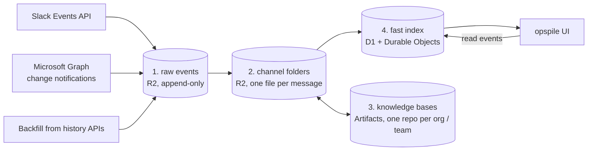

# helix-opspile architecture

opspile is a unified inbox for an ops team. It ingests every channel the team works in on
**Slack** and **Microsoft Teams**, keeps the threads in **Cloudflare R2**, and tracks read/unread
state per person and per team, so that you can see which threads somebody else has already
seen and you have not.

It follows the spirit of [klickhaus](https://github.com/adobe/klickhaus): a small static UI in
plain JavaScript, fed by separate ingestion services, with the data store doing the heavy
lifting.

Everything runs on Cloudflare (Workers, R2, D1, Durable Objects, Workers AI, AI Search,
Artifacts) in a single account.

## The four piles



Each pile is derived from the one before it. Pile 2 never talks to Slack or Teams directly,
so it, and everything after it, can be rebuilt by replaying pile 1.

### 1. Raw events

One R2 bucket, append-only, holding events exactly as the platform API delivered them. When
Slack or Microsoft add fields, we keep them; normalization happens downstream. The one
exception is credentials: Slack's deprecated verification `token` and Graph's `clientState`
are removed before an event is stored.

```
<source>/<tenant>/<channel>/<yyyy>/<mm>/<dd>/<eventTs>-<eventId>.json
```

- The key is derived from the platform's event id, so redelivered events (Slack retries with
  the same `event_id`, Graph may notify twice) overwrite themselves. Ingestion is idempotent.
- **Slack** delivers edits as `message_changed` (with the full new message), deletions as
  `message_deleted`, and reactions as separate events. All of them are stored.
- **Teams** change notifications usually carry only the resource path. We store the
  notification and the message we then fetch as two objects. Graph notifications have no
  event id, so a notification is keyed by its own hash (`notification-<sha256>.json`), and a
  fetched message by its version (`<lastModified ms>-<messageId>.json`). The notification's
  `resource` names the message; the message's metadata names the notification.
- Backfill pages from the history APIs land here too, marked `via: backfill`.

### 2. Channel folders

```
channels/<org>/<team>/<source>-<channelId>/<rootId>/<messageId>.md
```

Every channel belongs to one **org** (a customer or a vendor) and one **team** (the ops team
that owns it). The mapping is a small rules engine over rows in D1: each rule matches the
channel id, the channel name, the Teams team name or a Slack Connect team id with a regular
expression, and sets the team, the org or the kind (`channel`, `alert`, `ignore`); the lowest
priority wins. Naming conventions (`aem-<customer>` exists on both platforms) are rules, and
so are the overrides for vendor channels, alert channels and irregular names. Channels that
no rule matches are filed under `_unassigned`.

Channel names and authors are not in the events, so the normalizer looks them up
(`conversations.info` and `users.info` on Slack, Graph on Teams) and caches them in D1 for a
day. These are its only platform calls. Files only move forward to a newer version, and a
tombstone is final, so a replay of pile 1 in any order rebuilds the same pile 2; after a rule
change, pile 2 is emptied and replayed.

**One markdown file per message**, in a folder per platform thread (the root message's id; the
root message is `<rootId>/<rootId>.md`). Message bodies are markdown themselves (Slack mrkdwn
and Teams HTML are converted), so keeping each message in its own file avoids nesting one
document inside another, and makes every file a natural retrieval chunk. There is no
per-thread rollup file; reading a thread means listing its folder.

```markdown
---
source: slack
thread: slack:<enterpriseId>:<channelId>:<thread_ts>
logicalThread: slack:<enterpriseId>:<channelId>:<other_thread_ts>   # only if re-threaded
id: <ts>
at: 2026-10-14T07:37:26Z
author: { kind: person, name: …, org: …, staff: true }
editedAt: …
deletedAt: …
raw: [<raw object key>, …]
permalink: https://…
---

The message body, as markdown.
```

```
thread key   slack:<enterpriseId>:<channelId>:<thread_ts>
             teams:<tenantId>:<teamId>:<channelId>:<rootMessageId>
```

- New messages are new objects, so concurrent replies never contend for the same file.
- An edit rewrites exactly one file. Earlier versions remain in pile 1.
- A deletion keeps the file as a tombstone (`deletedAt` set, body removed), so links and read
  watermarks stay valid.

**Enrichment on write.** When a message is copied into this pile:

- **[Clef](https://blog.cloudflare.com/clairic-extraction-model/)** (a decision model)
  classifies the thread: who has to act next (`us`, `customer`, `vendor`, `nobody`), what kind
  of thread it is (incident, security, question, request, alert), and urgency. Thread-level
  results live in the index (pile 4).
- **Deterministic extraction** handles structured tokens: CVE ids, URLs, ticket links,
  `org/site` identifiers.
- **Clairic** (an extraction model) handles loose facts, and only values above a confidence
  threshold are kept.

**Re-threading.** People often post a follow-up as a new root message instead of replying,
and alert channels post the same alert again and again. When a root message arrives, its
*skeleton* (the text without timestamps, long numbers, hex and UUID ids, query strings and user
agents; short numbers like status codes stay) is embedded and the most similar earlier roots in
the same channel, within 14 days, are found by vector search. A near-identical one (cosine ≥
0.97) is a match outright; otherwise, above 0.82, Clef chooses between up to four candidates
and "a new topic", and a match needs a probability of at least 0.7. A match sets
`logicalThread` on that one message file and on its thread row, always pointing at the group's
first thread. The file stays where it is and the platform thread is never modified, so undoing
the match is a one-field change. Replays arrive in any order, so a root that is matched also
pulls in near-identical later roots that had found nothing earlier. The inbox shows a group as
one entry: the first thread's title, the latest activity, the most pressing attention of any
member, and all members' messages in order.

Vector search uses Workers AI embeddings in Vectorize, written at ingestion time so that a
message can be matched seconds after it arrives.
[AI Search](https://blog.cloudflare.com/introducing-autorag-on-cloudflare/) indexes the same
message files for agent retrieval, where its periodic re-indexing is acceptable.

### 3. Knowledge bases

One [Artifacts](https://blog.cloudflare.com/artifacts-git-for-agents-beta/) repository per org
and one per team: a pile of markdown files with git history.

```
kb-org-<slug>    what we know about this customer or vendor, across all teams
kb-team-<slug>   product and process knowledge for this team, across all customers
```

An agent working on a thread clones both repositories it applies to, reads them, and commits
what it learned to the right one. Each commit carries a git note pointing to the threads and
raw events that justify it, so every memory is traceable to its source, and a bad one is a
`git revert`.

### 4. Fast index

- **D1** holds the queryable index: containers, threads (last activity, last speaker,
  classification), people and their platform identities, ops teams, and read watermarks. It
  answers the inbox queries, for example "everything waiting on us for my team" or
  "everything from this customer in the last 7 days".
- **One Durable Object per ops team** holds live read state. UI clients connect over
  WebSocket, read events fan out to everyone on the team immediately, and the object writes
  them back to D1 in batches.
- The index is derived: a `messages` row per pile-2 file, and a `threads` row recomputed from
  its messages on every write (last activity by a person, last speaker and whether they are
  staff, title, message count), so it is the same in any replay order. Alert threads use the
  last message of any kind, because they consist of bot posts.
- The UI is one static page, served by the Worker at `/inbox` behind Cloudflare Access: facet
  cards (status, type, next actor, urgency, kind, customer, platform) on the left, threads in
  fixed-height rows in the middle, and the thread as a chat on the right (customers on the
  left, Adobe on the right, with reactions and images). Avatars are the Slack profile picture
  or the Gravatar for the email; the customer's icon is the favicon of their mail domain.
  Reactions are kept in D1 (`reactions`) from Slack's reaction events and from the reactions
  Teams reports on each message.

## Read state

Read state is a **watermark** per person per thread: "has read up to message timestamp X".

- **Unread for me:** the thread's last message is newer than my watermark.
- **Seen by somebody else, not by me:** another member of my team has a watermark at or past
  the last message, and I do not.
- **Unseen by the whole team:** nobody on the team has a watermark at or past the last message.

Neither platform exposes other users' read state for channels, and each exposes the
signed-in user's own state only coarsely, so opspile owns read state. Most of it is
**inferred** rather than clicked:

| Signal | Effect |
|---|---|
| Person posts a message in the thread | Their watermark moves to that message |
| Person reacts to a message | Their watermark moves to that message (Slack `reaction_added`; Teams reports reactions on the message) |
| Person opens the thread in opspile | Their watermark moves to the last message |
| A message is edited, or a reaction is added by someone else | No change; edits never make a thread unread |
| Bot or system message | Stored and shown, but does not count as new activity |

### Attention

Read state answers "who has seen this"; attention ranks what that means for the person
looking, most pressing first:

1. **Nobody at Adobe has seen it**: no staff member at all (in any team or none) has posted,
   reacted or opened the thread since its last message. Staff become people in D1 the first
   time they post, so their reads count even outside the ops teams.
2. **You were mentioned** after you last read the thread (a platform mention, or your full
   name in the text).
3. **A teammate was mentioned** after they last read it.
4. **Nobody on your team has seen it.**
5. **You have not seen it.**

Alert threads skip the first level: they are bot posts and nobody outside is waiting.

## Backfill

A reply whose root has never been seen (it was posted before ingestion started, or before
the bot joined) triggers one request for the thread's history: `conversations.replies` on
Slack, the message and its `/replies` on Graph. Every message lands in pile 1 marked
`via: backfill` and is normalized like a live event, so pile 2 cannot tell them apart. The
`backfills` table makes the request idempotent.

## Labels and facts

Two minutes after a person posts, the thread is labeled (later posts reuse the same label job,
and an unchanged thread is never labeled twice):

- **Clef** answers four questions: who acts next (`us`, `customer`, `vendor`, `nobody`), what
  kind of thread it is (`incident`, `security`, `question`, `request`, `alert`, `other`),
  urgency (0–3) and whether it is resolved. The state it reads is the thread as text, with
  every author marked as Adobe staff or customer.
- **Rules** extract CVE ids, ticket keys, Edge Delivery `org/site` pairs, GitHub repos and URLs.
- **Clairic** extracts the loose facts: the problem in the customer's words, the affected URL,
  the error, a deadline and a go-live date. Only values at or above a confidence threshold are
  kept (0.8, and 0.6 for the free-text problem).

**Label review.** Members of the admin team can review labels in the inbox: a queue of
current labels nobody has reviewed, least confident first, and per question the right
answer. A review is calibration data (Clef's agreement rate and most common corrections per
question) and overrides the model's answer for that label version; when the thread changes
and is labeled again, the model answers again and the old review only counts as history.

## Replying

Replies are written in the inbox and sent **as the person**, never as a bot: each person
connects their own Slack account (user scope `chat:write`) and Microsoft account (delegated
`ChannelMessage.Send`) once. The account must be theirs (the same person in D1, or the same
email); tokens are encrypted with `TOKEN_KEY`, Microsoft tokens are refreshed when they expire.
A reply goes to the latest platform thread of an inbox entry and comes back through the
normal ingestion path, like any other message.

## People

Authors are normalized to `{ kind: person | bot | system, org, staff }`.

- On **Slack**, bot posts carry `bot_id` and no `user`, and Slack Connect marks people from
  another workspace with `user_team`.
- On **Teams**, the support tenant invites everyone as a guest, staff included, so
  `userType` and `tenantId` do not distinguish staff from customers. The organization is
  derived from the person's **mail domain** instead.

## Platform facts that shape the design

These were measured against the live APIs during exploration.

- **Both platforms are two-level:** a root message and a flat list of replies, no deeper
  nesting. A root without replies is a thread of length one.
- **Slack** message ids are `ts` strings, unique per channel. A thread is keyed by the root's
  `ts`; replies carry `thread_ts` and `parent_user_id`. The root's `latest_reply` changes
  whenever a reply arrives, which makes change detection cheap.
- **Teams** message ids are epoch-millisecond strings, unique per channel. Replies carry
  `replyToId`. The root's `lastModifiedDateTime` does **not** change when replies arrive, so
  new activity cannot be detected by polling roots.
- **Bots edit their own messages later**, for example to add a ticket link, which is why edits
  never make a thread unread.
- **Alert channels** consist entirely of bot posts without replies. They are filed as
  `kind: alert` and counted, rather than shown as individual unread threads.

## Ingestion

Two new apps:

- A **Slack app**, installed into the enterprise grid, subscribed to message, edit, deletion,
  and reaction events. Slack only delivers message events for channels the app is a member
  of, so the app has to be added to every ingested channel, including Slack Connect channels.
- A **Microsoft Entra app registration** in the support tenant with application permissions
  to read teams, channels and channel messages. One tenant-wide change-notification
  subscription on `/teams/getAllMessages` delivers root messages and replies. It carries no
  resource data (so no encryption certificate) and lives at most 60 minutes, so a cron
  renews it every 20 minutes. Microsoft stopped metering Teams APIs on 2025-08-25, and
  creating the subscription needed no protected-API approval (measured 2026-10-20).
  Polling is not an alternative: `/messages/delta` and `/messages` return root messages
  only, never replies.

## Open questions

- Slack Connect: does adding the app to a shared channel require approval from the other
  workspace?
- Re-threading: what confidence threshold keeps false merges rare, measured on real
  follow-up posts?
